A concurrent run of a program can produce many different results. This chapter asks which of them are legal, and gives formal definitions for the answer.

- **What can go wrong:** an even number that two threads advance, and the three results its schedules produce.
- **Safety:** the invariant, the precondition, and the postcondition of an interface, a contract that says what a legal state of an object is.
- **Correctness:** when a concurrent run is correct, compared with the serial runs of the same calls.

## What can go wrong

We saw that a concurrent run of the program that prints `Hello` and `Goodbye` on two tasks can produce many outputs.

```text
Hello Goodbye
Goodbye Hello
HelGoodlobye
...

```

Which results are legal? Can different levels of wrong results be told apart? How can that be defined formally?

**Another example:** a program that defines an even number, and two tasks on it, each of which advances it by 2.

```java
class Even {
    int val;
    Even(int val) { this.val = val; }
    public int get() { return val; }
    public void next() { val++; val++; }
}

class Test {
    public static void main(String[] args) {
        Even e = new Even(0);
        new Thread(() -> { e.next(); }).start();
        new Thread(() -> { e.next(); }).start();
    }
}

```

How many atomic operations does the `run` method of each of the two threads have, that is, how many atomic operations are there in `Even`'s `next` method? `val++` is translated into three atomic operations (with the field `val` at address 100):

```text
read 100,R1
inc R1
write R1, 100

```

So `next` has six atomic operations, and between any two atomic operations, the run may move from one thread to the other.

Here are three possible schedules. In each table, `R1` is the register of the thread that runs the step, and `val` is the value in memory after the step.

**Schedule 1: T1 runs all six operations, then T2 runs all six.** No interleaving at all: T1 takes `val` from 0 to 2, and T2 from 2 to 4. **Result: 4.**

**Schedule 2: the threads swap in the middle of `next`.**

| Step | Thread | Operation | R1 | `val` |
| --- | --- | --- | --- | --- |
| 1–3 | T1 | first `val++` | 1 | 1 |
| 4–6 | T2 | first `val++` | 2 | 2 |
| 7 | T1 | `read 100,R1` | 2 | 2 |
| 8 | T2 | `read 100,R1` | 2 | 2 |
| 9–10 | T1 | `inc`, `write` | 3 | 3 |
| 11–12 | T2 | `inc`, `write` | 3 | 3 |

Both threads read 2 in steps 7 and 8, so both write 3. **Result: 3**, an odd number.

**Schedule 3: the threads alternate one operation at a time.**

| Step | Thread | Operation | R1 | `val` |
| --- | --- | --- | --- | --- |
| 1 | T1 | `read 100,R1` | 0 | 0 |
| 2 | T2 | `read 100,R1` | 0 | 0 |
| 3–4 | T1 | `inc`, `write` | 1 | 1 |
| 5–6 | T2 | `inc`, `write` | 1 | 1 |
| 7 | T1 | `read 100,R1` | 1 | 1 |
| 8 | T2 | `read 100,R1` | 1 | 1 |
| 9–10 | T1 | `inc`, `write` | 2 | 2 |
| 11–12 | T2 | `inc`, `write` | 2 | 2 |

Each thread overwrote the other's work twice. **Result: 2.**

So there are three different results: 2, 3, and 4. Which of them are correct? It looks like only 4, but why? That has to be defined. And can different levels of error be told apart in the results 2 and 3? Why, and how is that defined?

### A race condition

A **race condition** (מרוץ) happens when several threads access the same data at the same time, at least one of them writes it, and the result depends on how their steps happen to interleave.

```java
public void increment() { count++; }

```

- **`count++` is not one step.** It is a read-modify-write made of three steps: read the value, add 1, and write the new value back.
- **The lost update:** if two threads both read 0, both compute 1 and both write 1, so one of the two increments is lost.



:::problem id=worked-counter-race title="An interleaving that loses an update" source="materials/sessions/PS6-2026-1.pptx" kind=worked solution_origin=source
Show an interleaving in which two calls to `increment()` lose an update.

```java
public void increment() {
    int tmp = count;   // read
    tmp = tmp + 1;     // add
    count = tmp;       // write
}

```

:::solution

1. Thread t1 reads `count` (0).
2. Thread t2 reads `count` (0).
3. Thread t1 computes `tmp = 1` and writes `count` (1).
4. Thread t2 computes `tmp = 1` and writes `count` (1).

At the end, `count` holds 1, although any serial order of the two calls would give 2. Declaring `increment` `synchronized` makes the three steps one critical section, so this interleaving can no longer happen.
:::
:::

The fix is to make the three steps run as one, so no other thread can slip in between them.

The tools for that, locks among them, are the subject of [Synchronization](topic:synchronization).

## Safety of an object

**The goal:** to describe formally the problems in scenarios such as advancing an even number from 0 to 3. Define the idea of a "preserved property", the invariant, and of "preconditions" and "postconditions".

**The invariant** (אינווריאנטה). Given an interface, define the preserved property as the set of conditions on the values returned by the interface's queries (its getters) that an instance of it may be in. You can think of the invariant as defining the legal states of the object.

**For example, the `Even` interface:**

```java
interface Even {
    int get();
    void next();
}

```

The "state" of an object of type `Even` is defined by the information its queries return, that is, by the value returned by `get()`.

- **Syntactically,** `get` may return any whole number (in the range of `int`), including odd ones. So the set of possible states of an `Even` object is `{Integer.MIN_VALUE, ..., -3, -2, -1, 0, 1, 2, 3, ..., Integer.MAX_VALUE}`.
- **The invariant of `Even`** cuts that down to a smaller set, the right one in terms of meaning: `{Integer.MIN_VALUE, ..., -2, 0, 2, ..., Integer.MAX_VALUE - 1}`.

In other words, the invariant formally defines **the meaning of the interface**, instead of the informal explanation in the documentation or the context of the interface's name.

How is the invariant defined formally? It is defined by conditions on the values returned by the interface's queries. For example, `get() % 2 == 0`. Technically, you write the invariant's conditions as a comment on the interface, with the tag `@INV`.

```java
interface Even {
    // @INV: get() % 2 == 0
    int get();
    void next();
}

```

Every future implementation of the interface must satisfy the invariant's criterion (usually it is checked by dedicated tests, as you will see).

The invariant defines the meaning of the interface as a whole. **Preconditions and postconditions** define the meaning of every method of the interface.

- **The precondition** (תנאי התחלה) defines the criterion that must hold before running a given method, as conditions on the values returned by the queries.
  - **A constraint on the state of the object** the method runs on. For example, a method that drives a car to a destination requires the car to have enough fuel.
  - **A constraint on the parameters** passed to the method. For example, the destinations may be only inside Israel.
- **The postcondition** (תנאי סיום) defines the result of running the method, as conditions on the queries.
  - **The state of the object** after the method runs. For example, the car's location after the driving method equals the destination parameter.
  - **The returned value.** For example, the trip's cost is computed correctly from its properties as given in the queries.

```java
interface Even {
    // @INV: get() % 2 == 0

    // @PRE: none
    // @POST: trivial (simple getter)
    int get();

    // @PRE: none
    // @POST: get() == @PRE(get()) + 2
    void next();
}

```

The notation `@PRE(get())` means the value that `get()` had when the method was entered, before it changed anything.

### Contracts for a stack

A second example, the `Stack` interface:

```java
interface Stack<T> {
    void push(T obj);
    T pop();
    boolean isEmpty();
    boolean isFull();
}

```

**Defining the stack's invariant.** The invariant is a constraint on the values returned by the queries. Check each query by itself, and also how they combine, to see whether there are values that do not fit the meaning of a stack.

- **`isEmpty`:** a stack can be empty or not, so there is no constraint on the boolean value `isEmpty()` returns (if we wanted to define a stack that is never empty, we would put `isEmpty() == false` in the invariant).
- **`isFull`:** likewise, a stack can be full or not, so there is no constraint.
- **`pop`:** what does the object returned by `pop` mean? It is the last object pushed onto the stack, the method's return value. Is there a general constraint on the type of the object returned (beyond its being of the stack's type `T`)? Can it return `null`, in other words, can the stack hold objects that are not defined? Assume that `null` cannot be stored in the stack: `pop() != null`.
- **`isEmpty` and `isFull` together:** can the stack be both empty and full? Assume not: `!(isEmpty() && isFull())`.

```java
interface Stack<T> {
    // @INV: !(isEmpty() && isFull()) && pop() != null

    void push(T obj);
    T pop();
    boolean isEmpty();
    boolean isFull();
}

```

**Preconditions and postconditions.**

`push`:

- **Precondition:** the parameter `obj` cannot be `null` (`@param obj != null`), and the stack cannot be full (`!isFull()`).
- **Postcondition:** the stack is not empty (`!isEmpty()`). The contents of the stack from the start of the method did not change: ??? (there are no "pure" queries that do not change the stack that could describe it). The object passed as a parameter is at the top of the stack: ??? (it cannot be described with a "pure" query that does not change the stack).

`pop`:

- **Precondition:** the stack cannot be empty (`!isEmpty()`).
- **Postcondition:** the stack is not full (`!isFull()`). The contents of the stack from the start of the method did not change, except for the last element: ??? The object returned was at the top of the stack, the last object pushed: ???

**Design principles.** Sometimes you must extend the existing interface, so that the preconditions, postconditions, and invariant can be defined more exactly. Build a basic infrastructure for defining the conditions.

- **Separate the interface's queries, which do not change the object, from its commands, which change the object but do not return anything.** In the basic version of the `Stack` interface you cannot separate them, because `pop` changes the object and also returns something. This is called command-query separation (CQS).
- **Separate basic queries and commands from derived ones,** which are specific uses of basic queries and commands.

For the `Stack` interface:

1. **Add three methods:**

```java
T itemAt(int i);
int size();
int capacity();

```

2. **Separate queries from commands.** Instead of `pop`, define a query and a command:

```java
T top();
void remove();

```

**Basic versus derived.** These methods derive from the basic ones, meaning they can be carried out with simple use of them:

```text
top()     ≡  itemAt(size() - 1)
pop()     ≡  top() && remove()
isEmpty() ≡  size() == 0
isFull()  ≡  size() == capacity()

```

**The bottom line:** write the invariant, and the conditions of the **basic commands**, using only the **basic queries**. Take them one at a time.

**The invariant,** on the three basic queries:

```java
// @INV: 0 <= size() <= capacity() &&
//       for every i < size(): itemAt(i) != null
```

The size is never negative and never above the capacity, and no slot in use holds `null`.

**`remove`,** which takes off the top item:

```java
// @PRE:  size() > 0
// @POST: size() == @PRE(size()) - 1 &&
//        for every i < size(): itemAt(i) == @PRE(itemAt(i))
void remove();
```

You may call it only on a non-empty stack. Afterwards there is one item fewer, and every item that is left is the same as before.

**`push`,** which adds an item:

```java
// @PRE:  obj != null && size() < capacity()
// @POST: size() == @PRE(size()) + 1 &&
//        itemAt(size() - 1) == obj &&
//        for every i < size() - 1: itemAt(i) == @PRE(itemAt(i))
void push(T obj);
```

You may not push `null`, or push onto a full stack. Afterwards there is one item more, the new top is `obj`, and every item below it is unchanged.

The derived methods, `top`, `pop`, `isEmpty`, and `isFull`, need no separate contract: they are defined by the basic ones.

### Defining safety

:::definition id=def-safety title="Safety" source="materials/notes/lecture-notes.docx.pdf"

- **A safe object:** an object is safe if the invariants of every interface it implements hold throughout the program's run.
- **A safe run:** a run of a program is safe if all of its objects are safe.
:::

- **The run that reached the even number 3 is not safe.** The run that reached the even number 2 is safe.
- **Is the run that printed `HelGoodbyelo` safe?** Since no invariant was defined for the print task (for example, that it must print words from the English dictionary), the program is safe according to the definition.

## The contract between a method and its caller

The lecture slides present the same three clauses as a contract that also says whose bug it is when a clause turns out false.

:::definition id=def-dbc title="Precondition, invariant, and postcondition" source="materials/lectures/Chapter 9 - Design by Contract.pptx"

- **Precondition:** the condition the caller must establish before the call. The method may assume it.
- **A broken precondition:** the method's behavior is undefined, and the bug belongs to the caller.
- **Invariant:** a condition on the object that holds whenever none of its public methods is running.
- **A broken invariant:** the bug belongs to the class implementation.
- **Postcondition:** what the method guarantees about the object's state and its return value when it returns, provided the precondition held.
- **A broken postcondition:** the bug belongs to the method's implementation.
:::



Defensive programming and a contract answer different questions.

- **Defensive programming** checks the inputs at run time and throws an exception when an input is invalid.
- **A contract** decides, at design time, who is responsible for making sure the data is valid. The method does not have to re-check what the caller already promised.

:::problem id=worked-crop-contract title="The contract for crop" source="materials/lectures/Chapter 9 - Design by Contract.pptx" kind=worked solution_origin=source
State the precondition, the invariant, and the postcondition of `crop`, an image method that keeps only the rectangle starting at (`x`, `y`) with width `w` and height `h`.

```java
/**
 * @pre x >= 0 && y >= 0 && x + w <= width && y + h <= height
 * @post width == w && height == h
 */
void crop(int x, int y, int w, int h);

```

:::solution

- **Precondition:** the coordinates `x` and `y` are non-negative, and the crop rectangle of width `w` and height `h` lies entirely inside the current image bounds.
- **Invariant:** the image dimensions are positive, and the length of the pixel buffer equals `width * height`.
- **Postcondition:** the image dimensions are updated to `w` and `h`, and the pixel buffer holds the pixels of the cropped region.
:::
:::

:::check id=chk-whose-bug
`crop` is called with a negative width. Whose bug is that?

- [ ] The implementation, because the invariant failed
- [x] The caller, because a precondition failed
- [ ] The garbage collector, because the buffer leaked

- **The caller is at fault:** a negative width breaks the precondition, and establishing the precondition is the caller's job.
- **The method owes nothing:** when the precondition does not hold, the method is not required to establish its postcondition.
:::

## Correctness of a concurrent run

How do you formally define the problems of the scenario that printed `HelGoodbyelo`, and of the run that took the even number from 0 to 2?

:::definition id=def-correctness title="Correctness" source="materials/notes/lecture-notes.docx.pdf"
The idea of correctness describes the run of a program, beyond the correctness of each of its objects.

- **A serial run is correct** if every method that was run satisfied the postcondition defined for it. In other words, all the operations in the code ran correctly.
- **For a concurrent run that is not enough.** In the third schedule of the even number, the postcondition of `next` holds for each thread separately (each one saw `get()` go from 0 to 2), yet the program as a whole is not correct: it reached 2 instead of 4.
- **A concurrent run is correct** if the result of running the methods concurrently could have been obtained by some serial run of the methods, in any order.
:::

Some examples:

- **`Hello Goodbye`:**
  - Method A runs `run` on a `MsgPrinter` with the field `Hello`.
  - Method B runs `run` on a `MsgPrinter` with the field `Goodbye`.
  - A serial run in the order A then B gives `Hello Goodbye`, and in the order B then A gives `Goodbye Hello`.
  - **The set of legal results is `{Hello Goodbye, Goodbye Hello}`.** The concurrent run that reached `HelGoodbyelo` is not correct, because that result is not in the set of legal results.
- **`Even`:**
  - Method A runs `next`, advancing the even number by 2.
  - Method B runs `next`, advancing the even number by 2.
  - A serial run in the order A then B gives 4, and in the order B then A also gives 4.
  - **The set of legal results is `{4}`.** The concurrent run that reached 2 is not correct, because that result is not in the set of legal results.

So the run that reached 3 is neither safe nor correct, and the run that reached 2 is safe but not correct.

## Practice

:::problem id=ps6-counter-race title="A counter without a lock" source="materials/sessions/PS6-2026-1.pptx" kind=exercise solution_origin=source
Two threads each call `cnt.increment()` once on the same object of this class. The constructor starts `count` at 0.

```java
public class Counter {
    private int count;
    public Counter() { count = 0; }
    public void increment() { count++; }
    public int getValue() { return count; }
}
```

:::check id=ps6-counter-race-q1
Which results can two completed calls to `increment` leave in `count`?

- [x] 2, when one call finishes before the other starts
- [ ] 0, because the two writes cancel
- [x] 1, when both threads read 0 before either of them writes

- **The result can be 2:** when one call finishes before the other starts, as in a serial run.
- **The result can be 1:** when both threads read 0 before either one writes, so one increment is lost.
- **The result cannot be 0:** each thread writes at least the value 1.
:::

:::check id=ps6-counter-race-q2
The body is {{=read count into a register|lock the object|call wait}}, then {{=add 1 to that register|notify a waiter|call join}}, then {{=write the register back to count|delete count|allocate a new counter}}.

Those are the three steps of `count++`: read `count` into a register, add 1 to the register, and write the register back to `count`.
:::

:::check id=ps6-counter-race-q3
Which repairs match the two failures?

- [ ] `volatile` makes the three steps of `count++` mutually exclusive
- [x] `volatile`, or the same lock on the write and on the read, repairs a stale `getValue`
- [ ] A lock only around `getValue` repairs the lost update
- [x] A lock that makes the three steps mutually exclusive repairs the lost update

- **The class has two separate failures.** `increment` can lose updates, and `getValue` can return a stale value that another thread has already changed.
- **Fixing the stale read:** make `count` `volatile`, or use the same lock for both the write and the read, so that the write is guaranteed to be visible (it "happens before" the read).
- **Fixing the lost update:** only making the three steps of `count++` mutually exclusive helps. `volatile` does not, and a lock around `getValue` alone does not.
:::

:::

:::problem id=ps5-stack-contract title="The contract for Stack" source="materials/sessions/SPL_PS5.pptx" kind=exercise solution_origin=source
`Stack` has `push`, `top`, `isEmpty`, and `size`. `push` rejects null. `top` returns the last element that was pushed and does not remove it. `size` is never negative, and an empty stack has size 0.

:::check id=ps5-stack-contract-q1
The postcondition of `push` writes the old size as {{=size()@pre|size()|capacity()}}.

The postcondition says that after `push(obj)`, `size()` equals `size()@pre + 1`, and `top()` equals `obj`.
:::

:::check id=ps5-stack-contract-q2
Which of these belong to the contract?

- [x] Invariant: `size() >= 0`, and `isEmpty()` is true exactly when `size()` is 0
- [ ] Postcondition of `top`: `size()` grows by one
- [x] Precondition of `push`: `obj != null`. Precondition of `top`: `!isEmpty()`
- [x] Postcondition of `top`: the result is the last element that was pushed and has not yet been removed, and `size()` is unchanged

`top` is a query, so its postcondition says `size()` is unchanged. Only `push` makes the size grow by one.
:::

:::check id=ps5-stack-contract-q3
Which test checks the precondition of `push`?

- [ ] Record `size()`, push `"a"`, and check that `size` grew by one and that `top` is `"a"`
- [x] Call `push(null)` and expect rejection
- [ ] Check `size` before and after, with no null argument

- **Testing the precondition:** call `push(null)`, which breaks the precondition, and expect it to be rejected.
- **Testing the postcondition:** push `"a"`, then check that the size grew by one and that `top` is `"a"`. That is the first option.
- **Testing the invariant:** check that `size` is valid before and after the call. That is the third option.
:::
:::

:::examnote
- **What the question looks like:** it shows an interface and asks you to define the invariant, plus the precondition and postcondition of one method.
- **The usual traps:** an invariant that forgets the empty case, or a postcondition that holds only if no other code touches the object at the same time.
:::

:::problem id=exam-16a-q1 title="The contract for a queue" source="materials/exams/16-a.pdf" kind=exam solution_origin=derived
`Queue<T>` has `add(T item)` and `remove()`. `createQueue()` returns the object under test. `setUp` builds a new queue.

:::check id=exam-16a-q1-q1
The contract adds the queries {{=size|lock|thread}} and `isEmpty`.

With those two queries, the invariant can say that `size() >= 0`, and that `isEmpty()` is true exactly when `size() == 0`.
:::

:::check id=exam-16a-q1-q2
Which of these belong to the contract?

- [x] The next `remove` yields the earliest `add` that has not yet been removed
- [ ] `remove` on an empty queue has the postcondition that `size()` becomes negative
- [x] `remove` has precondition `!isEmpty()`. Its postcondition is that `size()` is smaller by one and the removed element was the oldest
- [x] The postcondition of `add` is that `size()` is larger by one, and later `remove` calls still yield the old elements and then the new item

- **A queue keeps insertion order:** `remove` always returns the oldest element that is still in the queue.
- **Removing from an empty queue** is ruled out by the precondition `!isEmpty()`, so the size can never become negative.
:::

:::check id=exam-16a-q1-q3
What does `testAdd` check?

- [ ] It records `size` before the call and expects that size to stay the same
- [ ] It calls `add` and never inspects the queue
- [x] It adds one element, then checks `size() == 1` and that `remove` returns that element

`setUp` gives `testAdd` an empty queue, so there is nothing to record beforehand. The test adds one element, then checks that the size is 1 and that `remove` returns that same element.
:::

:::check id=exam-16a-q1-q4
Which of these match the tests?

- [ ] `setUp` may leave the previous test's elements in the queue
- [x] `testRemove` on an empty queue expects the precondition to fail
- [x] `testRemove` after one `add` checks that `size` returns to 0 and that the value matches
- [x] `setUp` gives every test a fresh queue, so leftovers do not look like failures of the invariant

- **`testRemove` on an empty queue** deliberately breaks the precondition and expects that to be reported.
- **`testRemove` after one `add`** expects the size to return to 0 and the removed value to match.
- **`setUp`** must create a fresh queue for every test, so that one test's leftovers cannot make another test fail.
:::
:::

:::problem id=exam-18a-q2 title="A bounded stack" source="materials/exams/18-a.pdf" kind=exam solution_origin=derived
`Stack<T>` is bounded. `push` may store null. `pop` removes an element. `size` is the current number of elements. `capacity` is the maximum.

:::check id=exam-18a-q2-q1
The precondition of `push` is {{=size() < capacity()|data != null|size() == 0}}.

Since `push` may store null, the only precondition is that the stack has room. The postcondition is that `size()` equals `size()@pre + 1`, and that the next `pop()` returns `data`.
:::

:::check id=exam-18a-q2-q2
Which of these belong to the contract?

- [x] Invariant: `0 <= size() <= capacity()`, and `capacity()` does not change
- [ ] `push` of null violates the precondition
- [x] `pop` has precondition `size() > 0`
- [x] The postcondition of `pop` is that `size()` is `size()@pre - 1`, and the result is the last element that was pushed and is still on the stack

- **The invariant** bounds the size: it is never negative and never exceeds the fixed capacity.
- **Pushing null** does not break anything, because the question explicitly allows it.
:::

:::check id=exam-18a-q2-q3
Which implementation breaks the postcondition even when a lock was held?

- [x] `size` grows past `capacity`, or `push` returns without storing `data`
- [ ] `capacity()` stays constant across calls
- [ ] `pop` returns the last element that is still on the stack

- **A lock does not make code correct:** holding a lock only stops other threads from interfering. If the code itself lets `size` pass `capacity`, or forgets to store `data`, the contract is still broken.
- **The other two options** describe correct behavior, so they break nothing.
:::
:::

:::problem id=exam-19a-q2 title="The invariant of a tree" source="materials/exams/19-a.pdf" kind=exam solution_origin=derived
`SortedBinaryTree<T extends Comparable<T>>` has `getData`, `getLeft`, `getRight`, and `insert`. The implementation stores `data`, `left`, and `right` in `volatile` fields. The invariant describes the tree when no method is running on it.

:::check id=exam-19a-q2-q1
Which claims belong to the invariant?

- [x] For every node, `getData() != null`
- [ ] A child may hold a datum equal to its parent
- [x] If `getLeft()` is not null, `getData().compareTo(getLeft().getData()) > 0`, and the left child satisfies the same invariant
- [x] If `getRight()` is not null, `getData().compareTo(getRight().getData()) < 0`, and the right child satisfies the same invariant

- **No duplicates:** `insert` does not add a value that is already present, so no child holds a value equal to its parent's.
- **Recursive invariant:** every subtree must satisfy the same invariant, not just the root.
:::

:::check id=exam-19a-q2-q2
The precondition of `insert` is a {{=non-null|duplicate|volatile}} argument.

`insert` compares the new value with `compareTo`, which fails on null, and the invariant forbids null data. So the caller must pass a non-null value.
:::

:::check id=exam-19a-q2-q3
What does `volatile` guarantee for this tree?

- [ ] The three field updates inside `insert` are atomic
- [x] A write of a single reference is visible to other threads
- [ ] Two threads can no longer break the invariant

- **What `volatile` gives:** each single write to a `volatile` field is immediately visible to other threads.
- **What it does not give:** it does not make the several field updates inside `insert` one atomic step, so two threads inserting at once can still break the invariant.
- **Whose problem that is:** that is a concurrency bug in the implementation. The invariant itself is still correctly stated.
:::

:::check id=exam-19a-q2-q4
Which postcondition does `insert` establish?

- [ ] The three field writes are one atomic update
- [ ] An equal key is stored under both children
- [x] The value is in the tree, the tree is still sorted, and a value that was already present is still present once

- **After `insert(v)`**, `v` is in the tree, and the tree is still sorted.
- **If `v` was already present**, it still appears exactly once, because duplicates are never added.
:::
:::

:::problem id=exam-24a-q2 title="The contract for a set" source="materials/exams/24-a.pdf" kind=exam solution_origin=derived
`Set<T>` has `contains` and `add`. `SetImpl` is a linked list with a `volatile` head. `add` walks the list and returns if `equals` matches an element. Otherwise it links a new node at the end.

:::check id=exam-24a-q2-q1
The precondition of `add` is {{=obj != null|head == null|already present}}.

The implementation calls `equals` on the elements. Calling a method on null throws an exception, so unless the contract handles null, the caller must not pass it.
:::

:::check id=exam-24a-q2-q2
Which of these belong to the invariant?

- [x] No two nodes are `equals`
- [ ] `add` of an element that is already present appends another node
- [x] `contains(x)` is true exactly when some node reachable from `head` holds an element equal to `x`
- [x] The list has no cycle

- **No duplicates:** `add` returns early when an equal element exists, so no two nodes are ever `equals`, and adding an existing element leaves the number of nodes unchanged.
- **`contains` agrees with the list:** it is true exactly for the elements stored in the list.
- **No cycle:** otherwise walking the list would never end.
:::

:::check id=exam-24a-q2-q3
Which postcondition does `add` establish?

- [ ] The number of nodes always grows by one
- [ ] The contract requires `add` to be safe for two threads at once
- [x] `contains(obj)` holds, every previous member is still present, and the node count grows only when `obj` was not already a member

After `add(obj)`, `contains(obj)` is true. Every `y` that was a member before the call is still a member, and the list grows by one node only if `obj` was new.
:::

:::check id=exam-24a-q2-q4
What is true of the published `add` when two threads run it?

- [ ] The contract says `add` is synchronized
- [x] The contract says nothing about threads. Two threads can both link a node, or both assign `head`, and an element is lost
- [ ] `volatile` head makes the `equals` walk and the link atomic

- **The contract is silent about threads**, so the published `add` meets its postcondition only when one thread runs it at a time.
- **What goes wrong:** two threads can both walk to the end and link a node in the same place, so one element is lost.
- **Who must fix it:** keeping the contract under concurrency is the implementation's job, for example by synchronizing `add`. `volatile` alone is not enough.
:::
:::

:::problem id=exam-19b-q2 title="A sorted tree" source="materials/exams/19-b.pdf" kind=exam solution_origin=derived
`SortedBinaryTree` states this invariant:

```java
//@INV: getData() != null &&
// (getLeft() == null || getData().compareTo(getLeft().getData()) > 0) &&
// (getRight() == null || getData().compareTo(getRight().getData()) < 0)
```

- **Insertion** walks down the child pointers to find the right place. The pointers are `volatile`, but the walk takes no lock.
- **An alternative design** protects the same tree with a readers-writer lock.

:::check id=exam-19b-q2-q1
Start from a node that holds 5, with null children. Which interleaving breaks the invariant?

- [ ] Both threads lock the root, so the second insert waits and the tree keeps 4
- [x] A reads `left == null` to insert 3, B writes the node 4 into `left`, then A overwrites `left` with the node 3
- [ ] A and B both write `right`, and the `compareTo` order stays true
- [ ] The `volatile` pointers make the null check and the assignment one step, so the second insert sees the first child

Both threads saw `left == null` before either wrote it, so A's write replaced B's. The node 4 is now disconnected, and the tree has lost a value. `volatile` makes each single write visible, but it does not make "check, then write" one step.
:::

:::check id=exam-19b-q2-q2
Lock every node from the {{=root downward|leaf upward|left child only}}. Hold the lock on a node while the insertion {{=reads that node's child|calls wait|releases the parent}}, and, when the insertion updates that child, hold the same lock while it {{=writes the child|calls notifyAll|reads the root}}.

This technique is called hand-over-hand locking. Because a node stays locked from the moment its child is read until the child is written, two insertions that reach the same node take turns on it, and neither can overwrite the other's child.
:::

:::check id=exam-19b-q2-q3
What does a `ReadWriteLock` change?

- [ ] `insert` takes the read lock, and `contains` takes the write lock
- [ ] A `contains` that arrives during a write proceeds, because the read lock is shared with the writer
- [ ] Readers and a writer all run together on the node being changed
- [x] Concurrent `contains` calls take the read lock and overlap, and `insert` takes the write lock

With a `ReadWriteLock`, many `contains` calls can take the read lock and run at the same time, while `insert` takes the write lock and runs alone. A `contains` that arrives during an insert waits until the insert finishes.
:::

:::

To sum up, safety is defined on objects, through the invariant of each interface, and correctness is defined on runs, by comparing a concurrent run with the serial runs of the same methods.

- **Next:** [Synchronization](topic:synchronization) shows the ways to keep a concurrent run safe and correct.
