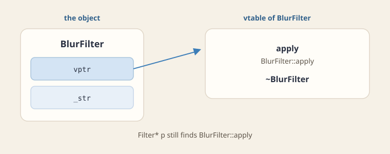

Programming languages let you define different relations between the types in a program. This chapter goes through those relations, and then shows how C++ carries out inheritance and polymorphism in memory.

- **Relations between types:** is-a, is-implemented-in-terms-of, and has-a, and how Java and C++ express each one.
- **A derived object in memory:** its structure, and the order of initialization, deletion, copying, and assignment.
- **Polymorphism:** static and dynamic binding, the vtable that carries out dynamic binding, and the double-dispatch pattern.

## Relations between types

### A is-a B

`Student` is-a `Person`. In Java:

```java
class Person {
    protected final int _id;
    protected String _name;
    ...
}

class Student extends Person {
    protected Bag _bag;
    protected List<Book> _books;
    protected final University _univ;
    ...
}

```

In C++:

```cpp
class Person {
protected:
    const int _id;
    string _name;
    ...
};

class Student : public Person {
protected:
    Bag* _bag;
    vector<Book*> _books;
    const University& _univ;
};

```

### A is-implemented-in-terms-of B

`Living` is implemented in terms of `Person`, and so is `Loving`. `Learning` is implemented in terms of `Student`. In Java this relation is an interface.

```java
interface Living {
    void live();
}

interface Loving {
    void love();
}

interface Learning {
    void learn();
}

class Person implements Living, Loving {
    final int _id;
    String _name;
    ...
    void live() { ... }
    void love() { ... }
}

class Student extends Person implements Learning {
    Bag _bag;
    List<Book> _books;
    final University _univ;
    ...
    void learn() { ... }
    void live() { ... }
}

```

C++ has no syntactic distinction between implementing an interface (is-implemented-in-terms-of) and inheritance (is-a). Instead, a class may inherit from several classes. Even so, you should keep the design distinction between the two relations.

- **The class of the is-a relation** is declared as the first base class.
- **The other base classes** are declared as **abstract** classes: classes that contain only method declarations, with no implementation and no fields.

```cpp
class Living {
    virtual void live() = 0;
};

class Loving {
    virtual void love() = 0;
};

class Learning {
    virtual void learn() = 0;
};

class Person : public Living, public Loving {
    const int _id;
    string _name;
    ...
    void live() { ... }
    void love() { ... }
};

class Student : public Person, public Learning {
    Bag* _bag;
    vector<Book*> _books;
    const University& _univ;
    ...
    void learn() { ... }
    void live() { ... }
};

```

### A has-a B

`Student` has-a `Bag`. In Java and in C++ this is carried out by **composition**: a field of type `B` in class `A`.

## Derived classes in C++

A derived class (מחלקה נגזרת) extends a base class (מחלקת בסיס).

- **What a derived class can do:** add its own fields, and override (replace) a virtual function (פונקציה וירטואלית) of the base.
- **The challenge:** a call through a base pointer must find the override that belongs to the actual object, which is known only at run time.
- **How C++ solves it:** each such object stores a hidden pointer, the vptr, which points at its class's table of functions, the vtable.
- **The condition for safety:** substituting a derived object is correct only if the derived class still keeps the base class's contract.

A derived class names its base after a colon, and calls a base constructor from its member-initializer list.

```cpp
class BlurFilter : public Filter {
    double _str;
public:
    BlurFilter(double strength) : Filter("blur"), _str(strength) {}
    double getStrength() const { return _str; }
};

```

- **The base is built first:** the derived constructor calls a base constructor in its initializer list, here `Filter("blur")`.
- **If you leave that call out,** the compiler calls the base class's default constructor, and the code does not compile if the base has none.

### Access levels and inheritance in C++

The word after the colon, here `public`, sets how the base class's members can be reached through the derived class.

| Kind of inheritance | A public member of the base becomes | A protected member of the base becomes | A private member of the base |
| --- | --- | --- | --- |
| `public` | `public` (an "is-a" relationship) | `protected` | inaccessible |
| `protected` | `protected` | `protected` | inaccessible |
| `private` | `private` (used like composition: "implemented in terms of") | `private` | inaccessible |

## The Liskov substitution principle

:::definition id=def-lsp title="The Liskov substitution principle" source="materials/lectures/Chapter 6 - Inheritance.pptx"
The Liskov substitution principle says that an object of a derived class must be substitutable in every context that expects an object of the base class.

- **The program must stay correct** when a derived object replaces a base object.
- **The base class's invariants must still hold** for the derived object.
:::

The classic example that breaks the principle is deriving `Square` from `Rectangle`.

- **For a rectangle,** `setWidth(w)` changes the width and leaves the height as it is.
- **For a square,** the same call must also change the height, or it would stop being a square.
- **The result:** code written for a `Rectangle` that sets the width and expects the height to stay the same breaks when it receives a `Square`. The override does something the base class's contract does not allow.

## A derived object in memory

What is the structure of a class like `Student`, which inherits from other classes, and in what order does each mechanism run?

**Structure.** The structures of the base classes come first, in order, and then the derived class's own fields. All of it is recursive: each base class is laid out the same way.

1. The structure of the first base class.
2. The structure of the second base class.
3. ...
4. The structure of the last base class.
5. The structure of the derived class.

**Initialization.**

1. The automatic initialization of the first base class.
2. The automatic initialization of the second base class.
3. ...
4. The automatic initialization of the last base class.
5. The automatic initialization of the derived class.

To call a specific constructor of a base class, name it in the initializer list.

**Destruction** runs in the reverse order.

1. The automatic destruction of the derived class.
2. The automatic destruction of the last base class.
3. ...
4. The automatic destruction of the first base class.

**Copying.**

1. An automatic call to the constructor of the first base class. If the derived class's initializer list does not call the base's copy constructor with `other`, the base's empty constructor is called.
2. An automatic call to the constructor of the second base class, in the same way.
3. ...
4. An automatic call to the constructor of the last base class.
5. The copy constructor of the derived class runs (it copies the fields).

For the rule of five: to pass `other` to the base's move constructor, as an rvalue reference, use `std::move(other)`.

**Assignment.** By default, only the body of the derived class's assignment operator runs. Usually you must run the assignment operators of the base classes too, and that does not happen automatically. So inside the body of the assignment operator, call them explicitly.

1. A call to the assignment operator of the first base class (with `other`).
2. A call to the assignment operator of the second base class (with `other`).
3. ...
4. A call to the assignment operator of the last base class (with `other`).
5. The body of the derived class's assignment operator (it assigns the fields).

For the rule of five: to pass `other` to the base's move assignment as an rvalue reference, use `std::move(other)`.

```cpp
class Person : public Living, public Loving {
    const int _id;
    string _name;
    ...
    void live() { ... }
    void love() { ... }

    Person(int id, const string& name) : _id(id), _name(name) { }
};

class Student : public Person, public Learning {
    Bag* _bag;
    vector<Book*> _books;
    const University& _univ;
    ...
    void learn() { ... }
    void live() { ... }

    Student(int id, const string& name, Bag* bag, const University& univ)
        : Person(id, name), _bag(bag), _univ(univ) {
        _books.push_back(new DigitalBook());
        _books.push_back(new HardCopyBook());
    }

    Student(const Student& other)
        : Person(other), _bag(other._bag->clone()), _univ(other._univ) {
        ...
    }

    Student& operator=(const Student& other) {
        if (this != &other) {
            Person::operator=(other);
            delete _bag;
            _bag = other._bag->clone();
            ...
        }
        return *this;
    }

    virtual ~Student() {
        delete _bag;
        ...
    }
};

{
    Student s(7, "ringo", new Bag7(), univ);
}

```

| Part of `s` | Cells |
| --- | --- |
| `Living` | (no fields) |
| `Loving` | (no fields) |
| `Person` | `id`, `name` (`chars`, `length`) |
| `Learning` | (no fields) |
| `Student` | `bag`, `books` (`lst`, `size`), `univ` |

**The destructor must be virtual,** so that deleting an object of a derived class through a pointer to its base runs the destruction mechanism of the derived class too.

```cpp
Person* p;
p = new Student(...);
delete p;

```

The next section explains what `virtual` does, and why the destructor needs it.

## Polymorphism in memory

Remember that the program's code is loaded when the process is initialized, by the operating system, into the process's memory, in the region called the code section. In particular, each function is stored at some address in memory. A call to a function is translated into setting the program counter to the address where the function's code starts. That translation, from a call to a function to setting the `pc` to its address, is called **binding**.

When is binding done?

- **Option A:** at compile time. This is **static binding**.
- **Option B:** at run time. This is **dynamic binding**.

In Java, binding is always dynamic, at run time. In C++, programmers decide, for each function, whether calls to it are translated statically (at compile time) or dynamically (at run time). The default is compile time.

Why would you want the translation to happen only at run time?

```cpp
class A {
    virtual void F() { cout << "A"; }   // address 1000
};

class B : public A {
    virtual void F() { cout << "B"; }   // address 2000
};

{
    A* a;
    ...
    a = new B();
    ...
    a->F();   // pc = 1000, prints "A"  ----  pc = <formula for run time>, prints "B"
}

```

- **With static binding,** the compiler sees only the type of `a`, which is `A*`, and translates the call into `pc = 1000`. It prints `A`, although the object is a `B`.
- **With dynamic binding,** the address is computed at run time from the object itself, so the call prints `B`.

To support polymorphism, the binding of the function must be dynamic. How do you tell the C++ compiler? The keyword `virtual` marks the requirement that calls to the function be translated only at run time.

- **The `virtual` property of a function is inherited.**
- **Now it is clear why abstract functions must be virtual:** you cannot ask the compiler to translate calls to them at compile time, because they have no implementation.

```cpp
Learning* l;
l = new Student(...);
l->learn();   // ???

```

:::definition id=def-virtual title="Virtual function and vtable" source="materials/lectures/Chapter 6 - Inheritance.pptx"
A function that is not virtual is selected by **static binding** (קשירה סטטית).

- **How it works:** the compiler looks at the declared (static) type of the pointer or reference, and fixes which function to call at compile time.

A function declared `virtual` is selected by **dynamic binding** (קשירה דינמית), also called late binding.

- **How it works:** the function is chosen at run time, from the dynamic type, which is the actual class of the object.
- **What the call does:** it reads the object's vptr, looks up the function's address in that class's vtable, and calls it with the object's address as `this`.
- **A polymorphic class** is one with at least one virtual function. The compiler puts a hidden vptr in every object of such a class.
- **The vptr** points at the vtable of the object's own class. There is one vtable per class, shared by all its objects.
:::

:::problem id=worked-virtual-call title="Tracing a virtual call" source="materials/lectures/Chapter 6 - Inheritance.pptx" kind=worked solution_origin=source
Which method runs when `apply` is declared `virtual`, and which method runs when it is not?

```cpp
Filter* filter = new BlurFilter();
filter->apply(img);

```

:::solution

- **When `apply` is `virtual`:** the call uses dynamic binding. The object's vptr leads to the vtable of `BlurFilter`, so the call runs `BlurFilter::apply`.
- **When `apply` is not `virtual`:** the call uses static binding. The pointer's declared type is `Filter*`, so the call runs `Filter::apply`, even though the object is a `BlurFilter`.
:::
:::



A pure virtual function is declared with `= 0`, and has no implementation in the base class.

- **An abstract class** (מחלקה מופשטת) is a class with at least one pure virtual function.
- **You cannot create objects of an abstract class.** You can only create objects of derived classes that override every pure virtual function.

### How dynamic binding is carried out

**The data structures.** The compiler defines, for every class that has a virtual method, a virtual table in memory that holds the addresses where the code of the virtual methods in that class is stored. That table is called the **v-table**. For example, for the classes `Person` and `Student`:

```text
Person v-table, at address 100: [7000, 4000]
Student v-table, at address 200: [8000, 4000, 9000]

```

That means:

- the code of `live` in the class `Person` is at address 7000,
- the code of `love` in the class `Person` is at address 4000,
- the code of `live` in the class `Student` is at address 8000,
- the code of `love` for `Student` is still the one in `Person`, at address 4000,
- the code of `learn` in the class `Student` is at address 9000.

**Every instance of a class that has a v-table** (a class with virtual methods) gets one more cell in memory, at its start, holding the address of its class's v-table. That cell is initialized by `new` or `push`, according to the object's type, at run time.

This lets the compiler prepare a "formula" at compile time for finding the method's address according to the object's type at run time, through its v-table.

- **The object's address is the cell that holds the v-table's address.**
- **The method's place in that table, which lists the method addresses in order,** is known at compile time.
- **So the method's address** is reached by following the object's first cell to the table, and reading the method's entry.

```cpp
{
    Person* p;
    p = new Student(7, "ringo", new Bag7(), univ);
    p->live();
}

```

The call `p->live()` is translated to `pc = (*((*p) + 0))`: read the first cell of the object, which is the v-table's address (200), and jump to the address in its entry 0, which is 8000, `Student::live`.

| Heap cell | Content |
| --- | --- |
| object start | 200, the address of `Student`'s v-table |
| `Living`, `Loving` | (no fields) |
| `Person` | `id`, `name` (`chars`, `length`) |
| `Learning` | (no fields) |
| `Student` | `bag`, `books` (`lst`, `size`), `univ` |

Dynamic binding has two costs.

- **Memory:** the virtual tables, and one more cell in every object.
- **Time:** two more memory accesses on every call to a virtual method.

### The virtual destructor

:::theorem id=thm-virtual-dtor title="A polymorphic base needs a virtual destructor" source="materials/lectures/Chapter 6 - Inheritance.pptx"
If a class has virtual functions, it is meant to be used as a polymorphic base class, and its destructor must be declared `virtual`.

:::proof
- **The setup:** `Base* p = new Derived();` followed by `delete p;`. The destructor call follows the same binding rules as any other call.
- **If the destructor is not virtual,** static binding picks `~Base` from the pointer's type, and only `~Base` runs.
- **The consequence:** `~Derived` never runs, so whatever the derived class acquired is leaked. Formally, the behavior is undefined.
:::
:::

:::check id=chk-virtual-dtor
You are about to `delete` a `BlurFilter` through a `Filter*`. What must be true of `~Filter`?

- [ ] It must be pure virtual and have no body
- [x] It must be virtual
- [ ] It must be private

- **What must happen:** `~BlurFilter` has to run, followed by `~Filter`.
- **How to make it happen:** declare `~Filter` virtual. The `delete` then dispatches through the vptr and reaches `~BlurFilter` first.
:::

## The double-dispatch design pattern

The memory chapters end with a design pattern that sharpens how polymorphism is carried out: **double dispatch**.

**Motivation.**

- There are two interfaces, and each has several implementations.
- There is different code for every combination of implementations of the two interfaces.
- Given two objects of those interfaces, you must reach the code segment that fits them.

```cpp
class Printer {
    virtual void print(const Doc& doc) = 0;
};

class HP : public Printer {
    virtual void print(const Doc& doc) { ... }
};

class Xerox : public Printer {
    virtual void print(const Doc& doc) { ... }
};

class Doc { ... };
class PDF : public Doc { ... };
class Word : public Doc { ... };

{
    Printer* hp;
    Printer* xerox;
    Doc* pdf;
    Doc* word;
    ...
    hp = new HP();
    xerox = new Xerox();
    pdf = new PDF();
    word = new Word();
    ...
    hp->print(*pdf);      // should be directed to HP-PDF code
    hp->print(*word);     // should be directed to HP-Word code
    xerox->print(*pdf);   // should be directed to Xerox-PDF code
    xerox->print(*word);  // should be directed to Xerox-Word code
    ...
    delete hp;
    delete xerox;
    delete word;
    delete pdf;
}

```

How does the compiler translate `hp->print(*pdf)`? The method `print` of the class `Printer` is virtual, so the compiler translates the call into a formula such as `pc = (*(*hp + 0))`. That reaches the implementation of `print` in the class `HP`. As we said, there is different code for printing each document. How does the method know which document it received (it arrives as a `Doc`)?

**Option A:** check inside the code what the document's type is (`instanceof` in Java, `dynamic_cast` in C++).

```cpp
class HP : public Printer {
    virtual void print(const Doc& doc) {
        if (dynamic_cast<PDF*>(&doc)) { /* code for HP-PDF */ }
        if (dynamic_cast<Word*>(&doc)) { /* code for HP-Word */ }
    }
};

class Xerox : public Printer {
    virtual void print(const Doc& doc) {
        if (dynamic_cast<PDF*>(&doc)) { /* code for Xerox-PDF */ }
        if (dynamic_cast<Word*>(&doc)) { /* code for Xerox-Word */ }
    }
};

```

- **The drawback:** every time there is a new implementation of `Doc`, you must enter every place in the code of every `Printer` implementation that refers to document types, update it with the new document type, compile, and run the tests.

**A suggestion:** add to the `Printer` interface more signatures for `print`, one for every type of document. Then the update needed for every new printer, when there is a new document, is at the level of implementing a method, and not of updating existing code.

```cpp
class Printer {
    virtual void print(const Doc& doc) = 0;
    virtual void print(const PDF& pdf) = 0;
    virtual void print(const Word& word) = 0;
};

class HP : public Printer {
    virtual void print(const Doc& doc) { ... }
    virtual void print(const PDF& pdf) { /* code for HP-PDF */ }
    virtual void print(const Word& word) { /* code for HP-Word */ }
};

class Xerox : public Printer {
    virtual void print(const Doc& doc) { ... }
    virtual void print(const PDF& pdf) { /* code for Xerox-PDF */ }
    virtual void print(const Word& word) { /* code for Xerox-Word */ }
};

```

- **The problem:** the call `hp->print(*pdf)` does not reach the version of `print` in `HP` that takes a `PDF`, but the one that takes a `Doc`. The search through the v-table happens at run time, based on the object's type, but the choice among the overloads with the same name, that is, which signature, is fixed in the formula at compile time, from the declared type of the parameter (in our case `pdf` is declared a `Doc`, not a `PDF`).

So the dynamic-binding mechanism that carries out polymorphism activates the method of the class that matches the type of the object it runs on, at run time, but not the specific type of the method's parameter at run time.

**The solution:** run the mechanism a second time, by calling a method on the parameter.

```cpp
class Doc {
    virtual void printMe(const Printer& printer) = 0;
    ...
};

class PDF : public Doc {
    virtual void printMe(const Printer& printer) { printer.print(*this); }
    ...
};

class Word : public Doc {
    virtual void printMe(const Printer& printer) { printer.print(*this); }
    ...
};

class HP : public Printer {
    virtual void print(const Doc& doc) { doc.printMe(*this); }
    virtual void print(const PDF& pdf) { /* code for HP-PDF */ }
    virtual void print(const Word& word) { /* code for HP-Word */ }
};

class Xerox : public Printer {
    virtual void print(const Doc& doc) { doc.printMe(*this); }
    virtual void print(const PDF& pdf) { /* code for Xerox-PDF */ }
    virtual void print(const Word& word) { /* code for Xerox-Word */ }
};

```

1. **`hp->print(*pdf)`** dispatches on the printer: it reaches `HP::print(const Doc&)`.
2. **`doc.printMe(*this)`** dispatches on the document: it reaches `PDF::printMe`.
3. **Inside `PDF::printMe`,** `*this` has the static type `PDF`, so the compiler picks the overload `print(const PDF&)`. Because `print` is virtual, it runs `HP::print(const PDF&)`, the HP-PDF code.

:::check id=chk-double-dispatch
In the overload-only version, `Doc* pdf = new PDF();` and `hp->print(*pdf)` runs. Which `print` is called?

- [ ] `HP::print(const PDF&)`
- [x] `HP::print(const Doc&)`
- [ ] `Printer::print(const PDF&)`

- **The printer is chosen at run time:** `print` is virtual, so the call reaches `HP`.
- **The overload is chosen at compile time:** `*pdf` has the declared type `Doc`, so the compiler picks the signature that takes a `Doc`.
- **Double dispatch fixes it** by calling `doc.printMe(*this)`, where the document's own `*this` has the exact type.
:::

## Practice

:::problem id=ps3-virtual-destructor title="Deletion through a base pointer" source="materials/sessions/SPL_PS3.pptx" kind=exercise solution_origin=source
A derived object is destroyed with `delete` through a base-class pointer, and the destructor is not virtual.

```cpp
Base* p = new Derived();
delete p;
```

:::check id=ps3-virtual-destructor-q1
What does this `delete` do?

- [ ] The derived destructor runs, then the base destructor
- [ ] The behavior is defined, and only the base subobject is destroyed
- [x] The behavior is undefined

Deleting a derived object through a base pointer whose destructor is not virtual is undefined behavior. The standard does not promise anything about what happens.
:::

:::check id=ps3-virtual-destructor-q2
Which of these hold in a typical implementation of that `delete`?

- [x] The derived destructor is skipped, so resources the derived class owns are leaked
- [ ] The derived destructor still runs
- [x] The deallocation may use the size of the base subobject

- **In practice,** compilers usually run only `~Base`, so whatever the derived class owns is leaked.
- **Memory may also be freed incorrectly,** because the deallocation can use the size of the base part rather than of the whole object.
:::

:::check id=ps3-virtual-destructor-q3
If a class is meant to be inherited from, give it a {{=virtual|non-virtual|private}} destructor.

- **The rule:** a class that is meant to be inherited from should have a virtual destructor.
- **In particular,** any class with a virtual function is polymorphic, so it must have one.
:::

:::check id=ps3-virtual-destructor-q4
Which claim matches the rest of that rule?

- [x] A pure virtual function, written `= 0`, makes the base an abstract class, and the virtual destructor remains a requirement of its own
- [ ] Constructors are virtual, so the base constructor dispatches to the derived constructor
- [ ] A pure virtual function removes the need for a virtual destructor

- **Constructors cannot be virtual.** When an object is being built, its exact type is already known.
- **A pure virtual function** (`= 0`) makes the base abstract, but that does not make its destructor virtual.
- **So the virtual destructor is still required** and must be declared separately.
:::
:::

:::examnote
- **What the question looks like:** two derived types are used through one base pointer, and you must explain why a call reaches the base-class version. The cause is usually a non-virtual function, a non-virtual destructor, or an overload written where an override was needed.
- **The usual traps:** a memory diagram that leaves out the vptr, or a `delete` through the base pointer that never runs the derived destructor.
:::

:::problem id=exam-16a-q2 title="A visitor for shapes" source="materials/exams/16-a.pdf" kind=exam solution_origin=derived
A game engine has shapes (`SPHERE` and `BOX`, both derived from `SHAPE`) that are drawn by shaders (`BASIC_SHADER` and `COMPLEX_SHADER`, both derived from `SHADER`).

- **Each shader** has two overloads, `Render(SPHERE*)` and `Render(BOX*)`.
- **`RENDER_MGR::Render`** goes over every pair of shape and shader.
- **The problem:** overloads are chosen at compile time, so calling `Render` with a `SHAPE*` cannot pick `Render(SPHERE*)`. The fix is the visitor pattern, also called double dispatch.

:::check id=exam-16a-q2-q1
Which `Sphere::Accept` body is correct?

- [ ] `Render(static_cast<Shape*>(this));`
- [ ] `shader->Render(static_cast<Shape*>(this));`
- [x] `sh->Render(this);`

- **The answer:** `void Accept(Shader* sh) override { sh->Render(this); }`.
- **Why it works:** inside `Sphere::Accept`, `this` has the type `Sphere*`, so the compiler picks `Render(Sphere*)`. The call on `sh` is virtual, so it reaches the right shader.
- **`Box::Accept`** is the same code, where `this` is a `Box*`.
- **Why the others fail:** casting `this` to `Shape*` throws away exactly the type information the overload needs.
:::

:::check id=exam-16a-q2-q2
`Shader::Render` and `Shape::Accept` are declared {{== 0|inline|static}}.

- **`Shader`** declares `virtual void Render(Sphere* s) = 0` and `virtual void Render(Box* b) = 0`.
- **`Shape`** declares `virtual void Accept(Shader* sh) = 0`.
- **Both bases** are therefore abstract, and each also declares a virtual destructor with `= default`.
:::

:::check id=exam-16a-q2-q3
Which of these hold?

- [x] `RENDER_MGR::Render` calls `shape->Accept(shader)` for each pair
- [ ] Copying the manager's pointer array gives the copy its own shapes and shaders
- [x] `BasicShader` and `ComplexShader` override both `Render` overloads

- **`RENDER_MGR::Render`** calls `shape->Accept(shader)` for each pair, which starts the double dispatch.
- **`BasicShader` and `ComplexShader`** each override both `Render` overloads.
- **Copying the array of pointers is a bug,** because both managers would then share the same shapes and shaders. A correct copy constructor allocates new ones.
:::

:::check id=exam-16a-q2-q4
Which copy of `RENDER_MGR` is correct?

- [x] The copy constructor allocates new shapes and new shaders. A virtual `clone()` is that deep copy when the hierarchy provides one
- [ ] The copy constructor copies the pointer values, so the two managers share the objects
- [ ] The copy constructor allocates new shaders and keeps the original shapes

- **The correct copy constructor** allocates new shapes and new shaders, so the copy owns its own objects.
- **How to copy a shape you only know through a base pointer:** call a virtual `clone()`, which each derived class overrides to return a copy of its own real type.
:::
:::

:::problem id=exam-18a-q1 title="An image destructor" source="materials/exams/18-a.pdf" kind=exam solution_origin=derived
`Image` is an abstract base class with a field `int n_pixels` and a pure virtual function `virtual void show() = 0`. `ColorImage` inherits from it and holds a heap array of pixels.

- **In one place,** a `ColorImage` is destroyed through an `Image*`.
- **In another,** a `ColorImage` is passed by value.

:::check id=exam-18a-q1-q1
What does `delete` through an `Image*` do when the destructor is not virtual?

- [ ] `~ColorImage` runs and releases the pixel array
- [x] `~Image` runs alone, so `~ColorImage` never releases the pixel array
- [ ] There is no leak, because `show` is already virtual

- **What runs:** with a non-virtual destructor, `delete` through an `Image*` uses static binding, so only `~Image` runs.
- **The result:** `~ColorImage` never runs, so the pixel array is never released, which is a leak.
- **Why the third option is wrong:** `show` being virtual does not make the destructor virtual. Each function is virtual only if it is declared so.
:::

:::check id=exam-18a-q1-q2
The declaration that makes `delete` dispatch to `~ColorImage` is {{=virtual ~Image() = default|~Image() = default|virtual ~ColorImage() = default}}.

The destructor that must be virtual is the base class's, because `delete` looks it up through the `Image*`. Declaring `virtual ~Image() = default` makes the `delete` dispatch to `~ColorImage`.
:::

:::check id=exam-18a-q1-q3
Which of these hold when `ColorImage` owns a raw array?

- [x] `~ColorImage` must apply `delete[]` to the array
- [x] The copy constructor and the assignment operator must copy the array deeply
- [ ] A virtual `~Image` releases the pixel array by itself

- **`~ColorImage`** must release its raw array with `delete[]`. A virtual `~Image` only makes sure `~ColorImage` runs; it releases nothing by itself.
- **The copy constructor and the assignment operator** must make a deep copy of the array, which is the rule of three.
:::

:::check id=exam-18a-q1-q4
Which of these hold for the other repairs?

- [x] Declaring the variable in `main` with the dynamic type fixes that one line. The next `delete` through an `Image*` is still wrong
- [ ] That change of `main` makes every later `delete` through an `Image*` run `~ColorImage`
- [x] The copy the compiler generates shares the array, and each of the two destructors releases that same array

- **Changing `main`:** declaring the variable as a `ColorImage*` fixes that one line only. Any other `delete` through an `Image*` is still wrong, so the real fix is the virtual destructor.
- **The by-value call:** the compiler-generated copy shares the pixel array, so both destructors release the same array, which is a double free.
:::
:::

:::problem id=exam-18b-q1 title="Memory of an image hierarchy" source="materials/exams/18-b.pdf" kind=exam solution_origin=derived
`Image` is an abstract base class with a field `int n_pixels` and a pure virtual function `virtual void show() = 0`. `GrayImage` and `ColorImage` inherit from it. They store different pixel types, and each holds its own pixel array on the heap. The questions ask about memory during a call to `show`, and about `dynamic_cast`.

:::check id=exam-18b-q1-q1
Which description of the layout is right during that call?

- [ ] The stack frame holds the pixel buffer. The heap object starts with `n_pixels` and has no vptr
- [x] The heap object begins with the vptr, then `n_pixels`, then the derived class's pointer to the pixel buffer. The buffer is a further block on the heap
- [ ] The vptr and the pixel array both sit in the stack frame, next to the return address

- **The image object on the heap** starts with the vptr, then the base field `n_pixels`, then the derived class's own field, a pointer to the pixel buffer.
- **The pixel buffer** is a separate block on the heap.
- **The stack frame** holds neither the buffer nor the vptr.
:::

:::check id=exam-18b-q1-q2
What does the stack hold during the call?

- [x] The pointer parameter and the return address
- [ ] The pixel buffer and the vtable
- [ ] The vptr and `n_pixels`

During the call, the stack frame holds the pointer parameter and the return address. The vptr and `n_pixels` are inside the object on the heap, and the vtable lives in the program's static data, not on the stack.
:::

:::check id=exam-18b-q1-q3
`dynamic_cast<ColorImage*>(p)` returns {{=null|the same pointer p|a new ColorImage}} when `p` does not point at a color image.

- **`dynamic_cast<ColorImage*>(p)`** checks the object's real type at run time. It returns a valid pointer if `p` points at a `ColorImage`, and null if it does not.
- **A C-style cast** performs no check. It converts the pointer regardless, so a wrong cast goes unnoticed.
:::

:::check id=exam-18b-q1-q4
Which of these hold?

- [x] A grayscale image and a color image have different vtables, so `show` through an `Image*` reaches the override
- [ ] A C-style cast consults the vtable and returns null when the type does not match
- [x] The layout is right when every polymorphic subobject shows a vptr and the pixel array is outside the stack frame

- **Different vtables:** each class has its own vtable, so `show` called through an `Image*` reaches the right override.
- **A C-style cast** never checks the type and never returns null on a mismatch. Only `dynamic_cast` does that.
- **A correct drawing** shows a vptr in every polymorphic object, and the pixel array outside the stack frame.
:::
:::

:::problem id=exam-19a-q1 title="An application repository" source="materials/exams/19-a.pdf" kind=exam solution_origin=derived
`APP` is an abstract class with `virtual void run() = 0`, and `PAY_APP` and `PLAY_APP` override it.

- **`MY_APPS_REPO`** stores both kinds of application in one array.
- **Clients must not create a repository with `new`** directly.
- **`Clone` and `test_apps_repo` are already correct,** and the question looks at the call `repo->test_apps_repo(test->Clone())`.

:::check id=exam-19a-q1-q1
Which types can hold both kinds in one collection?

- [x] `APP** apps_repo_arr_`
- [ ] An array of `APP` objects
- [x] `std::vector<std::unique_ptr<APP>>`

- **The rule:** to hold different derived types in one collection, store pointers to the base class.
- **So both `APP**` and `std::vector<std::unique_ptr<APP>>` work.**
- **Why an array of `APP` fails:** `APP` is abstract, so no `APP` object can exist. Even for a non-abstract base, storing objects by value would slice off their derived parts.
:::

:::check id=exam-19a-q1-q2
Which constructor body is correct for `MY_APPS_REPO(int n_pay_app, int n_play_app)`?

- [x] Allocate `n_pay_app + n_play_app` slots. The first `n_pay_app` slots hold `new PAY_APP`. The remaining slots hold `new PLAY_APP`
- [ ] Allocate one array of `PAY_APP` and a second array of `PLAY_APP`
- [ ] Store both kinds by value in an array of `APP`

- **The array** has `n_pay_app + n_play_app` slots of type `APP*`.
- **The first `n_pay_app` slots** hold `new PAY_APP`, and the remaining slots hold `new PLAY_APP`.
- **Why not two arrays or values:** the repository must keep both kinds in one array, which only works through base-class pointers.
:::

:::check id=exam-19a-q1-q3
Every constructor is private. A client obtains an instance by calling {{=create|new|Clone}}.

- **Private constructors** stop any code outside the class from writing `new MY_APPS_REPO`.
- **Clients use a factory instead:** the public `static MY_APPS_REPO* create(...)`, which can call the private constructors because it is a member of the class.
:::

:::check id=exam-19a-q1-q4
Which of these hold for `repo->test_apps_repo(test->Clone())`?

- [ ] `Clone` returns the original repository, so the argument is that same object
- [x] If `Clone` returns by value, the argument is a temporary and the move constructor takes ownership of the pointer array
- [x] `APP` needs a virtual destructor so that destroying the repository applies `delete` to the real application objects

- **`Clone` creates a new repository.** It deep-copies the applications into it, so the argument is not the original object.
- **If `Clone` returns by value,** the argument is a temporary, so the move constructor can take its pointer array instead of copying it.
- **`APP` needs a virtual destructor,** so that when the repository deletes its `APP*` pointers, each real `PAY_APP` or `PLAY_APP` destructor runs.
:::
:::

:::problem id=exam-19b-q1 title="Overload resolution and the dynamic type" source="materials/exams/19-b.pdf" kind=exam solution_origin=derived
`TESTER` declares three overloads, `test(APP*)`, `test(PAY_APP*)`, and `test(PLAY_APP*)`, and all three are virtual.

- **The call** is `tester->test(app)`.
- **The variable `app`** is declared as `APP*`, but the object it points at is a `PAY_APP`.

:::check id=exam-19b-q1-q1
Which signature does `tester->test(app)` select?

- [ ] `test(PAY_APP*)`, because the object is a `PAY_APP`
- [x] `TESTER::test(APP*)`, at compile time, from the static type of `app`
- [ ] `test(PLAY_APP*)`, because that overload is also virtual

Overloads are chosen at compile time, from the declared types of the arguments. `app` is declared as `APP*`, so the compiler picks `test(APP*)`, even though `app` points at a `PAY_APP`. `virtual` affects only which class's version of that signature runs, not which overload is picked.
:::

:::check id=exam-19b-q1-q2
Dispatch that follows the application's dynamic type needs a virtual {{=accept|test|run}} on `APP`, or a chain of `dynamic_cast`.

- **A virtual `accept` on `APP`** is the visitor pattern: each application calls `tester->test(this)`, where `this` already has the precise type, so the right overload is chosen.
- **A chain of `dynamic_cast`** also works, but it is weaker: every new application type means editing the chain.
:::

:::check id=exam-19b-q1-q3
Which description of the layout is right?

- [ ] The pointer variable sits on the heap, and neither object has a vptr
- [ ] Callable addresses sit in the application object, and the vtables hold the fields
- [x] Each polymorphic object has a vptr, the pointer variable sits on the stack, and the argument stores the address of the application object

- **The objects:** the picture contains the tester object and the application object, and each has a vptr because each class is polymorphic.
- **The pointer variable** is a local, so it sits on the stack. As an argument, it holds the address of the application object.
- **The function addresses** live in the vtables, not inside the objects, and the objects' fields live in the objects, not in the vtables.
:::

:::check id=exam-19b-q1-q4
Which of these hold?

- [x] The application's further fields sit in the derived part of its block
- [ ] The dynamic type of `app` changes which overload was selected at compile time
- [x] Marking the three overloads `virtual` selects the tester's override of the signature that was already chosen

- **The derived fields:** fields added by `PAY_APP` sit in the derived part of the same object, after the base part.
- **What `virtual` does here:** it chooses which tester class's version of `test(APP*)` runs, at run time.
- **What `virtual` does not do:** the signature `test(APP*)` was fixed at compile time from the declared type of `app`, and the object's real type cannot change that.
:::
:::

:::problem id=exam-24b-q1 title="A tree under an inorder walk" source="materials/exams/24-b.pdf" kind=exam solution_origin=derived
`BinaryTree<T>` has child pointers `left` and `right`. `InorderBinaryTree` inherits from it, and also implements the abstract traversal interface `Traversable`, which makes it polymorphic.

```cpp
Traversable<BinaryTree<int>>* t1 = new InorderBinaryTree<BinaryTree<int>>(
    BinaryTree<int>(2),
    new InorderBinaryTree<BinaryTree<int>>(BinaryTree<int>(1)),
    new InorderBinaryTree<BinaryTree<int>>(BinaryTree<int>(3)));
InorderBinaryTree<int> t2(2,
    new InorderBinaryTree<int>(1),
    new InorderBinaryTree<int>(3));
```

:::check id=exam-24b-q1-q1
Which description of the layout of `t1` is right?

- [x] `t1` is a pointer in the frame and holds a heap address. That heap object has a vptr, stores datum 2 in the base subobject, and holds two child pointers. Each child is its own heap object, one with datum 1 and one with datum 3
- [ ] `t1` is the whole tree in the frame, and the children with data 1 and 3 are embedded beside datum 2
- [ ] `t1` points at one heap block that contains datum 2 together with both children

- **`t1` itself** is a pointer in the stack frame, holding the address of a heap object.
- **That heap object** is an `InorderBinaryTree`. Its base part stores the value 2, and it holds two child pointers.
- **Each child** is a separate `InorderBinaryTree` on the heap, one holding 1 and one holding 3.
- **All three objects** have a vptr, because the class is polymorphic through `Traversable`.
:::

:::check id=exam-24b-q1-q2
Which description of the layout of `t2` is right?

- [ ] `t2` is a pointer in the frame, and datum 2 lives on the heap
- [ ] `t2` and both children sit in the frame, and none of them has a vptr
- [x] `t2` is the whole derived object in the frame: datum 2, a vptr, and two pointers. The children with data 1 and 3 are heap objects, and each has a vptr

- **`t2` is not a pointer:** the whole object lives in the stack frame, including the value 2, a vptr, and two child pointers.
- **Its children** were created with `new`, so they are heap objects holding 1 and 3, each with its own vptr.
- **In short:** `t2`'s own fields are in the frame, and each child's fields are in that child's own heap block.
:::

:::check id=exam-24b-q1-q3
The `BinaryTree<int>(2)` argument was {{=copied into the parent|shared with the caller|left on the heap as a third child}}.

- **The argument `BinaryTree<int>(2)`** is a temporary. The constructor copies it into the parent's base part, and the temporary is then destroyed.
- **After the constructor returns,** only three trees remain: the parent and its two children.
:::

:::check id=exam-24b-q1-q4
Which of these hold?

- [x] Each of the three objects reachable from `t1` has a vptr, because the class is polymorphic through `Traversable`
- [ ] The children of `t2` are embedded in the frame and have no vptr
- [x] The fields of those children belong in their own heap blocks

- **Every object reachable from `t1`** has a vptr, because the class is polymorphic through `Traversable`.
- **The children of `t2`** were created with `new`, so they are on the heap, not in the frame, and they too have a vptr.
- **Each child's fields** are in its own heap block.
:::
:::

:::problem id=exam-15b-q2 title="A vector that grows" source="materials/exams/15-b.pdf" kind=exam solution_origin=source
The class `mvector` stores its elements in a dynamic array of `node*`.

- **Growing:** when `insertAt` goes past the current size, it grows the array to the smallest power of 2 that is greater than `pos`.
- **Shrinking:** `removeAt` halves the array when its entire upper half is unused.
- **Copying nodes:** `node` is polymorphic, and has a pure virtual method `duplicate()` that returns a copy of the real object.

```cpp
void foo(mvector vec) {
    mvector my_vec(vec);
    // ***** here *****
}
void main() {
    mvector vec;
    node* n = new my_node("test");
    vec.insertAt(*n, 3);
    foo(vec);
}

```

At the end of `main`, the code adds the line `my_node* m = (my_node*)(vec.getAt(0));`.

:::check id=exam-15b-q2-q1
Which copy constructor is correct?

```cpp
// A
node* buf = new node[n];
for (int i = 0; i < n; ++i)
    buf[i] = *src[i];
```

```cpp
// B
node** buf = src;
```

```cpp
// C
node** buf = new node*[n];
for (int i = 0; i < n; ++i)
    buf[i] = src[i]->duplicate();
```

- [ ] A. Copying a `node` by value keeps the derived part.
- [ ] B. The copy stores the source array pointer and allocates no new array.
- [x] C. Allocate a new array on the heap and copy every node by calling `duplicate()`.

- **The copy constructor** allocates a new array of the right size on the heap, and copies every node into it.
- **Why `duplicate()`:** `node` is polymorphic, so only a virtual function knows the real type of each node and can copy it correctly.
- **Why A fails:** copying a `node` by value keeps only the base part and drops the derived part, which is called object slicing. Since `node` is abstract, `new node[n]` does not even compile.
- **Why B fails:** it shares the source's array instead of copying it.
:::

:::check id=exam-15b-q2-q2
Which description of the stack and the heap is right at the marked line?

- [ ] `my_vec` is another name for `vec` in `main`, so one vector object sits on the heap.
- [x] Three vectors sit on the stack: `vec` in `main`, the parameter `vec` in `foo`, and `my_vec`. After a deep copy, each has its own array on the heap, and `my_node` has a vtable.
- [ ] The three vectors share one array in `foo`'s frame, and `my_node` has no vtable.

- **There are three vector objects on the stack:** `vec` in `main`'s frame, the parameter `vec` in `foo`'s frame (passing by value made a copy), and the local `my_vec`, also in `foo`'s frame.
- **With a deep copy,** each of the three has its own array on the heap.
- **`my_node` has a vtable,** because it inherits virtual functions from `node`.
:::

:::check id=exam-15b-q2-q3
`getAt` returns `node*`, and the added line is a C-style cast. Which statement is correct?

- [ ] 1. Downcasting is forbidden in C++.
- [ ] 2. A C-style cast is checked only at compile time.
- [ ] 3. A downcast is safe only when there are no virtual methods.
- [x] 4. Virtual methods are bound at run time (dynamic binding).
- [ ] 5. None of the answers is correct.

- **The answer:** statement 4 is correct. A virtual call is resolved at run time, from the real object on the heap.
- **Why the others are wrong:** downcasting is allowed in C++, and a C-style cast is not "checked" at all; it simply converts the pointer.
- **The safe alternative:** `dynamic_cast` performs a run-time type check.
:::
:::

The vptr completes the C++ object model covered in this course.

This closes the memory part of the course.

- **Next:** [Threads](topic:concurrency) starts the concurrency part: several tasks running at once inside one process.
