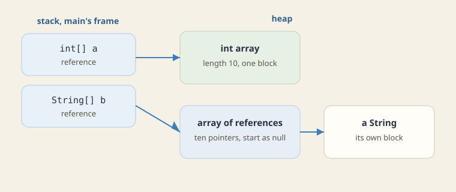

This chapter compares Java's run-time picture with the C++ model from earlier chapters.

- **Compile and run:** how Java turns source code into bytecode, and how the JVM runs it.
- **Storage:** what Java keeps on the stack, what it keeps on the heap, and how an array is laid out.
- **Calls and errors:** why every Java method call is dispatched at run time, and which exceptions the compiler forces you to handle.

## Compilation and execution

Java compiles a program to bytecode and runs that bytecode on the Java Virtual Machine, a run-time environment.

- **Portability:** the same `.class` file runs on any operating system that has a JVM, because the bytecode does not depend on the machine.

1. **Compilation** happens before the program runs. `javac` translates `.java` into `.class`, checks types, enforces access control, and requires every checked exception to be caught or declared.
2. **Execution** loads those `.class` files in the JVM. The JVM interprets the bytecode, and its just-in-time (JIT) compiler turns hot spots into native machine code.

Java also chooses which method to call differently from C++: every instance method in Java is virtual.

- **Dynamic binding** (קשירה דינמית), also called late binding, means the method that runs is chosen at run time, from the class of the actual object.
- **In C++**, a call is dispatched this way only when the function is declared `virtual`. Otherwise C++ picks the function at compile time, from the declared type.

## The Java storage model

Java uses the same stack and heap as C++, but it decides for you what goes where.

- **The stack** holds each method's local variables. A local of primitive type (`int`, `boolean`, and so on) holds its value directly, and a local of class type holds only a reference to an object.
- **The heap** holds every object and every array, together with the fields inside them. Unlike C++, Java never puts an object on the stack.

An array in Java is an object on the heap.

- **`length`:** the array's length is stored inside the array object itself.
- **Primitive elements:** an `int[]` stores the `int` values themselves, inside the array object.
- **Reference elements:** a `String[]` stores only references. Each `String` they refer to is a separate object elsewhere on the heap.



:::problem id=worked-array-layout title="An array on the heap" source="materials/lectures/Chapter 7 - Back to Java.pptx" kind=worked solution_origin=source
What is on the stack, and what is on the heap?

```java
int[] a = new int[10];
String[] b = new String[10];
b[0] = new String("Avi");
```

:::solution
- **On the stack:** `a` and `b` are two references in the frame of the running method. Nothing else is on the stack.
- **`a`:** it points at one array object on the heap. That object holds a header, the length 10, and ten `int` values, all 0.
- **`b`:** it points at a second array object, whose ten slots are references. Every slot starts as `null`.
- **`b[0]`:** after the third line, this slot refers to a new `String` object, which is a separate object on the heap. The other nine slots are still `null`.
:::
:::

## Exceptions

When something goes wrong at run time, a Java method throws an exception. The compiler treats the kinds of exception differently.

:::definition id=def-exception title="How Java classifies exceptions" source="materials/lectures/Chapter 7 - Back to Java.pptx"

- **Checked exceptions:** these inherit from `java.lang.Exception` but not from `RuntimeException`. They stand for failures a correct program should still expect, such as a missing file. The compiler requires the method to catch each one with `try-catch` or to declare it with `throws`.
- **Unchecked exceptions:** these inherit from `RuntimeException`. They stand for bugs in the program, such as `NullPointerException` and `IndexOutOfBoundsException`. A method may leave them undeclared.
- **Errors:** these inherit from `java.lang.Error`. They stand for severe failures of the JVM, such as `OutOfMemoryError`. Ordinary application code leaves them uncaught.
:::

- **`finally`:** this block runs whenever control leaves the `try` block, whether the block finished normally or an exception was thrown.
- **`try-with-resources`:** this form closes every resource that implements `AutoCloseable`, on every exit from the block, so you do not have to write the `finally` yourself.

:::check id=chk-checked
A method calls an API that throws `java.io.FileNotFoundException`, a checked exception. What does the compiler require?

- [ ] Nothing, because only `Error` is mandatory
- [x] A `try/catch` for this exception, or a `throws` clause
- [ ] A `finally` block and no `catch`

Checked exceptions are part of the method's type. Unchecked exceptions and `Error` stay outside that type.
:::

## Practice

:::problem id=ps5-checked-exception title="A checked exception" source="materials/sessions/SPL_PS5.pptx" kind=exercise solution_origin=source
`FileNotFoundException` is checked. `ArithmeticException` is unchecked.

:::check id=ps5-checked-exception-q1
A method that can throw `FileNotFoundException` must catch it or declare {{=throws|finally|assert}} `FileNotFoundException`.

A method that neither catches nor declares `FileNotFoundException` does not compile. Once the method declares it, every caller has the same choice to make.
:::

:::check id=ps5-checked-exception-q2
Which of these hold?

- [x] Ignoring `ArithmeticException` still compiles
- [ ] Ignoring `FileNotFoundException` still compiles
- [x] The caller of a method that declares `throws FileNotFoundException` has the same obligation
- [x] Catching `ArithmeticException` is usually the wrong response when the exception marks a bug the program should fix

- **`ArithmeticException`:** it is unchecked, so handling it is optional, and the code compiles without it.
- **`FileNotFoundException`:** it is checked, so the method must catch it or declare `throws FileNotFoundException`.
- **The caller:** a method that calls one declaring `throws FileNotFoundException` must itself catch or declare it.
- **Catching a bug:** `ArithmeticException` usually signals a bug, such as dividing by zero, so the right fix is to correct the code, not to catch the exception.
:::

:::check id=ps5-checked-exception-q3
If no frame from the throw site through `main` has a matching `catch`, what happens?

- [ ] `main` returns normally and the exception is discarded
- [ ] `finally` blocks along that walk are skipped
- [x] The JVM terminates the program and reports the exception

The exception unwinds every frame up to and including `main`. The JVM then terminates the thread and prints the exception with its stack trace.
:::

:::check id=ps5-checked-exception-q4
Which of these hold on that path?

- [x] `finally` blocks along the walk still run
- [ ] A second failure thrown by `close` replaces the original exception
- [x] `try-with-resources` closes the resource. A second failure from `close` is suppressed, and the original exception remains the one that propagates

- **`finally`:** every `finally` block on the way out still runs.
- **The original exception:** with `try-with-resources`, it stays the exception that propagates. A second failure thrown by `close` is attached to it as a suppressed exception instead of replacing it.
:::
:::

- **Next:** in Java every instance method is virtual by default. [Inheritance and polymorphism](topic:inheritance) shows how C++ gets the same behavior only through the keyword `virtual`.
- **After that:** [Concurrency](topic:concurrency) covers what happens when several threads run these methods at the same time.
