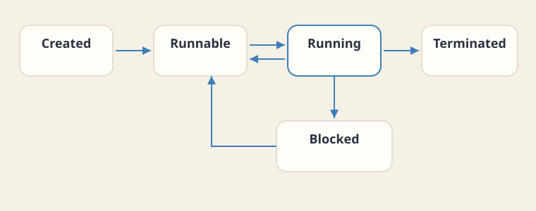
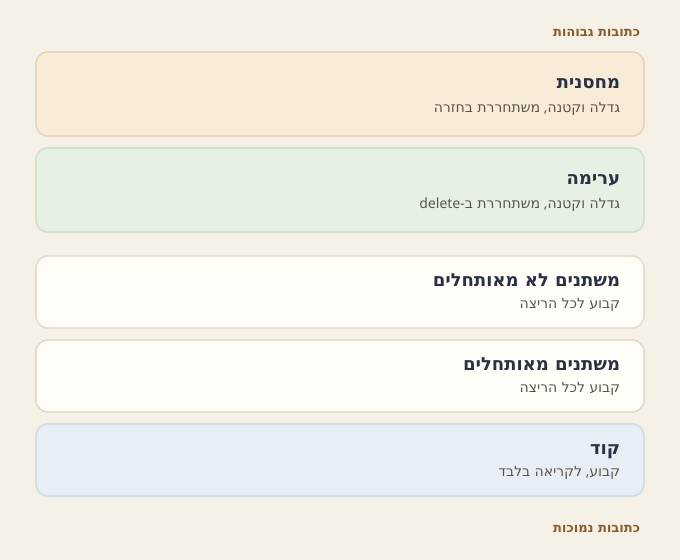
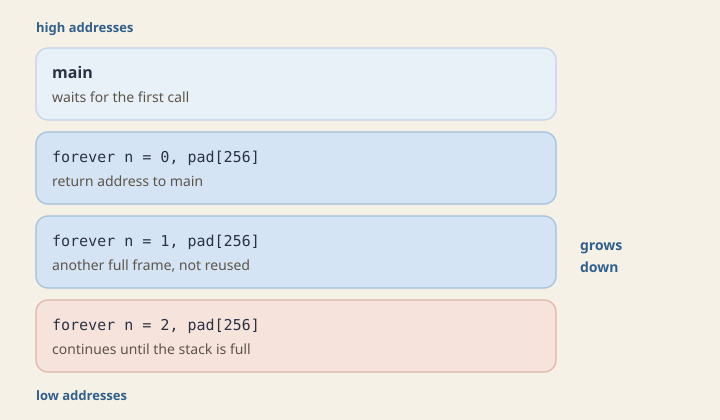
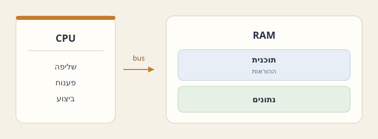
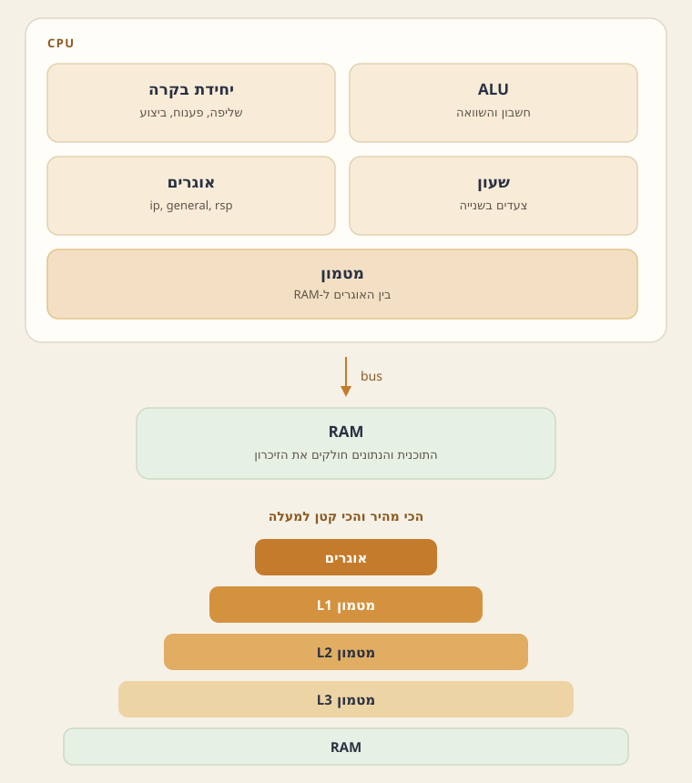

This chapter maps how a C++ process sits on the machine: the run-time environment, the five regions of the address space, and why stack and heap are split.

- **Run-time environment** — how the operating system turns a program into a process.
- **Five regions** — stack, heap, static data, and code inside one virtual address space.
- **Design and machine picture** — why those regions exist, and a von Neumann view of a running process.

## The run-time environment

Systems programming keeps the programmer close to the machine: memory, protocols, and the run-time environment (סביבת זמן ריצה) that executes the program.

Consider a system that searches for a film on the network, downloads it, and plays it.

- **Separate services** for searching the network, reading and writing the file system, and decoding video are provided by the layer between the program and the hardware, above the processor's instruction set.

:::definition id=def-runtime title="Computer, program, process, and run-time environment" source="materials/notes/lecture-notes.docx.pdf"

- **Computer** is a logical unit that carries out tasks on its own, through its instruction set.
- **Program** is a passive collection of instructions: a formal description of a task.
- **Process** is one execution of a program, with its own address space and its own state.
- **Run-time environment** is the layer between a program and the infrastructure.
- **C++ layer** is the operating system, and the infrastructure under it is the hardware.
- **Four roles** belong to that layer.
- **Properties** of the infrastructure are preserved.
- **Abstraction** sits over that infrastructure.
- **Interface** is more convenient than the infrastructure itself.
- **Extra services** are ones the infrastructure does not provide on its own.
:::

The operating system is the run-time environment of a C++ process.

- **Operating system** stands between the process and the hardware.
- **Process creation** happens when a program is started: the operating system builds the process and moves it from state to state.
- **Program counter (PC)** holds the address of the next instruction the processor will execute.

:::definition id=def-process-states title="Process states" source="materials/notes/lecture-notes.docx.pdf"
A process has five main states:

| State | Description | Next state |
| --- | --- | --- |
| Created | The process object is built, memory is allocated, the file is loaded, and the PC points at the first line of `main` | Runnable |
| Runnable | The process is ready to run and is waiting for its turn from the scheduler | Running |
| Running | The process is executing on the CPU. Each step advances the PC to the next instruction | Runnable (when the time slice ends); Blocked (waiting for an event or for I/O); Terminated (when the program finishes) |
| Blocked | The process cannot run at the moment, and it is not in the scheduler's ready queue | Runnable (once the cause of the block is gone) |
| Terminated | The resources have been released and the process has ended | none |



:::

- **Runnable** is the state of waiting for the scheduler.
- **Blocked** is the state of waiting for I/O or for an event.
- **System call** is how a process asks the kernel for a service.
- **Ordinary function call** transfers control to code inside the same process.
- **Kernel** performs the operation on the disk or the network card.
- **External hardware event** is delivered back to the process as a message from the operating system.
- **Multitasking** lets the operating system run more processes than the machine has physical cores, by a context switch from one process to another.
- **Virtual address space** is independent for each process and is usually larger than the physical RAM.
- **Permissions** on files and on memory are enforced by the operating system.
- **JVM** is a further run-time environment, running above the operating system.
- **Bytecode portability** is described in the chapter [Back to Java](topic:java-runtime): the same bytecode runs, with only small changes, on different operating systems.

## The five regions

The virtual address space runs from low addresses up to high addresses.

- **Course pictures** draw those regions: a pointer (מצביע) on the stack (מחסנית), a buffer on the heap (ערימה), and an argument passed by value into the frame of the called function.
- **Growing regions** sit separate and grow toward each other, so the free range between them can be used by whichever side needs it.

:::definition id=def-address-space title="The address space of a process" source="materials/lectures/Chapter 1 - The Memory Model.pptx"
A running process has an address range of its own. Five main regions sit inside that range:

| Region | Also called | Size | Release | Access |
| --- | --- | --- | --- | --- |
| Stack | Stack | Dynamic (grows and shrinks) | Automatic, in LIFO order | Read and write |
| Heap | Heap | Dynamic (grows and shrinks) | Manual, by the programmer (for example `delete`) | Read and write |
| Uninitialized static data | BSS / Uninitialized Data | Fixed at compile time | For the life of the process | Read and write |
| Initialized static data | Data / Initialized Data | Fixed at compile time | For the life of the process | Read and write |
| Code | Text / Code | Fixed at compile time | For the life of the process | Read only |



High addresses sit at the end of the stack region, which grows downward. Low addresses sit in the code region.
:::

- **Stack** holds local variables and the data a return needs: the return address, and saved registers.
- **Stack frame** is popped when the function ends, and its local variables leave that memory.
- **Heap** is where a program allocates blocks dynamically, for example with `new`.
- **Heap lifetime** is separate from the stack frame of the function that allocated it, so the block can remain after that function has returned.
- **Data and BSS** are the two static regions that hold variables whose lifetime is the lifetime of the process.
- **Data** holds initialized static data.
- **BSS** holds uninitialized static data.
- **Code region (Text)** holds the machine instructions the processor fetches and executes through a read-only mapping.

### Static variables

A static variable is initialized with a value the compiler (מהדר) can compute at compile time.

- **Constant expression** is fixed before the program runs as the initializer.
- **Global** (`int a = 1`) lasts the whole run and is visible from every file.
- **File-scope static** (`static int b = 2`) lasts the whole run and is visible in this file only.
- **Function static** (`static int c = 3` inside a function) lasts the whole run for this function only and is initialized once, not on every call.

```cpp
int a = 1;                 // global: whole run, visible from every file
static int b = 2;          // file-scope static: whole run, this file only
void function() {
    static int c = 3;      // function static: whole run, this function only
}                          // c is initialized once, not on every call

```

- **`a`** is visible from any file that declares it, for example with `extern`.
- **`b`** is visible only in the file that defines it. That limit is file scope.
- **`c`** keeps its value from one call of `function` to the next, and only the code inside `function` may name `c`.
- **Compiler and linker (מקשר)** give these variables a fixed address before `main` begins, and every later call finds those same variables.

In the next example, `c` and `x` have different lifetimes, although both names appear inside `tick`.

- **`c`** lives in the static region, and its initialization runs once.
- **`x`** lives in the stack frame, and each call gets a new `x`.

```cpp
void tick() {
    static int c = 0;   // static region, initialized on the first call
    int x = c;          // stack, a new x on every call
    c = c + 1;
}

int main() {
    tick();             // x is 0, then c becomes 1, then x is gone
    tick();             // x is 1, copied from the c that stayed
}

```



| Moment | `c` | `x` |
| --- | --- | --- |
| First call, at the line `int x = c` | 0 | 0 |
| First call, when the function ends | 1 | Gone (popped off the stack) |
| Second call, at the line `int x = c` | 1 | 1 |

### The stack frame

:::definition id=def-stack-frame title="Stack frame" source="materials/lectures/Chapter 1 - The Memory Model.pptx"

- **Stack frame** (activation record) is pushed on every function call.
- **Frame contents** hold the return address, the parameters that were passed, and the function's local variables.
- **LIFO pop** removes frames last in first out when the function returns.
:::

- **Local variable** is allocated inside the frame of the current call.
- **Frame release** moves the stack pointer when the call ends, with no search for a free block, so the allocation is fast.
- **Name lifetime** ends when the function returns, because the whole frame is then available for a later call to reuse.
- **Stack overflow** means the stack has no room left for another frame.
- **Common causes** of stack overflow are infinite recursion and a very large local array.
- **Pass by value** in the call `foo(a)` copies the value of `a` into a new parameter `n`.
- **Reference (רפרנס) parameter** would be another name for the caller's `a`.

```cpp
void foo(int n) {
    int x = n * 2;
}

int main() {
    int a = 4;
    foo(a);
    return 0;
}

```

While `foo` is running, the stack holds two frames.

- **`main`'s frame** holds `a`.
- **`foo`'s frame** holds the return address, the parameter `n`, and the local variable `x`.
- **Return from `foo`** pops its frame.



| Name | While `foo` is running | After `foo` returns |
| --- | --- | --- |
| `a` | In `main`'s frame, value 4 | Still in `main`'s frame, value 4 |
| `n` | In `foo`'s frame, value 4 | Gone when the frame is popped |
| `x` | In `foo`'s frame, value 8 | Gone when the frame is popped |
| Return address | In `foo`'s frame, points back into `main` | Popped in order to perform the return, then gone |

:::problem id=worked-frame-call title="The frame of a call" source="materials/lectures/Chapter 1 - The Memory Model.pptx" kind=worked solution_origin=source
Where are `n` and `x` stored while `foo` is running, and what remains after `foo` returns?

```cpp
void foo(int n) {
    int x = n * 2;
}

int main() {
    int a = 4;
    foo(a);
    return 0;
}

```

:::solution

- **`n` and `x`** are stored in `foo`'s stack frame.
- **`n`** is the parameter, a copy of the value 4 passed from `main`.
- **`x`** is a local whose value is 8.
- **Frame position** sits at the top of the stack, above `main`'s frame, which still holds `a`.
- **Return from `foo`** pops `foo`'s frame, so the names `n` and `x` can no longer be used.
- **`a`** is still 4 because the call passed `a` by value, so `n` received a copy; a reference parameter would have named `a` itself.
- **Heap block from `new`** would stay allocated if `foo` had executed `new`, even though the pointer that addressed it lived in the frame and would disappear with the frame.
:::
:::

:::check id=chk-frame-gone
After `foo` returns, which of the following is still in memory?

```cpp
void foo(int n) {
    int x = n * 2;
}
int main() {
    int a = 4;
    foo(a);
}

```

- [ ] `n`, because the parameter was passed in
- [ ] `x`, because it was initialized
- [x] only `a`

- **`n` and `x`** belonged to `foo`'s frame, and that frame has been popped.
- **`a`** lives in `main`'s frame, which is still on the stack.
:::

### The heap

```cpp
int* pi = new int;       // one int on the heap; pi itself is local
delete pi;

int* arr = new int[10];  // ten ints on the heap
delete[] arr;            // the array form, not delete

```

- **Heap block** can outlive the function that allocated it.
- **Stack local** cannot outlive its frame: the local is released when its frame is popped.
- **`new` cost** is the time to find a free range, plus a record of what is free.
- **Memory manager** is the operating-system service that does that search.
- **Stack allocation** is faster because it only moves the stack pointer.
- **Heap bookkeeping** records which blocks are occupied and which are free.
- **Pointer vs block** may occupy different regions.

```cpp
int* pi = new int[10];             // pi on the stack, the ten ints on the heap
Student* ps = new Student("Avi");  // ps on the stack, the Student on the heap

```

- **First line** puts `pi` as a local on the stack holding an address, with the ten integers as one contiguous block on the heap.
- **Second line** puts `ps` on the stack and the `Student` object on the heap.
- **Stack allocation** ends with the call that created it because a stack frame is popped on every return.
- **C++ ownership** means the programmer owns each dynamic block: `new` obtains it, and a matching `delete` releases it.
- **`new` / `delete` analogy** is like obtaining and returning the key to an apartment: a forgotten key leaves the apartment occupied for the rest of the process.
- **Memory leak (זליגת זיכרון)** is a heap block that stays marked occupied after no live pointer in the program still holds its address.
- **Garbage collection (איסוף אשפה)** in Java, C#, and Python releases storage the program can no longer reach, so those languages hide much of this region bookkeeping.
- **Java memory leak** is a reference that stays reachable by accident, for example because it was left in a static collection, after the program no longer needs the object.

```cpp
void leaky() {
    int* box = new int(9);   // box is a stack slot, 9 is an int on the heap
}                            // the return pops box and does not call delete

```


### All five regions in one run

One run of a program can use all five regions at the same time:

```cpp
int ready = 1;              // initialized static, whole run
int scratch;                // uninitialized static, whole run

void note() {
    static int calls = 0;   // initialized static, once
    int x = calls;          // local on the stack
    int* box = new int(x);  // box on the stack, the int on the heap
    calls = calls + 1;
    delete box;
}

int main() {
    note();                 // x becomes 0, calls becomes 1, box is gone
    note();                 // x becomes 1, from the calls that stayed
}

```

| Name | Region | Still present after `note` returns? |
| --- | --- | --- |
| `ready` | Initialized static data | Yes, until the process ends |
| `scratch` | Uninitialized static data (BSS) | Yes, until the process ends |
| `calls` | Initialized static data | Yes, it keeps its value across calls |
| `x` | Stack (`note`'s frame) | No, it is popped on return |
| `box` | Stack (`note`'s frame) | No, it is popped on return |
| the `int` from `new` | Heap | Released explicitly before the return (`delete box`) |
| the program's code | Code region (Text) | Yes, read only |


### Recursion and the stack

Each recursive call pushes a new frame.

- **Previous frame** stays in place because the call that created it is still in progress.
- **`forever`** calls itself again with `n + 1`, so no call reaches its end and no frame is popped.
- **`pad` array** of 256 integers takes space in every frame, and the stack grows until its region is full.

```cpp
void forever(int n) {
    int pad[256];
    forever(n + 1);    // this call does not return, so no frame is popped
}

int main() {
    forever(0);
}

```



This example never executes `new`, so the heap stays empty.

- **Failure mode** is a stack overflow.
- **Heap exhaustion** can happen with a single stack frame.
- **A loop of `new`** that never releases its blocks shrinks the free heap until allocation fails with `std::bad_alloc`.

## Design considerations

The frame of a called function lives entirely inside the lifetime of the function that called it.

- **Stack match** fits that nesting because frames leave in LIFO order: the frame pushed last is the frame popped first.
- **Frame creation** moves the stack pointer by a size the compiler already knows.
- **Frame leave** moves the pointer back by that same amount.
- **Contiguous live frames** occupy one range because frames are released in the reverse of the order in which they were created, so the stack stays free of fragmentation.

Two kinds of storage need the heap:

1. An object whose lifetime must continue after the function that created it has returned.
2. Data whose size is unknown at compile time, such as `new int[n]` when `n` is obtained at run time.

- **Local slot size** is fixed by the compiler in the frame before the program runs.
- **Dynamic-size data** is allocated on the heap.
- **Pointer in the frame** stores only the address, and the pointer's size is fixed and known.

## The von Neumann machine

In the von Neumann architecture, the RAM that holds a program's data also holds its code, the instructions.

:::definition id=def-von-neumann title="The von Neumann machine" source="materials/lectures/Chapter 1 - The Memory Model.pptx"

- **Von Neumann architecture** is a processor (CPU), a bus, and a main memory (RAM) shared by code and data.
- **Fetch-decode-execute cycle** repeats: the processor fetches an instruction from memory, decodes it, and executes it.
:::



The main parts of the processor:

- **Control unit (CU).** It runs the fetch-decode-execute cycle, stays in step with the clock, and handles input and output through interrupts.
- **Arithmetic-logic unit (ALU).** It performs arithmetic, logical operations, comparisons, bitwise operations, and checks for arithmetic overflow.
- **Registers** are the fastest storage in the processor.
- **General-purpose registers** hold values for the operation in progress (`load`, `store`).
- **Dedicated registers** hold execution state, including `ip` (the instruction pointer) and `rsp` (the stack pointer).
- **Cache.** This is fast memory between the registers and physical RAM, divided into levels. L1 is the smallest and the fastest, then L2, then L3.



- **Stack region** is where the address lies when the processor loads a local variable.
- **Heap region** is where the address lies when it reads through the pointer `pi`.
- **Bus** carries every access.
- **Software division** of stack, heap, and code region maps onto the same physical RAM.

The memory hierarchy, from the fast and small end to the slow and large end:

| Component | Role | Retains data with the power off? |
| --- | --- | --- |
| Register | Values for the processor's current operation | No |
| Cache | A copy of recently used RAM cells, so the processor can avoid a slow access | No |
| Main memory (RAM) | The process's data and code during the run | No |
| Disk (SSD/HDD) | Permanent storage for files | Yes |
| Magnetic tape | Long-term backup and retrieval | Yes |

- **Data bus width** is how many bits move in one memory transfer, and that width is the word size.
- **Address bus width** is the largest range of memory the processor can address.

The raw instruction set includes operations such as these:

- `READ 100 R1`: copy the contents of cell 100 into register R1.
- `ADD R1 R2 R3`: add the contents of R1 and R2, and store the result in R3.
- `WRITE R3 200`: copy the contents of R3 into cell 200.

:::problem id=worked-add-trace title="A trace of an addition" source="materials/notes/lecture-notes.docx.pdf" kind=worked solution_origin=source
The variable `i` is stored in cell 3000 and the variable `j` in cell 4000. Translate the fragment into `READ`, `WRITE`, and `ADD` instructions.

```java
int i = 10;
int j = 20;
i = i + j;

```

:::solution
The values are written into memory first. They are then loaded into registers, the ALU adds them, and the result is written back into the cell of `i`:

```text
WRITE 3000 10
WRITE 4000 20
READ  3000 R1
READ  4000 R2
ADD   R1 R2 R3
WRITE 3000 R3

```

- **Cell 3000** holds 30 at the end.
- **Addition** is performed in the processor's registers.
- **RAM** holds the cells that were read and the cell that was written.
:::
:::

The stack and the heap correspond to a small set of operations:

**Stack operations:**

- `createAF`: create a new stack frame.
- `removeAF`: remove the current frame and return to the caller's frame.
- `push`: add a cell at the top of the current frame.
- `pop`: remove the cell at the top of the frame.
- `read` / `write`: access a cell in the current frame only.

**Heap operations:**

- `new`: allocate a free run of cells on the heap and mark them occupied for this process.
- `delete`: release an allocated range and mark it free.
- `read` / `write`: access a cell that is currently allocated on the heap.
- **Released cell:** a read or a write after `delete` is a run-time fault, a segmentation fault.

A procedure call does the following.

- **`createAF`** creates the frame.
- **Return address** is pushed.
- **`this` pointer** is pushed when the call is a method of an object.
- **Arguments** are pushed, the body runs, and the return value is written to a temporary location.
- **Argument pop and `removeAF`** pop the arguments and remove the frame to return to the caller's frame.

:::check id=chk-where-array
The following line runs inside a function. Where do `pi` and the ten integers live?

```cpp
int* pi = new int[10];

```

- [ ] Both are on the stack
- [x] `pi` is on the stack and the ten integers are on the heap
- [ ] Both are on the heap
- [ ] `pi` is stored in the code region

- **`pi`** is a local variable that holds an address, so it is allocated in the stack frame.
- **Ten integers** are allocated on the heap by `new[]`.
:::

## An example layout

Consider this code:

```cpp
int* pi = new int[10];
pi[0] = 1;

```

| Name | Region | Contents |
| --- | --- | --- |
| `pi` | The stack frame | The address of the first `int` on the heap |
| The ten `int`s | Heap | The array values (index 0 has been set to 1) |
| The instructions | Code region (Text) | Machine instructions, read only |

When the function returns, the local `pi` disappears with the frame.

- **Ten integers** stay allocated on the heap until the program executes `delete[] pi`.
- **Memory leak** happens once the only copy of that address has disappeared with the frame, because the integers are then unreachable and the block stays occupied.

:::problem id=worked-stack-array title="A pointer on the stack" source="materials/lectures/Chapter 1 - The Memory Model.pptx" kind=worked solution_origin=source
Explain where `ps` is stored, where the `Student` object is stored, and what happens in memory if nobody calls `delete`.

```cpp
int main() {
    Student* ps = new Student("Avi");
    return 0;
}

```

:::solution

- **`ps`** is a local pointer, so it occupies a cell in `main`'s stack frame.
- **`Student` object** is allocated on the heap:

```text
stack (main):  ps  ----------+
                             |
heap:                        v
                       Student("Avi")

```

- **`main` ends** pops the stack frame and `ps` disappears.
- **Heap block** stays allocated with no pointer that can reach it, so the block is a memory leak.
:::
:::

:::trap
- **`delete`** releases one object.
- **`delete[]`** releases an array.
- **`delete` on `new[]`** is undefined behavior, and it corrupts the heap's bookkeeping.
- **Memory leak** is a separate failure: the block is never released.
:::

:::trap
Global variables, and local variables declared `static`, occupy the static region for the whole run of the program.

- **Storage** is that static region for the entire lifetime.
- **Outside frames** means they sit outside every stack frame, and outside the heap.
:::

## Practice

:::problem id=ps2-stack-vs-heap title="Stack versus heap" source="materials/sessions/SPL_PS2 (1).pptx" kind=exercise solution_origin=source
Four names are declared in `demo`.

```cpp
void demo() {
    int local = 2;
    int* one = new int(2);
    int* many = new int[10];
    string* s = new string("I'm on the heap");
}

```

:::check id=ps2-stack-vs-heap-q1
Where does each object live, and which release matches it?

`local` is an `int` on the {{=stack|heap|vtable}} and takes {{=no delete|delete|delete[]}}.

`one` is a pointer on the {{=stack|heap|vtable}}. The `int` from `new int(2)` lives on the {{=heap|stack|frame of demo}} and is released with {{=delete|delete[]|no delete}}.

`local` is an `int` in `demo`'s stack frame; the return releases it and it takes no `delete`. `one` is a local pointer on the stack; the `int` it addresses is a block on the heap and is released with `delete one`.
:::

:::check id=ps2-stack-vs-heap-q2
`many` is a pointer on the {{=stack|heap|vtable}}. The array of ten integers lives on the {{=heap|stack|frame of demo}} and is released with {{=delete[]|delete|no delete}}.

`s` is a pointer on the {{=stack|heap|vtable}}. The `string` object lives on the {{=heap|stack|frame of demo}} and is released with {{=delete|delete[]|no delete}}.

`many` is a local pointer on the stack; the array of ten integers is a block on the heap and is released with `delete[] many`. `s` is a local pointer on the stack; the `string` object itself is a block on the heap and is released with `delete s`.
:::

:::check id=ps2-stack-vs-heap-q3
What is true if `demo` returns while those three blocks are still allocated?

- [ ] The return pops the frame and releases the three heap blocks with it.
- [ ] The three pointers move onto the heap, so the blocks stay reachable.
- [x] The return pops the frame and the pointers disappear with it. A block left behind is a memory leak on the heap.

- **Heap blocks** have to be released before the function returns.
- **Return** pops the frame and the pointers disappear with it.
- **Leftover block** on the heap is a memory leak.
:::
:::

:::problem id=mm-pass-by-value title="Pass by value and a leak" source="materials/lectures/Chapter 1 - The Memory Model.pptx" kind=exercise solution_origin=derived
While `foo` runs, and then after it returns:

```cpp
void foo(int n) {
    int x = n * 2;
    int* box = new int(x);
}

int main() {
    int a = 4;
    foo(a);
}

```

:::check id=mm-pass-by-value-q1
While `foo` is running, where does each name live?

- [x] `a` is in `main`'s stack frame
- [x] `n` and `x` are in `foo`'s stack frame
- [x] `box` is a pointer cell in `foo`'s frame; the `int` from `new` is on the heap
- [ ] `n` is another name for `a` on the stack

- **Pass by value** copies `4` into the parameter `n`.
- **`box`** holds an address; the addressed `int` is a heap block.
:::

:::check id=mm-pass-by-value-q2
After `foo` returns with no `delete`, what remains?

- [ ] `n`, `x`, and `box` stay in memory until `main` ends
- [x] Only `a` is still on the stack. The heap `int` is still allocated, and nothing points to it
- [ ] The return releases the heap `int` automatically with the frame

- **Return** pops `foo`'s frame, so `n`, `x`, and `box` are gone.
- **Heap block** without a matching `delete` is a memory leak.
:::
:::

:::problem id=mm-regions-quiz title="Which region holds the name" source="materials/lectures/Chapter 1 - The Memory Model.pptx" kind=exercise solution_origin=derived
Use the five-region layout from the lesson.

```cpp
int ready = 1;
int scratch;

void note() {
    static int calls = 0;
    int x = calls;
    int* box = new int(x);
    calls = calls + 1;
    delete box;
}

```

:::check id=mm-regions-quiz-q1
Match each name to its region while `note` is running.

`ready` and `calls` live in {{=initialized static data|the stack|the heap}}.

`scratch` lives in {{=uninitialized static data (BSS)|the stack|the code region}}.

`x` and `box` live in {{=note's stack frame|initialized static data|the heap}}.

The `int` from `new` lives on the {{=heap|stack|code region}}.

Static names last for the whole process. Locals sit in the current frame. `new` obtains a heap block.
:::

:::check id=mm-regions-quiz-q2
After `note` returns, which are still present?

- [x] `ready`, `scratch`, and `calls`
- [ ] `x` and `box`
- [x] the program's code in the code region
- [ ] the `int` from `new`, because `delete box` already ran before the return

- **`delete box`** releases the heap `int` before the return.
- **Locals** `x` and `box` disappear with the frame.
- **Static storage and code** last for the process.
:::
:::

:::problem id=mm-delete-forms title="delete and delete[]" source="materials/lectures/Chapter 1 - The Memory Model.pptx" kind=exercise solution_origin=derived
Choose the matching release for each allocation.

:::check id=mm-delete-forms-q1
`int* p = new int(3);` is released with {{=delete p|delete[] p|no delete}}.

`int* a = new int[10];` is released with {{=delete[] a|delete a|no delete}}.

`new T` pairs with `delete`. `new T[n]` pairs with `delete[]`.
:::

:::check id=mm-delete-forms-q2
What goes wrong if the forms are swapped?

- [x] `delete` on memory from `new[]` is undefined behavior and can corrupt the heap's bookkeeping
- [ ] The compiler always rewrites `delete` into `delete[]` for arrays
- [x] Skipping every `delete` leaves heap blocks allocated after the pointers are gone — a memory leak

- **Wrong form** corrupts bookkeeping.
- **Missing release** is a leak, a separate failure.
:::
:::

The chapter [Pointers and references](topic:pointers) builds on this drawing.

- **Stack cell** holds an address that is useful while the block on the heap is still alive.
- **[The rule of three](topic:rule-of-three)** is where copy constructors and owned buffers show up — including past-paper `mvector` questions that need a deep copy.
