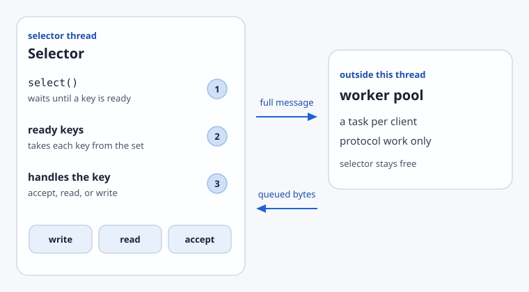

This chapter turns the print server into a general server pattern. The pattern is built from two parts, and each part is a parameter.

- **The protocol:** the "language" the server speaks, split into encoding and framing on one side, and the meaning of the messages on the other.
- **The concurrency model:** how the server manages conversations with several clients at once, from a single thread up to the reactor.
- **Synchronization inside the reactor:** keeping the messages of each client in order, with the actor thread pool, and keeping the selector's registrations on its own thread.

## The protocol

A protocol is the shared "language" of two processes: the rules of their conversation. Compare it with a human language, which has:

- a way letters form words, and words form sentences,
- the meaning of a sentence,
- rules for how sentences follow each other, and for when the conversation is over.

A protocol fixes the same things for messages:

| Part | Question it answers | In the print server |
| --- | --- | --- |
| **Encoding** | How does a message become bytes? | Java's `getBytes` |
| **Framing** | Where does one message end in the byte stream? | a newline |
| **Syntax** | What is inside a message? | one string |
| **Semantics** | What should happen when a message arrives? | print it |
| **Synchronization** | Which messages may come in which order? | any, at any time |

A richer example: a **price server**.

- **Encoding:** strings in UTF-8.
- **Framing:** the first two bytes of every message give its length.
- **Syntax and semantics:** `QUERY product` answers with `[<store price> ...]`, and `BUY product store` answers `SUCCESS` or `FAIL`.
- **Synchronization:** you may not `BUY` a product before you `QUERY` its price.

HTTP, between browsers and web servers, is another protocol, and so is STOMP, from the assignment.

### Two interfaces

The general server splits a protocol into two interfaces, so each can be swapped independently.

**`MessageEncoderDecoder`** handles encoding and framing: turning messages into bytes, and finding messages in a stream of bytes.

```java
public interface MessageEncoderDecoder<T> {
    byte[] encode(T message);
    T decodeNextByte(byte nextByte);   // a message when one is complete, else null
}
```

For the print protocol, a message is a line:

```java
public class LineMessageEncoderDecoder implements MessageEncoderDecoder<String> {
    private List<Byte> bytes = new LinkedList<>();

    public byte[] encode(String message) {
        return (message + "\n").getBytes(StandardCharsets.UTF_8);
    }

    public String decodeNextByte(byte nextByte) {
        if (nextByte == '\n') {               // the end of a message
            String ret = toUtf8String(bytes);
            bytes.clear();
            return ret;
        }
        bytes.add(nextByte);                  // still in the middle
        return null;
    }
}
```

**`MessagingProtocol`** handles syntax, semantics, and synchronization: what to do with a message, and when the conversation ends.

```java
public interface MessagingProtocol<T> {
    T process(T msg);           // the reply, or null for none
    boolean shouldTerminate();
}
```

For the print protocol:

```java
public class PrintingProtocol implements MessagingProtocol<String> {
    private boolean shouldTerminate = false;

    public String process(String msg) {
        if (msg.equals("bye!")) shouldTerminate = true;
        else System.out.println(msg);
        return null;
    }

    public boolean shouldTerminate() { return shouldTerminate; }
}
```

### The connection handler

A `ConnectionHandler` runs one conversation with one client: read bytes, let the encoder-decoder find messages, let the protocol answer them.

```java
public void run() {
    int b;
    while (!protocol.shouldTerminate() && (b = in.read()) >= 0) {
        T msg = encdec.decodeNextByte((byte) b);
        if (msg != null) {
            T reply = protocol.process(msg);
            if (reply != null)
                out.write(encdec.encode(reply));
        }
    }
}
```

Its fields are the client's `Socket`, and one encoder-decoder and one protocol object for this client.

### The base server

The server accepts clients, and gives each one a connection handler. The protocol and the encoder-decoder are parameters, passed as **factories**.

```java
public void serve() {
    ServerSocket serverSock = new ServerSocket(port);
    while (!Thread.currentThread().isInterrupted()) {
        Socket client = serverSock.accept();
        ConnectionHandler handler = new ConnectionHandler(
            client, encdecFactory.get(), protocolFactory.get());
        handler.run();
    }
}
```

- **Why factories (`Supplier`):** each client needs its **own** encoder-decoder and protocol, because each keeps the state of one conversation (half a message, or whether `bye!` arrived). `get()` makes a fresh one per client.

The print server is now one line:

```java
new BaseServer(7000,
               () -> new PrintingProtocol(),
               () -> new LineMessageEncoderDecoder()).serve();
```

## The server's concurrency model

`serve` above calls `handler.run()` itself, so the server talks to one client at a time. That decision should be a parameter too. Make it an abstract method:

```java
abstract class BaseServer {
    abstract protected void execute(ConnectionHandler handler);

    public void serve() {
        ...
        execute(handler);      // instead of handler.run()
    }
}
```

Now each concurrency model is a small subclass.

### 1. A single thread

```java
protected void execute(ConnectionHandler handler) {
    handler.run();
}
```

- **Pro:** simple, and needs no extra resources.
- **Con:** only one client is served at a time; everyone else waits.
- **Fits** a trivial protocol with few clients, such as a time server.

### 2. A thread per client

```java
protected void execute(ConnectionHandler handler) {
    new Thread(handler).start();
}
```

- **Pro:** every client is served at once.
- **Con:** a new thread for every client, never reused. With thousands of clients, the server runs out of resources and crashes.
- **Fits** only when the number of clients is small and bounded.

### 3. A thread pool

A fixed set of threads that keep running, each serving one client at a time, then taking the next. Java provides it as `ExecutorService`.

```java
ExecutorService pool = Executors.newFixedThreadPool(numThreads);

protected void execute(ConnectionHandler handler) {
    pool.submit(handler);
}
```

Inside, a pool is just the producer-consumer pattern from [Waiting and liveness](topic:waiting-and-liveness): a queue of tasks, and threads that loop on `taskQueue.remove().run()`.

- **Pro:** controlled use of resources, and threads are reused.
- **Con, utilization:** a thread serves a whole conversation, and spends most of it blocked on the client's socket, while other clients wait in the queue.
- **Con, fairness:** a few clients get full service, and the rest get none until they finish.

Think of a bank branch with a few clerks, each serving one customer from start to finish. That is model 3, and it is how most real systems work. Model 4 fixes its two problems.

### 4. The reactor

Two changes fix model 3.

- **Fairness:** a task handles **one message** of a client, not the whole conversation. Then a thread moves on to another client.
- **Utilization:** **one thread does all the I/O** with all the clients, and the other threads only process messages in memory, so they never block on a socket.

That one communication thread has a lot to do: accept new clients, read from every client, and write to every client. If any of those blocked, everyone would wait. Two tools make it possible.

- **Non-blocking I/O:** `read` returns what is there now (possibly nothing), `write` writes what fits now (possibly nothing), and `accept` returns a new client or `null`. Nothing waits.
- **A `Selector`:** instead of polling every client, the communication thread asks the selector to wake it when some client is ready to be accepted, read from, or written to.



The events the selector reports:

| Event | Means |
| --- | --- |
| `OP_ACCEPT` | a new client is connecting |
| `OP_READ` | at least one byte has arrived from a client |
| `OP_WRITE` | there is room to send at least one byte to a client |

:::definition id=def-reactor title="Java NIO pieces of the reactor" source="materials/lectures/Chapter 11 - Reactor.pptx"

- **`Selector`:** the Java NIO object that the reactor's thread waits on. `select` returns when at least one registered channel is ready, and the thread then handles the ready channels.
- **`ServerSocketChannel` and `SocketChannel`:** the server and client channels. They can be made non-blocking with `configureBlocking(false)`.
- **`SelectionKey`:** the record of one channel's registration with the selector. Its interest set says which operations to watch (`OP_ACCEPT`, `OP_READ`, `OP_WRITE`), and `readyOps()` says which of them are ready now.
- **`ByteBuffer`:** a block of memory that data is read into and written out of.
:::


### The reactor, method by method

**`serve`** is the communication thread's loop. It sets up a non-blocking server channel, registers it for `OP_ACCEPT`, and then waits for events.

```java
ServerSocketChannel serverSock = ServerSocketChannel.open();
serverSock.bind(new InetSocketAddress(port));
serverSock.configureBlocking(false);
serverSock.register(selector, SelectionKey.OP_ACCEPT);

while (!Thread.currentThread().isInterrupted()) {
    selector.select();                          // block until some event
    for (SelectionKey key : selector.selectedKeys()) {
        if (!key.isValid()) continue;
        if (key.isAcceptable()) handleAccept(serverSock);
        else handleReadWrite(key);
    }
    selector.selectedKeys().clear();
}
```

**`handleAccept`** accepts the new client, makes its channel non-blocking, and registers it for `OP_READ`, with its connection handler attached to the key.

```java
SocketChannel client = serverSock.accept();
client.configureBlocking(false);
NonBlockingConnectionHandler handler = new NonBlockingConnectionHandler(
    readerFactory.get(), protocolFactory.get(), client, this);
client.register(selector, SelectionKey.OP_READ, handler);
```

**`handleReadWrite`** finds the client's handler on the key. On a read event, it reads the bytes and hands the processing to the pool. On a write event, it writes what is waiting.

```java
NonBlockingConnectionHandler handler = (NonBlockingConnectionHandler) key.attachment();
if (key.isReadable()) {
    Runnable task = handler.continueRead();
    if (task != null) pool.submit(task);
}
if (key.isWritable())
    handler.continueWrite();
```

**`updateInterestOps`** changes which events the selector watches for a client.

```java
void updateInterestOps(SocketChannel chan, int ops) {
    chan.keyFor(selector).interestOps(ops);
    selector.wakeup();
}
```

### The non-blocking connection handler

Each client has a handler with its channel, its encoder-decoder, its protocol, and a **write queue** of replies waiting to be sent.

**`continueRead`** runs on the communication thread. It only reads the bytes, then returns a task that does the rest on a worker thread.

```java
public Runnable continueRead() {
    ByteBuffer buf = ByteBuffer.allocateDirect(BUFFER_SIZE);
    if (chan.read(buf) < 0) {       // -1: the client disconnected
        close();
        return null;
    }
    buf.flip();
    return () -> process(buf);      // the worker's job
}
```

**The worker's task** decodes messages, processes them, and queues the replies. Queuing a reply means the selector should now also watch for `OP_WRITE`.

```java
private void process(ByteBuffer buf) {
    while (buf.hasRemaining()) {
        T msg = encdec.decodeNextByte(buf.get());
        if (msg != null) {
            T reply = protocol.process(msg);
            if (reply != null) {
                writeQueue.add(ByteBuffer.wrap(encdec.encode(reply)));
                reactor.updateInterestOps(chan, OP_READ | OP_WRITE);
            }
        }
    }
}
```

**`continueWrite`** runs on the communication thread. It writes as much as the channel accepts, and once the queue is empty, stops watching for `OP_WRITE`.

```java
public void continueWrite() {
    while (!writeQueue.isEmpty()) {
        ByteBuffer top = writeQueue.peek();
        chan.write(top);
        if (top.hasRemaining()) return;     // the channel is full; try later
        writeQueue.remove();
    }
    if (protocol.shouldTerminate()) close();
    else reactor.updateInterestOps(chan, OP_READ);
}
```

The interest set needs care, especially `OP_WRITE`.

:::trap
Leaving `OP_WRITE` set when there is nothing to send makes `select` spin.

- **Why:** a channel is almost always ready for writing, so `select` returns immediately, finds nothing to do, and loops again, burning a whole CPU core.
- **The fix:** set `OP_WRITE` only while the write queue holds bytes, and clear it as soon as the last of them has been written.
:::


:::check id=chk-write-interest
A channel's write queue is empty, and `OP_WRITE` is still set. What does the selector thread do?

- [ ] It blocks in `select` until the client sends a byte
- [x] It spins, because the channel is already ready for writing
- [ ] It closes the channel

- **Why it spins:** a channel with free space in its send buffer counts as ready for writing, so `select` returns immediately, over and over.
- **The fix:** clear `OP_WRITE` from the interest set, and set it again only when a reply is waiting in the write queue.
:::


### ByteBuffer indexes

A `ByteBuffer` keeps three indexes: `position`, `limit`, and `capacity`.

- **`capacity`** is the buffer's total size, and it never changes.
- **Filling the buffer:** `channel.read` and `put` store bytes at `position`, and advance `position` past them.
- **`flip`** switches the buffer from filling to draining: it sets `limit` to the current `position`, and `position` to 0. The next `get` or `channel.write` then reads exactly the bytes that were just stored.
- **`clear`** sets `position` to 0 and `limit` to `capacity`, which makes the whole buffer available for the next fill.

```java
ByteBuffer buf = ByteBuffer.allocate(1024);
channel.read(buf);   // Read bytes from channel into buffer (position advances)
buf.flip();          // Prepare for reading from buffer: limit = position, position = 0
channel.write(buf);  // Write bytes from buffer to channel
buf.clear();         // Reset buffer for writing: position = 0, limit = capacity

```


:::problem id=worked-flip title="Flipping a buffer" source="materials/sessions/SPL_PS10.pptx" kind=worked solution_origin=source
You have just read 5 bytes into the buffer and now want to write them out. What does `flip` change?

```java
ByteBuffer buf = ByteBuffer.allocate(16);
channel.read(buf);    // position == 5, limit == 16
buf.flip();
channel.write(buf);
```

:::solution

- **What `flip` does:** it sets `limit` to 5 and `position` to 0, so the buffer is ready to be read from.
- **Then `channel.write(buf)`** sends exactly those five bytes. The capacity is still 16.
- **Without `flip`:** the write would start at position 5 and stop at limit 16, sending the empty tail of the buffer instead of the data.
- **Calling `flip` twice in a row** is also a bug: the second call sets `limit` to 0, because `position` is already 0, so the buffer looks empty.
:::
:::


## Synchronization in the reactor

The reactor is a concurrent program, so look for places where two threads touch the same data. There are two kinds.

### 1. The communication thread and a worker

Each client's `writeQueue` is filled by workers and emptied by the communication thread, at the same time. So it must be a thread-safe queue:

```java
private final Queue<ByteBuffer> writeQueue = new ConcurrentLinkedQueue<>();
```

A thread-safe queue makes each call safe, but not a check followed by an action. Look at the end of `continueWrite`:

```java
if (writeQueue.isEmpty())                     // 1. the communication thread sees "empty"
    reactor.updateInterestOps(chan, OP_READ); // 3. ... and stops watching OP_WRITE
```

If a worker adds a reply at step 2, between the check and the change, the reply sits in the queue while the selector no longer watches for writing. The client, waiting for that reply, may never send anything again, so nothing ever wakes the reactor to send it. You will see below how the final design solves this.

### 2. Two workers on the same client

If a client's bytes arrive in two reads, two tasks for the same client may run at once, on two workers. Both feed bytes into the client's single encoder-decoder, and the messages get mixed.

**Attempt 1: lock the handler inside the task.**

```java
return () -> {
    synchronized (this) { process(buf); }
};
```

The bytes no longer mix, but their **order** is not kept. The tasks entered the pool in order, yet the worker holding the second task may be scheduled first. If the first read held `AB;C` and the second `D;`, the second task runs first, and the server executes a message `D` that the client never sent.

**Attempt 2: keep a queue of tasks per client, and always run the first one.**

```java
handler2tasks.get(handler).add(task);
pool.submit(() -> {
    synchronized (handler) {
        handler2tasks.get(handler).remove().run();
    }
});
```

Now whichever worker runs, it runs the client's oldest task, so the order is kept. But if one client sends many messages, several workers take its tasks and all but one wait on its lock, while other clients wait in the pool's queue.

**Attempt 3: never put two tasks of the same client in the pool at once.** That is the **actor thread pool**.

### The actor thread pool

Call each client an **actor**. The pool keeps:

- **`acts`:** a queue of pending tasks for each actor,
- **`playingNow`:** the set of actors that have a task in the pool right now.

**`submit`** runs a task right away only if the actor is idle. Otherwise the task waits in the actor's queue.

```java
public void submit(T act, Runnable task) {
    synchronized (act) {
        if (!playingNow.contains(act)) {
            playingNow.add(act);
            execute(task, act);
        } else {
            pendingRunnablesOf(act).add(task);
        }
    }
}
```

**`execute`** wraps the task, so that when it finishes, the actor's next task is started.

```java
private void execute(Runnable task, T act) {
    threads.submit(() -> {
        try { task.run(); }
        finally { complete(act); }
    });
}
```

**`complete`** starts the next pending task of the actor, or marks the actor idle.

```java
private void complete(T act) {
    synchronized (act) {
        Queue<Runnable> pending = pendingRunnablesOf(act);
        if (pending.isEmpty()) playingNow.remove(act);
        else execute(pending.poll(), act);
    }
}
```

So each actor has at most one task in the pool, its tasks run in order, and the other workers stay free for other clients.

**Synchronization inside the pool.**

- **`submit` runs on the communication thread, and `complete` on a worker.** Both read and change the same actor's state, so both lock the actor.
- **`acts` is reached by many threads,** so it must be a thread-safe map, and `playingNow` a concurrent set (`ConcurrentHashMap.newKeySet()`).

**A memory detail.** When a client disconnects, the selector drops its key, and with it the last reference to the handler, so the garbage collector can free it. But `acts` still holds the handler as a key, so it would never be freed. The fix is a `WeakHashMap`, which drops an entry once nothing else refers to its key. `WeakHashMap` is not thread-safe, so its accesses go through a `ReadWriteLock`:

```java
private Queue<Runnable> pendingRunnablesOf(T act) {
    actsRWLock.readLock().lock();
    Queue<Runnable> pending = acts.get(act);
    actsRWLock.readLock().unlock();
    if (pending == null) {
        actsRWLock.writeLock().lock();
        acts.put(act, pending = new LinkedList<>());
        actsRWLock.writeLock().unlock();
    }
    return pending;
}
```

The reactor then uses the actor pool, with the handler as the actor:

```java
pool.submit(handler, task);
```

The notes also show a version of the actor pool that uses CAS instead of `synchronized`. It is reading material only, **not exam material**.

### Changing the selector only from the communication thread (an exam case)

Changing a channel's registration can **block** the changing thread while another thread is inside `select`. Here, a worker calls `updateInterestOps` after queuing a reply, while the communication thread sits in `select`, so the worker may get stuck.

The fix: only the communication thread touches the selector. Other threads leave it a **task** to do so.

```java
void updateInterestOps(SocketChannel chan, int ops) {
    SelectionKey key = chan.keyFor(selector);
    if (Thread.currentThread() == selectorThread) {
        key.interestOps(ops);
    } else {
        selectorTasks.add(() -> { if (key.isValid()) key.interestOps(ops); });
        selector.wakeup();            // get the communication thread out of select
    }
}
```

The communication thread runs those tasks each time it returns from `select`:

```java
selector.select();
while (!selectorTasks.isEmpty())
    selectorTasks.remove().run();
```

This also fixes the race at the end of `continueWrite`. A worker's change to `READ | WRITE` is now a task plus a `wakeup`, so it always runs after the communication thread's change to `READ`, and the final registration is `READ | WRITE`, as it should be.

### Reusing buffers

`continueRead` allocates a new `ByteBuffer` for every read. A small optimization keeps a shared pool of buffers instead:

```java
private static final ConcurrentLinkedQueue<ByteBuffer> BUFFER_POOL = new ConcurrentLinkedQueue<>();

private static ByteBuffer leaseBuffer() {
    ByteBuffer buf = BUFFER_POOL.poll();
    if (buf == null) return ByteBuffer.allocateDirect(BUFFER_SIZE);
    buf.clear();
    return buf;
}

private static void releaseBuffer(ByteBuffer buf) { BUFFER_POOL.add(buf); }
```

The full reactor code is in the course's class material.

## Practice

:::problem id=ps10-flip title="position after flip" source="materials/sessions/SPL_PS10.pptx" kind=exercise solution_origin=source
A buffer with capacity 8 was cleared, and then three bytes were stored in it with `put`.

:::check id=ps10-flip-q1
Which of these hold before `flip`?

- [ ] After three `put` calls, `limit` is 3
- [x] After `clear`, position is 0, limit is 8, and capacity is 8
- [ ] After three `put` calls, capacity is 3
- [x] After three `put` calls, position is 3 and limit is 8

- **After `clear`:** position is 0, limit is 8, and capacity is 8.
- **After three `put` calls:** position has advanced to 3. Limit and capacity are still 8, because `put` never changes them.
:::

:::check id=ps10-flip-q2
After `flip`, `position` is {{=0|3|8}} and `limit` is {{=3|8|0}}.

`flip` moves the limit to where the data ends, 3, and resets the position to 0. The capacity stays 8.
:::

:::check id=ps10-flip-q3
What does `channel.write` send?

- [x] The three bytes in `[position, limit)`
- [ ] The five bytes past `limit`
- [ ] All eight bytes of capacity
- [ ] Nothing, because `position` is 0

- **`channel.write` sends the bytes from `position` up to, but not including, `limit`.** Here that is the three stored bytes.
- **The other five bytes** of capacity lie past `limit`, so they are not sent.
:::
:::

:::problem id=ps11-actor-order title="Task order" source="materials/sessions/SPL_PS11.pptx" kind=exercise solution_origin=source
A client sends message M1 and then message M2. The server turns them into tasks R1 and R2.

:::check id=ps11-actor-order-q1
Why can an ordinary pool start R2 before R1?

- [ ] The selector thread runs R2 before it enqueues R1
- [x] `execute(R1)` and `execute(R2)` are two tasks, and two free workers can start R2 first
- [ ] The pool records that both tasks belong to one channel and still prefers R2
- [ ] R1 and R2 share one worker, so the later submit runs first

- **An ordinary pool treats R1 and R2 as unrelated tasks.** If two workers are free, both tasks may start at once, and R2 may even finish first.
- **The reason:** the pool keeps no record that both tasks came from the same client.
:::

:::check id=ps11-actor-order-q2
An actor pool keeps a {{=queue for that client|single queue for every client|lock inside select}} and will not start R2 while R1 is still running for the same {{=actor|selector|port}}.

An actor pool keeps a separate queue for each client, which the pool calls an actor. It never starts R2 while R1 is still running for the same actor, so each client's messages are handled one at a time, in order.
:::

:::check id=ps11-actor-order-q3
Which of these hold?

- [ ] The selector thread runs the protocol for R1 and R2
- [x] Different clients still run concurrently, on the pool's threads
- [x] The selector thread only enqueues
- [x] An ordinary pool is the wrong tool for a protocol that assumes messages stay in order

- **Different clients still run in parallel** on the pool's threads. Only messages from the same client wait for each other.
- **The selector thread only enqueues** the tasks. It never runs the protocol itself.
- **So an ordinary pool is the wrong tool** for any protocol that relies on messages being handled in order.
:::
:::

:::problem id=ps11-write-interest title="Write interest" source="materials/sessions/SPL_PS11.pptx" kind=exercise solution_origin=source
Here are four common reactor mistakes.

- **Leaving `OP_WRITE` set** while the write queue is empty.
- **Reading with no size limit,** so the buffers can grow without bound.
- **Doing heavy or blocking work** on the selector thread.
- **Calling `interestOps`** from a thread other than the selector thread.

:::check id=ps11-write-interest-q1
Which mistake burns a core while no client is sending?

- [ ] A read with no size bound, so the buffers grow without limit
- [ ] Heavy or blocking work on the selector thread
- [x] `OP_WRITE` stays set while the write queue is empty
- [ ] `interestOps` from a thread other than the selector thread

Leaving `OP_WRITE` set on an idle channel causes the spin. The channel is always ready for writing, so `select` never blocks, and the loop runs non-stop even though no client is sending.
:::

:::check id=ps11-write-interest-q2
After the last queued byte has been written, the interest set goes back to {{=OP_READ alone|OP_WRITE alone|OP_READ together with OP_WRITE}}.

Once everything has been written, the channel only needs to wait for input again, so set the interest set back to `OP_READ` alone, with `key.interestOps(SelectionKey.OP_READ)`.
:::

:::check id=ps11-write-interest-q3
When is `OP_WRITE` set again?

- [ ] While the write queue is empty, so `select` stays awake
- [ ] From a pool thread, as soon as the protocol returns
- [x] When a protocol reply has been queued and `write` did not accept every byte
- [ ] On every channel, for the whole life of the connection

Turn `OP_WRITE` on only when there is something left to send: a reply has been queued, and `write` could not send all of it at once. The selector will then report when the channel can take more.
:::

:::check id=ps11-write-interest-q4
Which of these hold?

- [ ] `interestOps` from another thread is the same bug as the spin
- [x] The `interestOps` call that clears `OP_WRITE` is made on the selector thread
- [ ] Clearing `OP_WRITE` is what makes `select` spin
- [x] Calling `interestOps` from another thread is a separate bug

- **The right place:** the `interestOps` call that clears `OP_WRITE` belongs on the selector thread.
- **A separate bug:** calling `interestOps` from another thread is a different mistake from the spin. It can race with `select`.
- **Clearing `OP_WRITE` does not cause the spin.** It is the cure for it.
:::
:::

:::problem id=ps10-stomp title="STOMP frames" source="materials/sessions/SPL_PS10.pptx" kind=exercise solution_origin=source
A client wants to receive messages for `/topic/a`.

:::check id=ps10-stomp-q1
What does the client send first, and what does it send after it has read the reply?

- [ ] `SUBSCRIBE`, then `CONNECT`
- [ ] `MESSAGE`, then `SUBSCRIBE`
- [x] `CONNECT` with `accept-version` and `host`, then `SUBSCRIBE` with `id` and `destination`

- **First:** the client sends `CONNECT` with the headers `accept-version` and `host`, and waits for the server's `CONNECTED` frame.
- **The reply:** `CONNECTED` carries a `version` header, which names the protocol version the session will use.
- **Then:** the client sends `SUBSCRIBE` with an `id`, such as `sub-1`, and `destination:/topic/a`.
:::

:::check id=ps10-stomp-q2
Which of these hold after that `SUBSCRIBE`?

- [x] If the server cannot create the subscription, it sends `ERROR` with a `message` header
- [ ] The headers are rejected unless `id` comes before `destination`
- [x] A subscription that succeeded later delivers `MESSAGE` frames whose `destination` is `/topic/a`

- **On failure:** if the server cannot create the subscription, it sends an `ERROR` frame with a `message` header that explains why.
- **On success:** every later message sent to `/topic/a` reaches the client as a `MESSAGE` frame whose `destination` is `/topic/a`.
- **Header order:** STOMP headers may appear in any order.
:::

:::check id=ps10-stomp-q3
Every frame ends with {{=a null character|a newline|a length prefix}}.

Every STOMP frame ends with the null character `'\0'`, which is how the receiver knows the frame is complete.
:::

:::check id=ps10-stomp-q4
How does the client leave before closing the socket when it wants a receipt?

- [x] It sends `DISCONNECT` with a `receipt` header, and the server answers `RECEIPT`
- [ ] It sends `UNSUBSCRIBE` and waits for another `CONNECTED`
- [ ] It closes the socket, and the server answers `ERROR`

To leave politely, the client sends `DISCONNECT` with a `receipt` header. The server answers with a `RECEIPT` frame, which confirms it has processed everything the client sent, and only then does the client close the socket.
:::
:::

:::problem id=prac-reactor-encdec title="Finding messages in a byte stream" source="materials/lectures/Chapter 11 - Reactor.pptx" kind=exercise solution_origin=derived
This is the line encoder-decoder from the chapter. The connection handler feeds it one byte at a time.

```java
public class LineMessageEncoderDecoder implements MessageEncoderDecoder<String> {
    private List<Byte> bytes = new LinkedList<>();

    public byte[] encode(String message) {
        return (message + "\n").getBytes(StandardCharsets.UTF_8);
    }

    public String decodeNextByte(byte nextByte) {
        if (nextByte == '\n') {
            String ret = toUtf8String(bytes);
            bytes.clear();
            return ret;
        }
        bytes.add(nextByte);
        return null;
    }
}
```

:::check id=prac-reactor-encdec-q1
The client sends the five bytes `h`, `i`, `\n`, `y`, `o`. After `h`, `decodeNextByte` returns {{=null|the string h|an empty string}}. After `\n`, it returns {{=the string hi|null|the string hi followed by a newline}}. After `y` and `o`, the bytes `yo` {{=wait in the list for their newline|are returned as a message|are thrown away}}.

- **A message ends only at `\n`.** Until then, every byte is stored, and the method returns `null`.
- **At `\n`,** the stored bytes become the string `hi`, without the newline, and the list is cleared for the next message.
- **`yo`** is the start of the next message. It stays in the list until its own `\n` arrives, possibly in a later read.
:::

:::check id=prac-reactor-encdec-q2
Which parts of the protocol does each interface own?

- [x] Framing, where one message ends, belongs to `MessageEncoderDecoder`
- [x] Deciding that `bye!` ends the conversation belongs to `MessagingProtocol`
- [ ] Printing the message belongs to `MessageEncoderDecoder`
- [ ] Turning a `String` into bytes belongs to `MessagingProtocol`

- **`MessageEncoderDecoder`** handles encoding and framing: bytes in, messages out, and back.
- **`MessagingProtocol`** handles syntax, semantics, and synchronization: what a message means, the reply, and when the conversation ends.
:::

:::check id=prac-reactor-encdec-q3
`encode("bye!")` returns the bytes of {{=bye! followed by a newline|bye! alone|a length followed by bye!}}, so that the other side's decoder can tell where the message ends.

The encoder adds the same delimiter that the decoder looks for. Without the `\n`, the receiving decoder would keep waiting for the end of the message.
:::
:::

:::problem id=prac-reactor-factories title="One protocol object per client" source="materials/lectures/Chapter 11 - Reactor.pptx" kind=exercise solution_origin=derived
The base server receives factories, not objects, and calls `get()` for every client it accepts.

```java
new BaseServer(7000,
               () -> new PrintingProtocol(),
               () -> new LineMessageEncoderDecoder()).serve();
```

:::check id=prac-reactor-factories-q1
Suppose a buggy server shared one `LineMessageEncoderDecoder` among all clients. Client A sends `he`, and before A sends more, client B sends `yo` and a newline. B's message is decoded as {{=heyo|yo|he}}.

The decoder keeps the bytes of the message it is in the middle of. A's `he` was still in its list when B's bytes arrived, so B's message got A's bytes in front of it. Each client needs its own decoder, because each one is partway through its own message.
:::

:::check id=prac-reactor-factories-q2
Suppose the clients also shared one `PrintingProtocol`. Client A sends `bye!`. Client B's conversation {{=ends too|goes on|ends only after B sends bye!}}.

`PrintingProtocol` remembers whether `bye!` arrived, in its field `shouldTerminate`. With one shared object, A's `bye!` sets it for everyone, so B's handler stops as well.
:::

:::check id=prac-reactor-factories-q3
`protocolFactory.get()` runs {{=once for every client the server accepts|once, when the server starts|once for every message}}.

Each accepted client gets a fresh encoder-decoder and a fresh protocol, built by the factories at the moment its connection handler is created. That is the whole point of passing a `Supplier` instead of an object.
:::
:::

:::problem id=prac-reactor-models title="Choosing a concurrency model" source="materials/lectures/Chapter 11 - Reactor.pptx" kind=exercise solution_origin=derived
The base server has four subclasses, one for each concurrency model.

```java
// 1. a single thread
protected void execute(ConnectionHandler h) { h.run(); }

// 2. a thread per client
protected void execute(ConnectionHandler h) { new Thread(h).start(); }

// 3. a thread pool
protected void execute(ConnectionHandler h) { pool.submit(h); }

// 4. the reactor: one selector thread for all I/O, a pool for the protocol
```

:::check id=prac-reactor-models-q1
A time server, whose few clients each ask once and leave, fits {{=a single thread|a thread per client|the reactor}}. Ten machines in a lab, each connected all day, fit {{=a thread per client|a single thread|a thread pool of two}}. Thousands of chat clients that are connected but mostly silent fit {{=the reactor|a thread per client|a single thread}}.

- **A single thread** serves one client at a time, which is fine when each conversation is one quick request.
- **A thread per client** serves everyone at once, but only works when the number of clients is small and bounded.
- **The reactor** holds thousands of connections with a few threads, because nobody blocks on an idle socket.
:::

:::check id=prac-reactor-models-q2
A pool has 4 threads. Four clients are connected and rarely send anything. A fifth client connects and sends a message. What happens to it?

- [x] It waits in the pool's queue until one of the four conversations ends
- [ ] It is served at once by a fifth thread
- [ ] Its message is handled between two messages of the other clients

- **In model 3, a thread serves a whole conversation.** Each of the four threads is blocked reading from its own idle client.
- **So the fifth client gets no service at all** until one of them disconnects. That is the utilization and fairness problem that the reactor fixes.
:::

:::check id=prac-reactor-models-q3
Which of these are what the reactor changes?

- [x] A task handles one message of a client, not the whole conversation
- [x] One thread does all the socket I/O, with non-blocking calls and a selector
- [ ] Every client gets a thread of its own
- [ ] `read` waits until a whole message has arrived

- **One message per task** lets a pool thread move on to another client after every message, which is fair.
- **One communication thread** never blocks: `read` returns what is there now, possibly nothing, and the selector says which clients are ready.
:::
:::

:::examnote
- **What the question looks like:** it asks you to replace a delimiter with a length prefix, to cap the number of clients, or to design a small command protocol on top of the existing server.
- **The usual traps:** treating one TCP read as one whole message, or forgetting that UDP has no `accept`.
:::

:::examnote
- **What the question looks like:** it changes the reactor from the exam's appendix, for example by moving framing off the selector, limiting the work per client, adding a log, or serving a database query while `select` keeps running.
- **The usual traps:** putting a heavy call on the selector thread, which stalls every client, or leaving `OP_WRITE` set so that `select` spins forever.
:::

:::problem id=exam-15a-q3 title="A reactor over UDP" source="materials/exams/15-a.pdf" kind=exam solution_origin=source
Change the reactor to use UDP: it talks to every client through a single `DatagramSocketChannel`, instead of one TCP `SocketChannel` per client.

- **`send` and `receive`** are non-blocking, and return immediately.
- **`receive`** returns the sender's address, or null when nothing has arrived.

:::check id=exam-15a-q3-q1
Which of these match the change?

- [ ] Keep `ConnectionAcceptor` and accept datagram connections
- [x] Remove `ServerSocketChannel` and `SocketChannel`
- [x] Delete `ConnectionAcceptor`
- [x] Create one non-blocking `DatagramSocketChannel`, bound to the port, and register it for reading and writing

UDP has no connections, so there is nothing to accept. Remove `ServerSocketChannel`, `SocketChannel`, and `ConnectionAcceptor`. Instead, create one non-blocking `DatagramSocketChannel` bound to the port, and register it for `OP_READ | OP_WRITE`.
:::

:::check id=exam-15a-q3-q2
`receive` learns the sender's {{=SocketAddress|SocketChannel|SelectionKey}}. The output queue holds pairs of {{=address and buffer|channel and selector|port and key}}.

- **Receiving:** a single `ConnectionHandler` calls the non-blocking `receive` into a `ByteBuffer`, which also gives it the sender's `SocketAddress`.
- **Replying:** each protocol task remembers that address, so the reply can be sent back to the right client through the same channel.
- **The output queue** therefore holds pairs of (address, buffer): what to send, and to whom.
:::

:::check id=exam-15a-q3-q3
What advantage does UDP give this server?

- [x] It skips the handshake and the socket per client
- [ ] It keeps every datagram, in send order
- [ ] It gives `accept` a connection to split off
- [ ] It needs one channel per client to stay reliable

UDP needs no connection handshake and no socket per client. It does not keep datagrams or their order, and it has no `accept`.
:::

:::check id=exam-15a-q3-q4
Which of these hold?

- [x] UDP can drop datagrams or change their order
- [ ] A channel per client makes delivery reliable
- [x] One channel is what this design uses, because UDP has no connection for `accept` to split off
- [x] The remote address is the key that separates clients

- **UDP is unreliable:** datagrams can be lost or arrive in a different order.
- **One channel serves everyone,** because UDP has no connections for `accept` to create.
- **Clients are told apart by their remote address.** A channel per client would add state without making delivery any more reliable.
:::
:::

:::problem id=exam-16b-q3 title="Executor fairness" source="materials/exams/16-b.pdf" kind=exam solution_origin=derived
The reactor's executor picks tasks without looking at how many bytes a client has already transferred, or how many of its requests have already been served. As a result, one busy client can be chosen again and again while others wait.

:::check id=exam-16b-q3-q1
Which scenario is unfairness by bytes transferred?

- [ ] Client A had a thousand requests and client B had one, and a FIFO queue keeps serving A because A arrives more often
- [x] Client A sent one huge upload and client B sent a few bytes, and the executor always prefers A, so B waits
- [ ] The selector thread scans every client on every event and picks A
- [ ] A and B have the same byte count, so the queue freezes

Unfairness by bytes means the client that has already moved the most data keeps getting served. If A sent one huge upload, B sent a few bytes, and the executor keeps preferring A, then B waits behind a client that has already used most of the bandwidth.
:::

:::check id=exam-16b-q3-q2
Which scenario is unfairness by requests already served?

- [ ] A huge upload is always preferred over a few bytes
- [ ] B is served first because B already has the smaller request count
- [x] A FIFO queue among ready tasks keeps A ahead because A arrives more often, while B's request count stays the smaller one
- [ ] The worker takes the client with the most requests so far

- **The setup:** client A has had a thousand requests served, and client B only one.
- **What goes wrong:** with a plain FIFO queue, A keeps getting served simply because its requests arrive more often, while B stays far behind.
:::

:::check id=exam-16b-q3-q3
The fewest-bytes policy orders tasks by {{=the client's byte count, ascending|the client's byte count, descending|arrival order}}. The fewest-requests policy orders them by {{=requests already served|bytes still waiting|the selector's ready set}}. The worker takes the {{=minimum|maximum|newest task}}.

Both fixes use a priority queue. For the first policy, order the tasks by the client's byte count, from smallest to largest. For the second, order them by the number of requests already served. Either way, the worker always takes the task with the smallest value, so the client that has received the least goes first.
:::

:::check id=exam-16b-q3-q4
A `PriorityBlockingQueue` freezes `compareTo` at insertion. What follows?

- [ ] Every waiting task moves as soon as a counter changes
- [ ] Protocol work moves onto the selector thread
- [x] A task does not move when the counter changes later, so reinsert it or keep the count from insertion time
- [ ] A brand-new heavy client jumps ahead of a client who has been waiting with a low count

- **The limitation:** a `PriorityBlockingQueue` positions each task when it is inserted. If the client's counter changes later, the task does not move.
- **Two ways to handle it:** remove and reinsert the task when its counter changes, or simply define the priority as the count at insertion time.
- **Waiting clients are still protected:** a heavy client's new task has a high count, so it cannot jump ahead of a client that has been waiting with a low count.
:::
:::

:::problem id=exam-17a-q3 title="Where framing runs" source="materials/exams/17-a.pdf" kind=exam solution_origin=derived
In the current design, the selector thread reads bytes into a `ByteBuffer`, and a pool thread splits them into messages (frames them) and runs the protocol. A student wants the selector thread to do the framing too, and to submit one `Runnable` per complete message.

:::check id=exam-17a-q3-q1
After `channel.read`, the framing loop runs on the {{=selector thread|pool thread|logger thread}}. Each complete message becomes a {{=Runnable submitted to the executor|second read on the channel|change to the interest set}}.

In the student's design, the framing loop runs on the selector thread right after `channel.read`. Each complete message is wrapped in a `Runnable` and submitted to the executor, so each pool task receives exactly one complete message.
:::

:::check id=exam-17a-q3-q2
Where does this change do harm?

- [ ] The selector returns to `select` after the copy, and the pool scans the buffer
- [x] The selector scans a large buffer before it returns to `select`, so `accept` and other clients' reads wait
- [ ] A slow protocol lowers `ioThroughput` while `compThroughput` stays high
- [ ] The pool is given the channel before any bytes are copied

- **The harm:** if one client sends a large buffer, for example a megabyte that frames into many messages, the selector thread must scan all of it before it can return to `select`.
- **The result:** meanwhile no new client is accepted and no other client is read, because anything heavy on the selector thread stalls every client.
:::

:::check id=exam-17a-q3-q3
Which pairing of the two counters is right?

- [ ] `ioThroughput` counts finished `process` calls, and `compThroughput` counts bytes beside `read` and `write`
- [x] `ioThroughput` is bytes read plus bytes written on the selector thread, and `compThroughput` counts messages whose `process` has returned
- [ ] Both counters increase beside `read` and `write`
- [ ] Both counters increase in the pool task

- **`ioThroughput`** measures the I/O stage: the bytes read plus the bytes written, divided by the elapsed time. Its counters are updated next to `read` and `write`, on the selector thread.
- **`compThroughput`** measures the computation stage: the number of messages whose `process` call has returned, divided by the elapsed time. Its counter is updated in the pool task.
:::

:::check id=exam-17a-q3-q4
What does a slow protocol do to the two numbers?

- [ ] It lowers `ioThroughput` and leaves `compThroughput` high
- [ ] It lowers both, because they measure the same stage
- [x] It lowers `compThroughput` while `ioThroughput` stays high
- [ ] It stops `select`, so both counters freeze

The two numbers measure different stages. A slow protocol slows down the computation stage, so `compThroughput` drops, while the selector keeps moving bytes, so `ioThroughput` stays high.
:::

:::

:::problem id=exam-18a-q3 title="A saturated selector" source="materials/exams/18-a.pdf" kind=exam solution_origin=derived
The selector thread is saturated: it is busy 100% of the time. Shraga suggests adding workers to the actor pool and moving the server to a machine with more processors. Nahum's team instead adds capacity on the selector side.

:::check id=exam-18a-q3-q1
Does Shraga's change take load off this selector?

- [x] No. Those calls stay on the one selector thread, and the extra actor threads stay idle while the time sits in `select` and the byte copies
- [ ] Yes. The extra actor threads run `select`, `accept`, `read`, and `write`
- [ ] Yes. A larger machine splits that one thread across the new processors
- [ ] No. Extra workers hurt even when the pool is the saturated part

- **Why it does not help:** `select`, `accept`, `read`, and `write` all run on the single selector thread. When that thread is the bottleneck, extra worker threads have nothing to do.
- **Why more processors do not help either:** one thread can only use one processor at a time, so a bigger machine cannot split it.
:::

:::check id=exam-18a-q3-q2
Which of these hold?

- [ ] A second processor splits one selector thread by itself
- [x] Shraga's change helps when the pool is the saturated part
- [ ] Extra actor threads run `select`
- [x] Here the selector is the saturated part, so those extra workers do not take its load

Adding workers helps only when the pool is the bottleneck. Here the selector is the bottleneck, so extra workers do not reduce its load.
:::

:::check id=exam-18a-q3-q3
Leave the selector loop for {{=readiness and byte copies|framing and log writes|protocol tasks}}. Move {{=framing and every log write|select and accept|the pool lock}} out of that loop. If one thread still cannot copy bytes fast enough, split the channels across {{=several reactors|a larger actor pool|more logger threads}}.

- **Lighten the selector loop:** keep only readiness checks and byte copies in it, and move framing and every log write out of it.
- **If that is still not enough,** split the channels across several reactors, each with its own selector thread, handling its own port or its own share of the channels.
- **Keep the threads independent:** pool threads should never need the selector's lock.
:::
:::

:::problem id=exam-19a-q3 title="What an actor pool promises" source="materials/exams/19-a.pdf" kind=exam solution_origin=derived
The actor pool makes two promises for each connection.

- **One at a time:** at most one request from that connection runs at any moment.
- **In order:** if request 1 arrived before request 2, reply 1 is sent before reply 2.

:::check id=exam-19a-q3-q1
Each client has a {{=request queue|shared task list|selected-key set}} and a chain that means a task for this client is already in the pool. The selector submits a pool task only when that chain was {{=idle|busy|closed}}.

Each client has its own request queue, plus a flag (or chain) that says whether a task for this client is already in the pool. When a request arrives, the selector adds it to the client's queue, and submits a new pool task only if the client was idle.
:::

:::check id=exam-19a-q3-q2
Which of these hold?

- [ ] Two requests of one client run together on two workers
- [x] Two requests of one client never run together
- [x] They run in arrival order, so the replies are queued in that order
- [x] The selector writes those replies in queue order

- **How the task works:** it runs the protocol on the request at the head of the client's queue, queues the reply bytes for the selector to write, and then moves on to the client's next request, if there is one.
- **Why the promises hold:** only one task per client exists at a time, so two of its requests never run together. They run in arrival order, and the selector writes the replies in that same order.
:::

:::check id=exam-19a-q3-q3
Which change breaks a promise?

- [ ] Keep the chain, and let the same worker pull the next request
- [x] Submit every request to a shared pool with no per-client chain
- [ ] Queue the reply bytes for the selector to write
- [ ] Start the next request of the same client only when its queue still holds one

Submitting every request straight to a shared pool, with no per-client chain, would let two requests of the same client run at once. Throughput might rise, but both promises would be broken.
:::

:::check id=exam-19a-q3-q4
Which change is worth making?

- [ ] Drop the per-client chain so two requests of one client can run together
- [ ] Allocate a new `Runnable` for every message, even while that client's chain is busy
- [x] Keep the chain, and skip a new `Runnable` when the same worker pulls the next request
- [ ] Have the selector send reply 2 before reply 1

Keeping the chain, but letting the same worker pull the client's next request itself instead of allocating a new `Runnable`, saves work and keeps both promises. The other options break a promise.
:::
:::

:::problem id=exam-19b-q3 title="The next request on the same worker" source="materials/exams/19-b.pdf" kind=exam solution_origin=derived
This design improves the actor pool. When a worker finishes a request, it goes on to the same client's next waiting request on the same thread, without a new `Runnable`, until that client's queue is empty. The selector still does all the I/O, and the workers only run the protocol.

:::check id=exam-19b-q3-q1
The worker takes the next message under the client lock, then {{=releases the lock|calls interestOps|submits a new Runnable}}, then calls `protocol.process`, then {{=queues the reply|writes the socket|clears OP_READ}}.

The task's `run` is a loop: take the next message while holding the client's lock, release the lock, call `protocol.process`, queue the reply for the selector, and repeat. The lock is released before `process` so that the selector can keep adding messages to the queue in the meantime.
:::

:::check id=exam-19b-q3-q2
The reply bytes sit in `buf`. Which line is the bug?

```java
void run(Client client) {
    while (true) {
        Message msg;
        synchronized (client) {
            if (client.queue.isEmpty()) {
                client.running = false;
                return;
            }
            msg = client.queue.remove();
        }
        protocol.process(msg);
        client.channel.write(buf);
    }
}
```

- [ ] `client.running = false` when the queue is empty
- [ ] `client.queue.remove()` under the client lock
- [x] `client.channel.write(buf)`
- [ ] `protocol.process(msg)` after the lock is released

The bug is that a worker writes to the channel directly. In the reactor, only the selector thread may touch the channel and `interestOps`. The worker should put the reply on the client's write queue and let the selector send it.
:::

:::check id=exam-19b-q3-q3
Which of these hold?

- [x] `execute` still submits one task when the client was idle
- [ ] A second `Runnable` is allocated for a message already queued while the worker was alive
- [x] After the running flag is cleared, a new message makes the selector submit one new task
- [x] When the queue is empty, the loop clears the running flag

- **Starting a task:** `execute` still submits one task when the client was idle.
- **Ending a task:** when the queue is empty, the loop clears the running flag and exits. The next message then makes the selector submit a new task.
- **No extra `Runnable`:** a message that arrives while the worker is still running simply joins the queue, and the same worker picks it up.
:::
:::

:::problem id=exam-20a-q3 title="Logging off the selector thread" source="materials/exams/20-a.pdf" kind=exam solution_origin=derived
A `Logger` wraps an `OutputStream` and records the server's actions. Two workers may log at the same time, and the selector thread must never wait for the disk.

:::check id=exam-20a-q3-q1
Workers and the selector place a finished line, a `byte[]`, on a {{=BlockingQueue owned by the logger|write queue of the client|ByteBuffer of the channel}}. A single logger thread then {{=takes and writes the stream|calls select|changes interestOps}}.

Every thread that wants to log puts a complete line, as a `byte[]`, on a `BlockingQueue` owned by the logger. A single logger thread then `take`s lines from the queue and writes them to the stream.
:::

:::check id=exam-20a-q3-q2
Why does each log line stay whole?

- [x] One logger thread writes the lines
- [ ] Both workers write the `OutputStream`, and the disk orders the bytes
- [ ] The selector thread writes the line before the next `select`
- [ ] Each worker holds the selector lock across the write

Only one thread ever writes to the stream, so two lines can never be interleaved. And since the selector only hands lines to the queue, it never waits for the disk.
:::

:::check id=exam-20a-q3-q3
Which of these hold when the queue is bounded?

- [ ] A `put` from the selector thread is how it waits for disk space
- [x] A full queue drops log lines or counts them
- [x] The selector only offers a line when the queue has room
- [ ] Logger methods that workers call write the stream before they return

- **A full queue:** when the queue has a size limit and is full, the logger drops the new line, or counts how many were dropped.
- **The selector must not wait:** `put` blocks when the queue is full, which would stop `select`. So the selector uses `offer`, which adds the line only if there is room and otherwise returns at once.
- **Workers only enqueue:** the logger methods they call put the line on the queue and return, without writing the stream.
:::

:::check id=exam-20a-q3-q4
Where do formatting and the stream write run?

- [ ] On the selector thread, inside `select`
- [ ] On each worker, inside a lock the other workers wait on
- [ ] On the client connection, as a reply
- [x] On the logger thread, outside any lock the workers hold

Formatting and writing happen on the logger thread, outside any lock the workers hold, so a slow disk never delays a worker or the selector.
:::
:::

:::problem id=exam-24a-q3 title="Communication threads" source="materials/exams/24-a.pdf" kind=exam solution_origin=derived
A student changes `Reactor.handleReadWrite` so that the I/O for each ready key is handed to a pool of two threads, `Executors.newFixedThreadPool(2)`, named `communicationThreads`.

:::check id=exam-24a-q3-q1
Which of these make two communication threads on one selector unsafe?

- [ ] They run the protocol only on a message that has already been copied
- [x] They race on `selector.selectedKeys()`
- [x] They can change the interest set while `select` is using it
- [x] A read and a write on the same channel from two threads tear the handler's `ByteBuffer`

- **A race on the keys:** the two pool threads and the selector all touch the selected-key set and the interest sets at the same time, so the selector can throw an exception or miss an event.
- **A race on the buffer:** a read and a write on the same channel, running on two threads, can corrupt the handler's shared `ByteBuffer`.
- **The first option is safe:** running the protocol on a message that was already copied out is exactly what the worker pool is for.
:::

:::check id=exam-24a-q3-q2
Leave {{=select, accept, read, write, and interestOps|the protocol and the database query|handleReadWrite on the pool of two}} on one thread.

Everything that touches the selector or its channels, `select`, `accept`, `read`, `write`, and `interestOps`, must stay on the one selector thread.
:::

:::check id=exam-24a-q3-q3
If the pool of two is kept, what may it run?

- [ ] `handleReadWrite` itself, on keys from this selector
- [ ] `channel.read` and `channel.write`, split across the two threads
- [x] A message that has already been copied: run the protocol, then queue the reply bytes
- [ ] `interestOps`, so `select` does not see the key set

- **What the pool may do:** take a message that has already been copied out of the buffer, run the protocol on it, and queue the reply bytes.
- **But the reactor already has that:** it is exactly the job of the existing worker pool.
- **The conclusion:** the change itself, running `handleReadWrite` on a pool of two, should be rejected.
:::

:::check id=exam-24a-q3-q4
Where does a database query belong?

- [x] On that protocol task, inside the pool
- [ ] On the selector thread, before the next `select`
- [ ] On both communication threads at once
- [ ] Inside `handleReadWrite` on the pool of two

A database query is part of the protocol work, so it belongs in a protocol task in the worker pool. That way a slow query never stops `select`.
:::
:::

To sum up, a general server is a protocol (an encoder-decoder and a messaging protocol) plus a concurrency model. The reactor gives one communication thread all the non-blocking I/O, gives the worker threads only the processing of messages, and uses the actor thread pool so that two tasks of the same client never run at once.

- **Next:** [The command-invocation server](topic:serialization) uses the same reactor with a protocol whose messages are Java objects.
