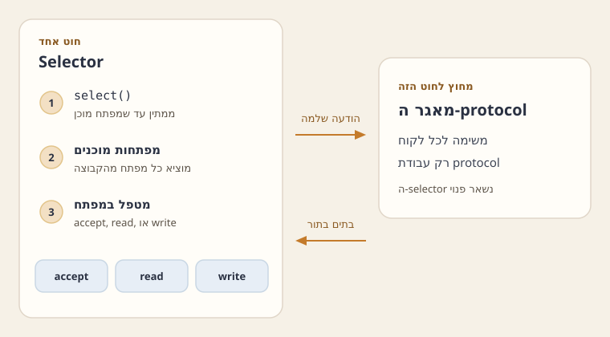

A server cannot stop the world inside `accept`.

- **Problem** — blocking work on the accepting thread stalls every other client.
- **Choices** — thread-per-client versus one selector thread that dispatches ready channels.
- **This chapter** — compares those architectures and walks the reactor pattern used in the course.

## Comparing server architectures

- **`accept`:** returns one new connection, and the thread that accepted it must be free for the next client.
- **Blocking on that thread** stalls every other connection.
- **A blocked read, frame, or query** means no further `accept`, and no read of a client that is already ready.
- **Thread per client:** moves the blocking work off the accepting thread, at the cost of a stack and a context switch for every connection, including the idle ones.
- **Reactor pattern:** keeps one thread waiting in `select` — in Java NIO, on a `Selector` — and dispatches the non-blocking channels that are ready.
- **Byte copies:** stay on that selector thread; a heavy call there stalls every client, so protocol work runs on a fixed pool of workers.

Two common shapes:

- **Thread-per-client** runs a separate thread for each connection.
- **That model** does not scale to thousands of connections. Each thread owns a stack, and the processor spends time switching among them.
- **Reactor** uses one selector thread for many network events (`OP_ACCEPT`, `OP_READ`, `OP_WRITE`) on non-blocking channels.
- **That thread** copies bytes and returns to `select`.
- **Heavy protocol work** goes to a fixed pool of worker threads shared across connections.

:::definition id=def-reactor title="Java NIO pieces of the reactor" source="materials/lectures/Chapter 11 - Reactor.pptx"

- **`Selector`:** the Java NIO object one thread waits on. `select` returns when registered channels are ready, and that thread dispatches the ready non-blocking channels.
- **`ServerSocketChannel` / `SocketChannel`:** channels that can be set to non-blocking mode with `configureBlocking(false)`.
- **`SelectionKey`:** the registration of a channel with the selector. The interest set names the operations to watch (`OP_ACCEPT`, `OP_READ`, `OP_WRITE`). `readyOps()` reports which of those operations are ready.
- **`ByteBuffer`:** a memory buffer used for reading and writing.
:::



## ByteBuffer indexes

The class `ByteBuffer` keeps three indexes: `position`, `limit`, and `capacity`.

- **`channel.read` and `put`:** write into the buffer and advance `position`.
- **`flip`** switches the buffer from writing into it to reading out of it.
- **`limit`** becomes the current `position`, and `position` becomes 0, so the next `get` or `channel.write` walks the bytes just stored.
- **`clear`:** sets `position` to 0 and `limit` to `capacity`, which prepares the same buffer for another fill.

```java
ByteBuffer buf = ByteBuffer.allocate(1024);
channel.read(buf);   // Read bytes from channel into buffer (position advances)
buf.flip();          // Prepare for reading from buffer: limit = position, position = 0
channel.write(buf);  // Write bytes from buffer to channel
buf.clear();         // Reset buffer for writing: position = 0, limit = capacity

```


:::trap
Leaving `OP_WRITE` set while the write queue has nothing to send makes `select` spin.

- **Ready channel:** the channel is already ready for writing, so `select` returns at once and the loop runs again.
- **Fix:** set `OP_WRITE` only while the write queue holds bytes, and clear it once the last of those bytes has been written.
:::

:::problem id=worked-flip title="Flipping a buffer" source="materials/sessions/SPL_PS10.pptx" kind=worked solution_origin=source
You have just read 5 bytes and want to write those bytes. What does `flip` change?

```java
ByteBuffer buf = ByteBuffer.allocate(16);
channel.read(buf);    // position == 5, limit == 16
buf.flip();
channel.write(buf);
```

:::solution

- **`flip`:** sets `limit` to 5 and `position` to 0, and switches the buffer from writing into it to reading out of it.
- **`channel.write(buf)`:** writes those five bytes; capacity is still 16.
- **Skipping `flip`:** starts the write at position 5 and stops at limit 16, which is the empty tail, so nothing useful is sent.
- **Second `flip`:** sets `limit` to 0, because `position` is already 0.
:::
:::

:::check id=chk-write-interest
A channel's write queue is empty, and `OP_WRITE` is still set. What does the selector thread do?

- [ ] It blocks in `select` until the client sends a byte
- [x] It spins, because the channel is already ready for writing
- [ ] It closes the channel

- **Write readiness:** a channel with free space in its send buffer is ready for writing, so `select` returns at once.
- **Spin:** that loop is a spin; clear `OP_WRITE` from the interest set until a later step has placed a reply on the write queue.
:::

## Practice

:::problem id=ps10-flip title="position after flip" source="materials/sessions/SPL_PS10.pptx" kind=exercise solution_origin=source
A buffer was `clear`ed at capacity 8, then three bytes were `put`.

:::check id=ps10-flip-q1
Which of these hold before `flip`?

- [ ] After three `put` calls, `limit` is 3
- [x] After `clear`, position is 0, limit is 8, and capacity is 8
- [ ] After three `put` calls, capacity is 3
- [x] After three `put` calls, position is 3 and limit is 8

- **After `clear`:** position 0, limit 8, capacity 8.
- **After three `put` calls:** position 3, limit 8, capacity 8.
:::

:::check id=ps10-flip-q2
After `flip`, `position` is {{=0|3|8}} and `limit` is {{=3|8|0}}.

After `flip`: position 0, limit 3, capacity 8.
:::

:::check id=ps10-flip-q3
What does `channel.write` send?

- [x] The three bytes in `[position, limit)`
- [ ] The five bytes past `limit`
- [ ] All eight bytes of capacity
- [ ] Nothing, because `position` is 0

- **`channel.write`:** sends the bytes in `[position, limit)`, which is those three bytes.
- **Past `limit`:** the other five lie past `limit` and are not sent.
:::
:::

:::problem id=ps11-actor-order title="Task order" source="materials/sessions/SPL_PS11.pptx" kind=exercise solution_origin=source
A client sends message M1 and then M2. The server creates tasks R1 and R2.

:::check id=ps11-actor-order-q1
Why can an ordinary pool start R2 before R1?

- [ ] The selector thread runs R2 before it enqueues R1
- [x] `execute(R1)` and `execute(R2)` are two tasks, and two free workers can start R2 first
- [ ] The pool records that both tasks belong to one channel and still prefers R2
- [ ] R1 and R2 share one worker, so the later submit runs first

- **Ordinary pool:** with two free workers can start R2 first.
- **Per-channel record:** an ordinary pool keeps no record that the two tasks belong to one channel.
:::

:::check id=ps11-actor-order-q2
An actor pool keeps a {{=queue for that client|single queue for every client|lock inside select}} and will not start R2 while R1 is still running for the same {{=actor|selector|port}}.

An actor pool keeps a queue for that client and will not start R2 while R1 is still running for the same actor.
:::

:::check id=ps11-actor-order-q3
Which of these hold?

- [ ] The selector thread runs the protocol for R1 and R2
- [x] Different clients still run concurrently, on the pool's threads
- [x] The selector thread only enqueues
- [x] An ordinary pool is the wrong tool for a protocol that assumes messages stay in order

- **Concurrency across clients:** different clients still run concurrently, on the pool's threads.
- **Selector role:** the selector thread only enqueues.
- **Ordered protocol:** an ordinary pool is the wrong tool for a protocol that assumes messages stay in order.
:::
:::

:::problem id=ps11-write-interest title="Write interest" source="materials/sessions/SPL_PS11.pptx" kind=exercise solution_origin=source
Four reactor mistakes:

- **`OP_WRITE` left set:** stays set while the write queue is empty.
- **Unbounded read:** a read with no size bound, so the buffers grow without limit.
- **Selector blocking:** heavy or blocking work on the selector thread.
- **`interestOps` off-thread:** a call to `interestOps` from a thread other than the selector thread.

:::check id=ps11-write-interest-q1
Which mistake burns a core while no client is sending?

- [ ] A read with no size bound, so the buffers grow without limit
- [ ] Heavy or blocking work on the selector thread
- [x] `OP_WRITE` stays set while the write queue is empty
- [ ] `interestOps` from a thread other than the selector thread

Leaving `OP_WRITE` set on an idle channel is the spin. The channel is ready for writing, so `select` never blocks.
:::

:::check id=ps11-write-interest-q2
After the last queued byte has been written, the interest set goes back to {{=OP_READ alone|OP_WRITE alone|OP_READ together with OP_WRITE}}.

After the last queued byte has been written, put the interest set back to `OP_READ` alone: `key.interestOps(SelectionKey.OP_READ)`.
:::

:::check id=ps11-write-interest-q3
When is `OP_WRITE` set again?

- [ ] While the write queue is empty, so `select` stays awake
- [ ] From a pool thread, as soon as the protocol returns
- [x] When a protocol reply has been queued and `write` did not accept every byte
- [ ] On every channel, for the whole life of the connection

Set `OP_WRITE` again only when a protocol reply has been queued and `write` did not accept every byte.
:::

:::check id=ps11-write-interest-q4
Which of these hold?

- [ ] `interestOps` from another thread is the same bug as the spin
- [x] The `interestOps` call that clears `OP_WRITE` is made on the selector thread
- [ ] Clearing `OP_WRITE` is what makes `select` spin
- [x] Calling `interestOps` from another thread is a separate bug

- **Clearing `OP_WRITE`:** make that `interestOps` call on the selector thread.
- **Other thread:** calling `interestOps` from another thread is a separate bug.
:::
:::

:::examnote
The question edits the reactor from the appendix. It moves framing off the selector, bounds the work per client, adds a log, or serves a database query while `select` keeps running. The trap is a heavy call on the selector thread, which stalls every client, or leaving `OP_WRITE` set so that `select` spins forever.
:::

:::problem id=exam-15a-q3 title="A reactor over UDP" source="materials/exams/15-a.pdf" kind=exam solution_origin=source
Keep the reactor, and talk to every client through one `DatagramSocketChannel`. There is no TCP `SocketChannel` per client. `send` and `receive` are non-blocking and return immediately. `receive` returns the sender's address, or null when nothing has arrived.

:::check id=exam-15a-q3-q1
Which of these match the change?

- [ ] Keep `ConnectionAcceptor` and accept datagram connections
- [x] Remove `ServerSocketChannel` and `SocketChannel`
- [x] Delete `ConnectionAcceptor`
- [x] Create one non-blocking `DatagramSocketChannel`, bound to the port, and register it for reading and writing

Remove `ServerSocketChannel` and `SocketChannel`, create one non-blocking `DatagramSocketChannel` bound to the port, and register it for `OP_READ | OP_WRITE`. Delete `ConnectionAcceptor`.
:::

:::check id=exam-15a-q3-q2
`receive` learns the sender's {{=SocketAddress|SocketChannel|SelectionKey}}. The output queue holds pairs of {{=address and buffer|channel and selector|port and key}}.

- **One `ConnectionHandler`:** calls non-blocking `receive` into a `ByteBuffer` and learns the `SocketAddress`.
- **Protocol tasks:** carry that address; `write` sends through the datagram channel to the stored address.
- **Output queue:** holds pairs `(address, buffer)`.
:::

:::check id=exam-15a-q3-q3
What advantage does UDP give this server?

- [x] It skips the handshake and the socket per client
- [ ] It keeps every datagram, in send order
- [ ] It gives `accept` a connection to split off
- [ ] It needs one channel per client to stay reliable

UDP skips the handshake and the socket per client.
:::

:::check id=exam-15a-q3-q4
Which of these hold?

- [x] UDP can drop datagrams or change their order
- [ ] A channel per client makes delivery reliable
- [x] One channel is what this design uses, because UDP has no connection for `accept` to split off
- [x] The remote address is the key that separates clients

- **UDP reliability:** UDP can drop datagrams or change their order.
- **One channel:** one channel is what this design uses, because UDP has no connection for `accept` to split off.
- **Client key:** the remote address separates clients; a channel per client adds state the protocol does not use while delivery stays unreliable.
:::
:::

:::problem id=exam-16b-q3 title="Executor fairness" source="materials/exams/16-b.pdf" kind=exam solution_origin=derived
The reactor's executor chooses a task with no regard for how many bytes this client has already transferred, and with no regard for how many of this client's requests have already been served. A busy client can be chosen forever.

:::check id=exam-16b-q3-q1
Which scenario is unfairness by bytes transferred?

- [ ] Client A had a thousand requests and client B had one, and a FIFO queue keeps serving A because A arrives more often
- [x] Client A sent one huge upload and client B sent a few bytes, and the executor always prefers A, so B waits
- [ ] The selector thread scans every client on every event and picks A
- [ ] A and B have the same byte count, so the queue freezes

Client A sent one huge upload and client B sent a few bytes. If the executor always prefers A, then B waits behind a client that has already consumed most of the bandwidth.
:::

:::check id=exam-16b-q3-q2
Which scenario is unfairness by requests already served?

- [ ] A huge upload is always preferred over a few bytes
- [ ] B is served first because B already has the smaller request count
- [x] A FIFO queue among ready tasks keeps A ahead because A arrives more often, while B's request count stays the smaller one
- [ ] The worker takes the client with the most requests so far

- **Setup:** client A had a thousand requests and client B had one.
- **FIFO queue:** if the queue is FIFO among ready tasks, A stays ahead simply because A arrives more often, and B's request count stays the smaller one while A is served again.
:::

:::check id=exam-16b-q3-q3
The fewest-bytes policy orders tasks by {{=the client's byte count, ascending|the client's byte count, descending|arrival order}}. The fewest-requests policy orders them by {{=requests already served|bytes still waiting|the selector's ready set}}. The worker takes the {{=minimum|maximum|newest task}}.

Place tasks on a queue ordered by the client's byte count, ascending, for the first policy, and by the count of requests already served for the second policy. The worker takes the minimum.
:::

:::check id=exam-16b-q3-q4
A `PriorityBlockingQueue` freezes `compareTo` at insertion. What follows?

- [ ] Every waiting task moves as soon as a counter changes
- [ ] Protocol work moves onto the selector thread
- [x] A task does not move when the counter changes later, so reinsert it or keep the count from insertion time
- [ ] A brand-new heavy client jumps ahead of a client who has been waiting with a low count

- **Frozen priority:** a `PriorityBlockingQueue` that freezes `compareTo` at insertion will not move a task when the counter changes later, so either reinsert the task or record that the key is the count at insertion time.
- **Waiting clients:** that still keeps a brand-new heavy client from jumping ahead of a client who has been waiting with a low count.
:::
:::

:::problem id=exam-17a-q3 title="Where framing runs" source="materials/exams/17-a.pdf" kind=exam solution_origin=derived
Today the selector thread reads a `ByteBuffer`, and a pool thread frames the bytes and runs the message. A student wants the selector thread to frame as well, and to submit one `Runnable` per message.

:::check id=exam-17a-q3-q1
After `channel.read`, the framing loop runs on the {{=selector thread|pool thread|logger thread}}. Each complete message becomes a {{=Runnable submitted to the executor|second read on the channel|change to the interest set}}.

On the read path, after `channel.read`, run the framing loop on the selector thread. Each complete message becomes a `Runnable` submitted to the executor, and the pool receives one complete message per task.
:::

:::check id=exam-17a-q3-q2
Where does this change do harm?

- [ ] The selector returns to `select` after the copy, and the pool scans the buffer
- [x] The selector scans a large buffer before it returns to `select`, so `accept` and other clients' reads wait
- [ ] A slow protocol lowers `ioThroughput` while `compThroughput` stays high
- [ ] The pool is given the channel before any bytes are copied

- **Large buffer on selector:** one client sends a large buffer that frames into many messages, or a framer scans a megabyte, and the selector thread does that scan before it returns to `select`.
- **Stall:** `accept` and the reads of other clients wait, because a heavy call on the selector thread stalls every client.
:::

:::check id=exam-17a-q3-q3
Which pairing of the two counters is right?

- [ ] `ioThroughput` counts finished `process` calls, and `compThroughput` counts bytes beside `read` and `write`
- [x] `ioThroughput` is bytes read plus bytes written on the selector thread, and `compThroughput` counts messages whose `process` has returned
- [ ] Both counters increase beside `read` and `write`
- [ ] Both counters increase in the pool task

- **`ioThroughput`:** bytes read plus bytes written on the selector thread, divided by the elapsed time, with counters beside `read` and `write`.
- **`compThroughput`:** the number of messages whose protocol `process` has returned, divided by the elapsed time, and that counter increases in the pool task.
:::

:::check id=exam-17a-q3-q4
What does a slow protocol do to the two numbers?

- [ ] It lowers `ioThroughput` and leaves `compThroughput` high
- [ ] It lowers both, because they measure the same stage
- [x] It lowers `compThroughput` while `ioThroughput` stays high
- [ ] It stops `select`, so both counters freeze

The two numbers measure different stages, so a slow protocol lowers `compThroughput` while `ioThroughput` stays high.
:::

:::
:::problem id=exam-18a-q3 title="A saturated selector" source="materials/exams/18-a.pdf" kind=exam solution_origin=derived
The selector thread is saturated. Shraga says: add workers to the actor pool, and move the server to a machine with more processors, in order to take load off the selector. Nahum's team adds capacity on the selector side.

:::check id=exam-18a-q3-q1
Does Shraga's change take load off this selector?

- [x] No. Those calls stay on the one selector thread, and the extra actor threads stay idle while the time sits in `select` and the byte copies
- [ ] Yes. The extra actor threads run `select`, `accept`, `read`, and `write`
- [ ] Yes. A larger machine splits that one thread across the new processors
- [ ] No. Extra workers hurt even when the pool is the saturated part

- **Selector thread:** `select`, `accept`, `read`, and `write` run on the one selector thread, so extra actor threads stay idle when the CPU time sits inside `select` and the byte copies.
- **More processors:** a larger machine does not split one thread by itself.
:::

:::check id=exam-18a-q3-q2
Which of these hold?

- [ ] A second processor splits one selector thread by itself
- [x] Shraga's change helps when the pool is the saturated part
- [ ] Extra actor threads run `select`
- [x] Here the selector is the saturated part, so those extra workers do not take its load

Shraga's change helps when the pool is the saturated part. The question says the selector is the saturated part.
:::

:::check id=exam-18a-q3-q3
Leave the selector loop for {{=readiness and byte copies|framing and log writes|protocol tasks}}. Move {{=framing and every log write|select and accept|the pool lock}} out of that loop. If one thread still cannot copy bytes fast enough, split the channels across {{=several reactors|a larger actor pool|more logger threads}}.

- **Selector loop:** leave it for readiness and for byte copies, and move framing and every log write out of that loop.
- **Several reactors:** if one thread still cannot copy bytes fast enough, split the channels across several reactors, each with its own selector and its own port or its own subset of channels.
- **Pool threads:** keep the selector's lock off the pool threads.
:::
:::

:::problem id=exam-18b-q3 title="A misleading measurement" source="materials/exams/18-b.pdf" kind=exam solution_origin=derived
Shraga measures a thread-per-client server and a reactor by sending a few requests from his laptop. The thread-per-client server answers faster, so he tells the company to switch. Nahum says the conclusion is wrong.

:::check id=exam-18b-q3-q1
Which of these explain Shraga's faster thread-per-client result?

- [x] His client count is too small to pay for a thread per connection
- [ ] His run already holds a thousand stacks parked in `read`
- [x] The protocol runs on the connection's thread, with no handoff to a pool
- [ ] The reactor skips `select`, the buffers, and the queue for a few requests

- **Small client count:** Shraga's client count is too small to pay for a thread per connection, and his requests never hold a thousand stacks parked in `read`.
- **Thread-per-client path:** one thread per client can be faster there, because the protocol runs on the connection's thread with no handoff to a pool.
- **Reactor overhead:** the reactor pays for `select`, for buffers, and for the queue.
:::

:::check id=exam-18b-q3-q2
A fair measurement holds {{=thousands of connections open|five requests from a laptop|one thread per core}} and counts {{=how many requests per second complete|the latency of those five requests|how many stacks the reactor allocates}}.

A fair measurement holds thousands of connections open and counts how many requests per second complete. The latency of five requests from a laptop is a different number, and it is the number Shraga reported.
:::

:::check id=exam-18b-q3-q3
Which of these hold for the company's load?

- [ ] The reactor creates one thread for each idle connection
- [x] Under many connections, most of them idle, a thread-per-client server runs out of memory on stacks
- [x] Under a burst, a thread-per-client server creates threads with no ceiling
- [x] The reactor keeps one selector thread and a bounded pool

Under many connections, most of them idle, a thread-per-client server runs out of memory on stacks, and under a burst it creates threads with no ceiling. The reactor keeps one selector thread and a bounded pool.
:::
:::

:::problem id=exam-19a-q3 title="What an actor pool promises" source="materials/exams/19-a.pdf" kind=exam solution_origin=derived
The actor pool promises two things for each connection. At most one request of that connection runs at a time. If request 1 arrived before request 2, reply 1 is sent before reply 2.

:::check id=exam-19a-q3-q1
Each client has a {{=request queue|shared task list|selected-key set}} and a chain that means a task for this client is already in the pool. The selector submits a pool task only when that chain was {{=idle|busy|closed}}.

Each client has a request queue and a flag, or a chain, meaning a task for this client is already in the pool. The selector enqueues an arrival and submits a pool task only when the chain was idle.
:::

:::check id=exam-19a-q3-q2
Which of these hold?

- [ ] Two requests of one client run together on two workers
- [x] Two requests of one client never run together
- [x] They run in arrival order, so the replies are queued in that order
- [x] The selector writes those replies in queue order

- **Per request:** the task runs the protocol for the request at the head, queues the reply bytes for the selector to write, and then starts the next request of the same client when the queue still holds one.
- **Promises:** two requests of one client never run together, and the selector writes the replies in queue order.
:::

:::check id=exam-19a-q3-q3
Which change breaks a promise?

- [ ] Keep the chain, and let the same worker pull the next request
- [x] Submit every request to a shared pool with no per-client chain
- [ ] Queue the reply bytes for the selector to write
- [ ] Start the next request of the same client only when its queue still holds one

Submit every request to a shared pool with no per-client chain. Pool throughput goes up, and the order promise is gone.
:::

:::check id=exam-19a-q3-q4
Which change is worth making?

- [ ] Drop the per-client chain so two requests of one client can run together
- [ ] Allocate a new `Runnable` for every message, even while that client's chain is busy
- [x] Keep the chain, and skip a new `Runnable` when the same worker pulls the next request
- [ ] Have the selector send reply 2 before reply 1

Keep the chain, and skip allocating a new `Runnable` for every message when the same worker can pull the next request itself. That edit keeps both promises.
:::
:::

:::problem id=exam-19b-q3 title="The next request on the same worker" source="materials/exams/19-b.pdf" kind=exam solution_origin=derived
When a worker finishes a request, it runs the next waiting request of the same client on that same worker, with no new `Runnable`, until that client's queue is empty. The selector does the I/O. The workers run the protocol.

:::check id=exam-19b-q3-q1
The worker takes the next message under the client lock, then {{=releases the lock|calls interestOps|submits a new Runnable}}, then calls `protocol.process`, then {{=queues the reply|writes the socket|clears OP_READ}}.

The `run` of that task is a loop: take the next message under the client lock, release the lock, call `protocol.process`, queue the reply, and then try again.
:::

:::check id=exam-19b-q3-q2
The reply bytes sit in `buf`. Which line is the bug?

```java
void run(Client client) {
    while (true) {
        Message msg;
        synchronized (client) {
            if (client.queue.isEmpty()) {
                client.running = false;
                return;
            }
            msg = client.queue.remove();
        }
        protocol.process(msg);
        client.channel.write(buf);
    }
}
```

- [ ] `client.running = false` when the queue is empty
- [ ] `client.queue.remove()` under the client lock
- [x] `client.channel.write(buf)`
- [ ] `protocol.process(msg)` after the lock is released

Replies still leave through the write queue, so the selector thread remains the only thread that touches `interestOps` and the channel.
:::

:::check id=exam-19b-q3-q3
Which of these hold?

- [x] `execute` still submits one task when the client was idle
- [ ] A second `Runnable` is allocated for a message already queued while the worker was alive
- [x] After the running flag is cleared, a new message makes the selector submit one new task
- [x] When the queue is empty, the loop clears the running flag

- **`execute`:** still submits one task when the client was idle.
- **Running flag:** the loop clears it when the queue is empty, and a new message after that makes the selector submit one new task.
- **No extra `Runnable`:** a second `Runnable` is not allocated for a message that was already queued while the worker was alive.
:::
:::

:::problem id=exam-20a-q3 title="Logging off the selector thread" source="materials/exams/20-a.pdf" kind=exam solution_origin=derived
`Logger` wraps an `OutputStream` and records server actions. Two workers may log at once. The selector thread stays off the disk.

:::check id=exam-20a-q3-q1
Workers and the selector place a finished line, a `byte[]`, on a {{=BlockingQueue owned by the logger|write queue of the client|ByteBuffer of the channel}}. A single logger thread then {{=takes and writes the stream|calls select|changes interestOps}}.

Workers and the selector place a finished line, a `byte[]`, on a `BlockingQueue` owned by the logger. A single logger thread does `take` and writes to the stream.
:::

:::check id=exam-20a-q3-q2
Why does each log line stay whole?

- [x] One logger thread writes the lines
- [ ] Both workers write the `OutputStream`, and the disk orders the bytes
- [ ] The selector thread writes the line before the next `select`
- [ ] Each worker holds the selector lock across the write

Lines stay whole because one thread writes them. The selector thread never blocks on the disk.
:::

:::check id=exam-20a-q3-q3
Which of these hold when the queue is bounded?

- [ ] A `put` from the selector thread is how it waits for disk space
- [x] A full queue drops log lines or counts them
- [x] The selector only offers a line when the queue has room
- [ ] Logger methods that workers call write the stream before they return

- **Bounded queue:** when the queue is bounded, a full queue drops log lines or counts them.
- **Selector:** a `put` from the selector thread would stop `select`, so the selector only offers a line when the queue has room.
- **Worker logger methods:** logger methods that workers call only enqueue.
:::

:::check id=exam-20a-q3-q4
Where do formatting and the stream write run?

- [ ] On the selector thread, inside `select`
- [ ] On each worker, inside a lock the other workers wait on
- [ ] On the client connection, as a reply
- [x] On the logger thread, outside any lock the workers hold

Formatting and the stream write run on the logger thread, so a slow disk sits outside any lock the workers hold.
:::
:::

:::problem id=exam-24a-q3 title="Communication threads" source="materials/exams/24-a.pdf" kind=exam solution_origin=derived
A student changes `Reactor.handleReadWrite` so that it hands the ready key to `Executors.newFixedThreadPool(2)`, under the name `communicationThreads`.

:::check id=exam-24a-q3-q1
Which of these make two communication threads on one selector unsafe?

- [ ] They run the protocol only on a message that has already been copied
- [x] They race on `selector.selectedKeys()`
- [x] They can change the interest set while `select` is using it
- [x] A read and a write on the same channel from two threads tear the handler's `ByteBuffer`

- **Key set race:** two pool threads that pull keys race on the key set and can change the interest set while `select` is using it, so the selector can throw or miss an event.
- **Shared buffer:** a read and a write on the same channel from two threads also tear the `ByteBuffer` the handler holds.
:::

:::check id=exam-24a-q3-q2
Leave {{=select, accept, read, write, and interestOps|the protocol and the database query|handleReadWrite on the pool of two}} on one thread.

`selector.selectedKeys()`, `key.interestOps`, and `channel.read` on a channel registered with this selector are the selector thread's work. Leave `select`, `accept`, `read`, `write`, and `interestOps` on one thread.
:::

:::check id=exam-24a-q3-q3
If the pool of two is kept, what may it run?

- [ ] `handleReadWrite` itself, on keys from this selector
- [ ] `channel.read` and `channel.write`, split across the two threads
- [x] A message that has already been copied: run the protocol, then queue the reply bytes
- [ ] `interestOps`, so `select` does not see the key set

- **Allowed work:** the pool of two, if you keep it, receives a message that has already been copied, runs the protocol, and then queues the reply bytes.
- **Actor pool:** that pool is the actor pool the reactor already has.
- **Reject:** pointing `handleReadWrite` itself at a pool of two is the change to reject.
:::

:::check id=exam-24a-q3-q4
Where does a database query belong?

- [x] On that protocol task, inside the pool
- [ ] On the selector thread, before the next `select`
- [ ] On both communication threads at once
- [ ] Inside `handleReadWrite` on the pool of two

A database query belongs on that protocol task, inside the pool, so a slow query does not stop `select`.
:::
:::

:::problem id=exam-24b-q3 title="A warehouse server" source="materials/exams/24-b.pdf" kind=exam solution_origin=derived
A logistics warehouse stores volunteers, evacuated families, and food parcels. `DB` is thread-safe, it has an empty constructor, and `executeQuery` returns the rows or throws `SQLException`. A client sends a query string. One `DB` serves every connection. The server has ten worker threads.

:::check id=exam-24b-q3-q1
Which line is the bug?

```java
public static void main(String[] args) throws Exception {
    new Reactor(Integer.parseInt(args[0]), 10,
        () -> new DBProtocol(new DB()),
        () -> new LineTokenizer()).serve();
}
```

- [ ] `Integer.parseInt(args[0])`
- [ ] The pool size `10`
- [x] `() -> new DBProtocol(new DB())`
- [ ] `() -> new LineTokenizer()`

Constructing `DB` inside the protocol factory builds one database per connection. Startup is heavy, so the factory captures the one `DB` from `main`: `() -> new DBProtocol(db)`.
:::

:::check id=exam-24b-q3-q2
Which body is correct for `DBProtocol.process`?

```java
// Body A
try {
    List<String> rows = db.executeQuery(msg);
    if (rows.isEmpty()) return "Result No";
    return rows.get(0);
} catch (SQLException e) {
    return e.getMessage();
}
```

```java
// Body B
List<String> rows = db.executeQuery(msg);
return rows.toString();
```

```java
// Body C
try {
    List<String> rows = db.executeQuery(msg);
    if (rows.isEmpty()) return e.getMessage();
    return "Result No";
} catch (SQLException e) {
    return rows.get(0);
}
```

- [ ] Body B, which returns every row and does not catch `SQLException`
- [x] Body A, which returns the first row, `"Result No"`, or the error text
- [ ] Body C, which returns the error text for an empty list and the first row from the catch

`DBProtocol.process` calls `db.executeQuery(msg)` inside a try. On a non-empty list it returns `rows.get(0)`, on an empty list it returns `"Result No"`, and on `SQLException` it returns `e.getMessage()`.
:::

:::check id=exam-24b-q3-q3
Where does a slow query run?

- [ ] On the selector thread, before the next `select`
- [ ] Inside the `DB` constructor, once per connection
- [x] On a worker in the pool of 10, while the selector thread stays in `select`
- [ ] On a new thread created for that query alone

The classroom reactor submits `process` to the pool of 10, so a slow query runs on a worker while the selector thread stays in `select`.
:::

:::check id=exam-24b-q3-q4
Which of these hold?

- [x] `DB` is thread-safe, so the ten workers may call it
- [ ] The protocol factory should construct a new `DB` for each connection
- [x] One `DB` is created in `main` and captured by the protocol

`DB` is thread-safe, so the ten workers may call it. One `DB` is created in `main` and captured by the protocol.
:::
:::

:::problem id=exam-24c-q3 title="A reply of another type" source="materials/exams/24-c.pdf" kind=exam solution_origin=derived
A client sends a message of type A and receives a reply of type B. `DB.executeQuery` returns `ArrayList<String>` and is thread-safe. `DBServer` uses `BaseServer` and the `ObjectEncoderDecoder` that already exists. One `DB` serves every client.

:::check id=exam-24c-q3-q1
`MessagingProtocol<T>` becomes {{=MessagingProtocol<T, R>|MessagingProtocol<T>|MessageEncoderDecoder<T>}}, and `process` returns {{=R|T|void}}.

Change `MessagingProtocol<T>` to `MessagingProtocol<T, R>`, and have `process` return `R`.
:::

:::check id=exam-24c-q3-q2
Which of these hold?

- [ ] The selector loop gains a second thread for the reply type
- [x] The handler reads with an encoder-decoder of `T` and writes with an encoder-decoder of `R`, or one decoder understands both
- [x] The reactor's type arguments follow that split
- [ ] The reply type has to stay `T`

The connection handler reads with `MessageEncoderDecoder<T>` and writes with `MessageEncoderDecoder<R>`, or with one decoder that understands both, and the reactor's type arguments follow that split. The selector loop stays as it is.
:::

:::check id=exam-24c-q3-q3
Which signature completes `Command`?

```java
interface Command {
    {{=R execute(Context ctx)|void execute()|T process(String msg)}};
}
```

`Command` is `R execute(Context ctx)`. `RemoteCommandInvocationProtocol` holds the shared context, decodes a message into a `Command`, calls `execute`, and returns the result as the reply message.
:::

:::check id=exam-24c-q3-q4
`main` builds one `DB` and one `BaseServer`. The pool size is {{=11|10|1}}. The protocol factory is {{=() -> new RemoteCommandInvocationProtocol(db)|() -> new RemoteCommandInvocationProtocol(new DB())|ObjectEncoderDecoder::new}}. The encoder factory is {{=ObjectEncoderDecoder::new|LineTokenizer::new|() -> new DB()}}.

- **`main`:** builds one `DB` and one `BaseServer` with pool size 11, a protocol factory `() -> new RemoteCommandInvocationProtocol(db)`, and an encoder factory `ObjectEncoderDecoder::new`.
- **Query path:** the query command's `execute` calls `db.executeQuery`, the list that comes back is the reply object, the encoder writes it, and `executeQuery` runs inside the pool task.
:::
:::

The reactor moves bytes.

- **[Serialization](topic:serialization):** how those bytes become an object.
- **[Persistence](topic:persistence):** the database these protocol tasks query.

:::problem id=exam-20b-q3 title="Store prices" source="materials/exams/20-b.pdf" kind=exam solution_origin=derived
`Stores` maps a store name to the prices of its products.

- **Commands:** They arrive through the command-invocation protocol and run on one shared `Stores` object inside a Reactor on port 7777.
- **`GetProductPrices`:** It takes a product name and returns the map from store name to price.

:::check id=exam-20b-q3-q1
Which `execute` body is correct?

- [ ] `return stores.getProductsOfStore(product).toString();`
- [x] Walk `stores.getStores()`, and append `store=price` when `getProductsOfStore(store).get(product)` is not null
- [ ] Open a socket to port 7777 inside `execute` and write the product name

- **`execute`:** It receives the `Stores` object.
- **Walk:** It walks `stores.getStores()`, reads `stores.getProductsOfStore(store).get(product)`, and appends `store=price` when that price is not null.
- **Return value:** It is that string.
:::

:::check id=exam-20b-q3-q2
`main` creates `new StoresImpl()` {{=once|per connection|inside execute}}.

`main` creates `Stores stores = new StoresImpl()` once, then passes that same object into the protocol factory.
:::

:::check id=exam-20b-q3-q3
Which of these hold for the Reactor and the protocol?

- [x] The call is `new Reactor(7777, 10, () -> new CommandProtocol(stores), tokenizerFactory)`
- [ ] Each connection constructs a fresh `StoresImpl`
- [x] The protocol parses a line into a `Command<Stores>` and calls `execute(stores)`

`main` creates one `StoresImpl`, then `new Reactor(7777, 10, () -> new CommandProtocol(stores), tokenizerFactory)`. The protocol parses a line into a `Command<Stores>` and calls `execute(stores)`.
:::

:::check id=exam-20b-q3-q4
The methods of `StoresImpl` are synchronized, or the map is a {{=concurrent map|private map|socket}}, because the Reactor runs several commands at once on this one object.

The methods of `StoresImpl` are synchronized, or the map is a concurrent map, because the Reactor runs several commands at once on this one object.
:::
:::
