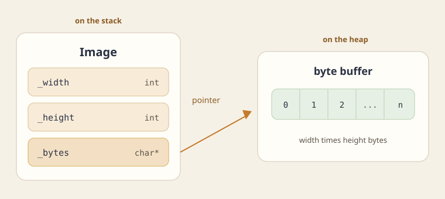

This chapter shows what goes wrong when a class owns memory through a pointer, and you let the compiler copy it field by field.

- **Copying:** passing or returning an object by value copies it, and the default copy shares the pointers, so two objects think they own the same memory.
- **Assignment:** assigning one existing object to another leaks the old memory and shares the new.
- **The rule of three:** the destructor, the copy constructor, and the assignment operator are the three functions you must write together to fix it.

## Copying an object

In C++ an object can be passed to a procedure by value, or returned from one by value. The object is then duplicated and copied from one activation frame to another. (This never happens in Java, because there an object variable always represents an address.)

How is the meaning of copying an object decided? For simple types, and for addresses, the meaning is clear. For objects it is not: should the copy be deep, or not, or something else?

In C++ the programmer decides what copying a class means, by writing a special constructor, called the **copy constructor**. Every time an object must be copied, when it is passed to or returned from a procedure, the compiler translates the copy into a call to that constructor.

Because it matters so much, the compiler defines a default copy constructor for every class, which copies field by field. For the `Student` class from [Classes and objects](topic:classes-and-objects), that default is this:

```cpp
class Student {
    ...
    Student(const Student& other)
        : _id(other._id), _name(other._name), _bag(other._bag),
          _books(other._books), _univ(other._univ)
    {}
};

void F(Student s) { ... }

{
    Student s(7, "ringo", new Bag7(), univ);
    F(s);
    cout << (*s.getBag());
}

```

- **The call `F(s)`** copies `s` into `F`'s frame. The copy's `_bag` holds the same address as `s._bag`, and its `_books` holds the same book addresses.
- **When `F` returns,** its copy of the student is destroyed, and `~Student` deletes the bag and the books.
- **Back in the block,** `*s.getBag()` reads a bag that was already deleted, and at the end of the block `~Student` deletes the same bag and books a second time.

If a class has no fields that are pointers, the default is enough. If it does, you must write a copy constructor that duplicates, in memory, the objects those fields point at.

```cpp
class Student {
    ...
    Student(const Student& other)
        : _id(other._id), _name(other._name), _univ(other._univ)
    {
        _bag = other._bag->clone();
        for (int i = 0; i < other._books.size(); i++)
            _books.push_back(other._books.at(i)->clone());
    }
};

class Bag7 : public Bag {
    ...
    virtual Bag* clone() { return new Bag7(*this); }
};

class DigitalBook : public Book {
    ...
    virtual Book* clone() { return new DigitalBook(*this); }
};

```

- **Why `clone` and not `new Bag(*other._bag)`:** `_bag` has the type `Bag*`, but the object it points at is a `Bag7`, or some other derived class the student does not know. A `virtual clone` method lets each class copy itself with its own copy constructor. [Inheritance and polymorphism](topic:inheritance) explains how the `virtual` call reaches the right class.
- **The result:** the copy inside `F` gets its own bag and its own books, at new heap addresses, and deleting them leaves the original student intact.

### The same bug with a byte buffer

The lecture slides show the same problem with an `Image` class.

- **The example:** an `Image` holds a `char* _bytes`, a buffer that its constructor (בנאי) allocated on the heap.
- **The copy:** copying the `Image` copies only that pointer, so both images point at one buffer.
- **The crash:** when the first image's destructor (הורס) releases the buffer, the other image is still using it, and later releases it a second time.

A destructor is named `~` followed by the class name. It takes no parameters and has no return type.

- **For `Image`:** `~Image()` calls `delete[] _bytes`.
- **In Java:** once no reference to an `Image` remains, the garbage collector eventually frees its byte array too.
- **In C++:** when an `Image` is destroyed, only the pointer itself disappears. The bytes it points at stay allocated unless the destructor releases them.



`void processImage(Image img)` takes the image by value, so calling it makes a copy.

- **At the call:** the copy constructor builds `img`. When the function returns, `img`'s destructor runs.
- **With the generated copy constructor:** `_width`, `_height`, and `_bytes` are copied as they are, so `img` and the caller's image point at the same array.
- **When the function returns:** `img`'s destructor runs `delete[]` on that shared array. The caller's `_bytes` is now a dangling pointer: it still holds the address, but the memory there has been released.

The fix is a copy constructor that allocates a new buffer and copies the other image's bytes into it.

```cpp
Image::Image(const Image& other)
    : _width(other._width), _height(other._height),
      _bytes(new char[_width * _height]) {
    std::memcpy(_bytes, other._bytes, _width * _height);
}
```

This constructor could also delegate to `Image(int, int, char*)`, so that the allocation code lives in only one place.

- **The result:** inside `processImage`, `img` now has a buffer of its own.
- **When it is destroyed:** its destructor releases only that buffer, and the caller's image is left intact.


## Assigning an object

In C++ you can assign one object to another. (In Java that is impossible, because objects in Java are addresses.)

```cpp
Student s1(7, "ringo", new Bag7(), univ);
...
Student s2(8, "jango", new Bag5(), univ);
...
s1 = s2;   // s1.operator=(s2);

```

What does this assignment mean? For simple types, and for addresses, assignment is clear, but for objects it is not (deep assignment, or not, and so on). In C++ the meaning of assignment is defined by the programmer, through a special method called the **assignment operator**. Because it matters so much, the compiler defines a default one, which assigns field by field.

```cpp
class Student {
    ...
    void operator=(const Student& other) {
        if (&other != this) {
            _id = other._id;
            _name = other._name;
            _bag = other._bag;
            _books = other._books;
            _univ = other._univ;
        }
    }
};

{
    Student s1(7, "ringo", new Bag7(), univ);
    ...
    {
        Student s2(8, "jango", new Bag5(), univ);
        ...
        s1 = s2;
        ...
    }
    cout << (*s1.getBag());
}

```

The default assignment causes two problems.

- **A memory leak:** the `Bag7` and the books that `s1` held are never deleted. Nothing points at them anymore.
- **Sharing:** the two objects now share the same bag and the same books. Deleting one of them leaves the other with a dangling bag and dangling books, which is exactly what happens when the inner block ends and `s2` is destroyed.

Here too the default is not enough when a class has pointer fields. Write the assignment so that it copies the content and not the addresses, and releases what the object held before.

```cpp
class Student {
    ...
    void operator=(const Student& other) {
        if (&other != this) {
            _id = other._id;
            _name = other._name;
            delete _bag;
            _bag = other._bag->clone();
            // delete the old books
            for (int i = 0; i < _books.size(); i++)
                delete _books.at(i);
            // clear the old books' addresses
            _books.clear();
            // add copies of the other student's books
            for (int i = 0; i < other._books.size(); i++)
                _books.push_back(other._books.at(i)->clone());
            _univ = other._univ;
        }
    }
};

```

- **`if (&other != this)`** guards against `s1 = s1`. Without it, the method would delete its own bag and then try to clone it.

To support `a = b = c`, which the compiler reads as `a.operator=(b.operator=(c))`, the operator must also return the object itself, so it can be used in a further assignment.

```cpp
class Student {
    ...
    Student& operator=(const Student& other) {
        if (&other != this) {
            ...   // as above
        }
        return *this;
    }
};

```

### Another way: copy and swap

The copy constructor fixes copies that create a new object. Assignment is a separate case, because the object on the left already exists and already owns a buffer.

```cpp
Image avi(1080, 1920, bytesAvi);
Image benni(1080, 1920, bytesBenni);
avi = benni;
```

Here both objects already hold a buffer before the assignment.

- **The generated assignment** copies `benni._bytes` into `avi._bytes`, so `avi` simply forgets its old array.
- **Two bugs at once:** `avi`'s old array is leaked, because nothing points at it anymore, and the two objects now share `benni`'s buffer.
- **The self-assignment trap:** a hand-written assignment that starts with `delete[]` breaks on `avi = avi`. It releases the buffer and then tries to copy from the memory it just released.

The standard way to write assignment is the copy-and-swap idiom.

```cpp
void Image::swap(Image& other) {
    std::swap(_width, other._width);
    std::swap(_height, other._height);
    std::swap(_bytes, other._bytes);
}

Image& Image::operator=(const Image& other) {
    Image temp(other);   // deep copy, through the copy constructor
    swap(temp);
    return *this;        // temp's destructor frees what used to be ours
}
```

Before the call, `avi` and `benni` each hold their own buffer.

- **Step 1:** `temp` is created as a third image, a deep copy of `benni`, with a new buffer.
- **Step 2:** `swap` exchanges the contents of `avi` and `temp`, so `avi` now holds the new buffer and `temp` holds `avi`'s old one.
- **Step 3:** when the function returns, `temp` is destroyed, and its destructor releases `avi`'s old buffer.
- **Why self-assignment is safe:** `temp` is always a separate copy, so swapping an object with a copy of itself leaves its values unchanged.

Assignment returns `*this` as an `Image&`, so that assignments can be chained the way they are for built-in types.

- **Chaining:** `=` groups from right to left, so `avi = benni = carmi` means `avi = (benni = carmi)`.
- **What that needs:** the inner assignment must give back an `Image` that the outer assignment can use as its argument.
- **Why a reference:** returning `*this` by reference gives back the object itself, without making another copy.


Copy-and-swap is also safe when allocation fails. An assignment that releases the old buffer first and then throws while allocating would leave the object broken.

- **Copy-and-swap allocates first**, inside `temp`, before it touches `avi`.
- **If that allocation throws**, `avi` has not been changed at all.

| | Copy constructor | Copy assignment operator |
| --- | --- | --- |
| The object on the left | does not exist yet | already holds a resource |
| Self-assignment | cannot occur | must be harmless |
| Releases the old buffer | no | yes |

:::problem id=worked-copy-and-swap title="Assignment by copy and swap" source="materials/lectures/Chapter 4 - Rule of Thee.pptx" kind=worked solution_origin=source
`avi` holds buffer A. `benni` holds buffer B. Follow `avi = benni` and say which buffer is released.

```cpp
Image& Image::operator=(const Image& other) {
    Image temp(other);   // deep copy of B into a new buffer B2
    swap(temp);          // avi gets B2, temp gets A
    return *this;        // ~Image on temp runs delete[] on A
}
```

:::solution
- **`Image temp(other)`** makes a deep copy of B in a new buffer, B2. At this point `avi` still owns A.
- **`swap(temp)`** makes `avi._bytes` point at B2, and `temp._bytes` point at A.
- **When the function returns,** `~Image` runs on `temp` and releases A with `delete[]`.
- **The result:** buffer A is the one released. `benni` still owns B, `avi` owns B2, and each object has its own buffer.
:::
:::

:::check id=chk-init-vs-assign
Which line calls the copy constructor?

```cpp
Image a(...);
Image b = a;
b = a;
```

- [ ] Both lines
- [x] Only `Image b = a`
- [ ] Only `b = a`

- **`Image b = a`** creates a new object, so it calls the copy constructor.
- **`b = a`** assigns to an object that already exists, so it calls the copy assignment operator.
- **Don't be fooled by `=`:** both lines contain it, but in a declaration it means initialization, not assignment.
:::

## The rule of three

:::definition id=def-rule-of-three title="The rule of three (חוק השלושה)" source="materials/lectures/Chapter 4 - Rule of Thee.pptx"
Write the destructor, the copy constructor (בנאי העתקה), and the assignment operator (אופרטור השמה) together: if a class needs one of them, it needs all three.

- **The destructor** releases the resources the object is responsible for.
- **The copy constructor** allocates new resources and copies the contents into them.
- **The assignment operator** does both jobs: it releases the resources this object already holds, and it makes a deep copy (העתקה עמוקה) of the other object.
- **`Image b = a`** creates a new object, so the copy constructor runs, even though the line contains `=`.
- **`b = a`** assigns to an object that already exists, so the assignment operator runs.

```cpp
Image a(...);
Image b = a;   // copy constructor, not assignment
b = a;         // assignment, both objects already exist
```
:::

These three methods define the meaning of a class in the basic scenarios of a programming language: removal from memory, passing by value, and assignment.

**Operator overloading.** Just as you can define the assignment operator, every class can define the meaning of the standard operators, such as `+`, `-`, `*`, `/`, `<`, `>`, `==`, `+=`, `[]`, and `<<`. This is an elegant and recommended way to design classes, but only assignment belongs to the rule of three, because it defines the basic semantics of the class.

:::trap
- **The wrong test:** `if (this == other)` compares a pointer (`this`) with an object (`other`), so it does not compile.
- **The right test:** `if (this == &other)` compares two addresses.
- **With copy-and-swap you need no test at all:** it releases the old buffer only after the copy exists, and the copy is always a separate object.
:::

:::trap
- **The question:** does every overloaded operator join the rule of three? For example, an `Image` may overload `operator()` so that `avi(x, y)` returns the pixel `_bytes[y * _width + x]`.
- **Why it does not matter here:** `operator()` is not one of the three special members, and an operator that only reads a value creates no ownership problem.
- **What does matter:** the rule of three is required because the class owns memory through a raw pointer.
:::

## Practice

:::problem id=ps3-rule-of-three title="The three functions of List" source="materials/sessions/SPL_PS3.pptx" kind=exercise solution_origin=source
`List` holds a `Node* head` that points at a chain of nodes allocated with `new`. The class still uses the special members that the compiler generates.

```cpp
class List {
    Node* head;
};
```

:::check id=ps3-rule-of-three-q1
`List b = a` uses the generated copy. What breaks?

- [ ] The program fails to compile, because a `Node*` cannot be copied
- [ ] `b` allocates its own chain
- [x] `b` and `a` share one chain. One destructor deletes the nodes, and the other deletes those same nodes again

The generated copy constructor copies only `head`, so both lists point at the same chain. After one destructor deletes the nodes, the other list holds a dangling pointer, and its destructor deletes the same nodes a second time.
:::

:::check id=ps3-rule-of-three-q2
Which bodies are required?

- [x] The destructor walks the chain and `delete`s every node
- [ ] The copy constructor copies `head` and shares the chain
- [x] The copy constructor allocates a new node for each element and points `head` at that new chain
- [x] Copy assignment releases the chain `this` already holds, then makes a deep copy, and returns `*this`

- **Why `List` needs all three:** its raw `Node*` does not manage the nodes on its own, so `List` must free them, copy them, and replace them itself.
- **When the generated members are fine:** when every member already manages its own memory, as `std::string` or `std::vector` do.
- **Why the second option is wrong:** sharing the chain is exactly the bug the rule of three prevents.
:::

:::check id=ps3-rule-of-three-q3
Copy-and-swap builds a {{=temporary|second list|reference}}, swaps the two `head` pointers, and lets that object's destructor release the old chain.

This way, assignment needs no new code of its own: it reuses the copy constructor to build the temporary and the destructor to release the old chain.
:::
:::

:::examnote
- **What the question looks like:** a small class with a raw pointer or raw array, and a request for its destructor and a deep copy constructor. Sometimes it is a two-dimensional board that needs both constructors.
- **The usual traps:** relying on the default memberwise copy, or writing an assignment that releases the old buffer before the new one exists.
:::

:::problem id=exam-15a-q2 title="A vector as a list" source="materials/exams/15-a.pdf" kind=exam solution_origin=source
A class `mvector<T>` behaves like a vector, but it stores its elements in a linked list of heap nodes instead of a contiguous array.

- **`insertAt`** allocates a new node and inserts it at position `pos`.
- **`removeAt`** removes a node and shrinks the list.
- **One proposal** drops the `_len` member and uses `sizeof(_head)` as the length.
- **The function `foo(mvector<T> vec)`** takes its argument by value.

:::check id=exam-15a-q2-q1
Which destructor matches this list, and which copy goes with it?

```cpp
// A
delete[] _head;
```

```cpp
// B
node<T>* current = _head;
while (current != nullptr) {
    node<T>* upcoming = current->_next;
    delete current;
    current = upcoming;
}
```

```cpp
// C
delete _head;
```

- [ ] A, together with a copy constructor that copies `_head` only.
- [x] B, together with a copy constructor that makes a deep copy of every node.
- [ ] C, together with a copy constructor that leaves every vector sharing one chain.

- **The destructor:** the elements are separate `node<T>` objects, each made with `new`, so the destructor must walk the list and `delete` each node. Option A uses `delete[]`, which is for arrays, and option C deletes only the first node.
- **The copy constructor:** it must deep-copy every node, so each vector owns its own nodes and its destructor releases only those.
:::

:::check id=exam-15a-q2-q2
`_len` is removed and the length is `sizeof(_head)`. Which statement is correct?

- [ ] 1. This works, and it returns the exact length.
- [ ] 2. The result has to be divided by `sizeof(T)`.
- [x] 3. On a 32-bit system the expression always returns 4.
- [ ] 4. A compilation error (`sizeof` cannot be applied to a template).
- [ ] 5. None of the answers is correct.

- **The answer:** statement 3 is correct.
- **Why:** `_head` is a pointer, and `sizeof` gives the size of the pointer itself, not of the list it points to.
- **On a 32-bit system** every pointer is 4 bytes, so the result is always 4, no matter how many elements the list holds.
:::

:::check id=exam-15a-q2-q3
Which description of the stack and the heap is right for `foo(mvector<T> vec)`?

- [ ] The parameter is another name for the caller's vector, so both share one `_head` cell on the stack.
- [ ] The nodes live in `foo`'s frame, next to `_head`.
- [x] A new `mvector` is created in `foo`'s stack frame, with its own `_head` and `_len`. A deep copy puts a new chain on the heap. A shallow copy leaves both stack pointers on one heap chain.

- **On the stack:** passing by value creates a new `mvector` in `foo`'s stack frame, with its own `_head` and its own `_len`.
- **On the heap, with a deep copy:** the nodes are duplicated into a new chain, and `vec._head` points at that new chain.
- **On the heap, with a shallow copy:** no nodes are copied, so the two `_head` pointers on the stack both point at the same chain.
:::
:::

:::examnote
- **What the question looks like:** an image repository stores its images through an array of pointers, and a function returns a local repository by value.
- **The usual traps:** assuming the returned object has its own copy of the pixels, and using the `sizeof` of a pointer as if it were a length.
:::

:::problem id=exam-20a-q1 title="An image repository" source="materials/exams/20-a.pdf" kind=exam solution_origin=derived
`Portrait` and `Scenery` are two kinds of image.

- **Pixels:** each pixel is a gray level from 0 to 255, and one image stores its pixels in a one-dimensional `BYTES` array, row after row.
- **The repository:** `ImageRepository` holds many images through an array of pointers named `_images`.
- **The constructor** allocates an array of `capacity` pointers.
- **`Insert`** receives an array of images, allocates a new array, and copies the pointers into it. The images' `BYTES` arrays are not copied.

```cpp
ImageRepository CreateEmptyRep() {
    ImageRepository rep;
    return rep;
}
```

:::check id=exam-20a-q1-q1
Which constructor and `Insert` match that design?

```cpp
// A
ImageRepository(int capacity)
    : _images(new Image*[capacity]), _capacity(capacity), _size(0) {}
void Insert(Image** src, int n) {
    Image** copy = new Image*[n];
    for (int i = 0; i < n; ++i) copy[i] = new Image(*src[i]);
    delete[] _images;
    _images = copy;
    _capacity = n;
    _size = n;
}
```

```cpp
// B
ImageRepository(int capacity)
    : _images(new Image*[capacity]), _capacity(capacity), _size(0) {}
void Insert(Image** src, int n) {
    Image** copy = new Image*[n];
    for (int i = 0; i < n; ++i) copy[i] = src[i]; // pointers only
    delete[] _images;
    _images = copy;
    _capacity = n;
    _size = n;
}
```

```cpp
// C
ImageRepository(int capacity)
    : _images(nullptr), _capacity(capacity), _size(0) {}
void Insert(Image** src, int n) {
    _images = src;
    _size = n;
}
```

- [ ] A. `Insert` allocates a new `Image` for each element, so the pixels are copied.
- [x] B. The constructor allocates `new Image*[capacity]`. `Insert` copies pointers into a new array. The `BYTES` blocks stay where they are.
- [ ] C. The constructor leaves `_images` null. `Insert` stores the caller's array and does not allocate.

- **The constructor in B** allocates `_images` with `new Image*[capacity]`, records the capacity, and starts with `_size` 0.
- **`Insert` in B** allocates a new array of pointers and copies only the pointers, as the design says.
- **Why not A:** it copies every image, and so every pixel, which the design does not ask for.
- **Why not C:** it never allocates its own array, and just keeps the caller's.
:::

:::check id=exam-20a-q1-q2
`Insert` releases the previous `_images` array with {{=delete[]|delete|no delete}}. It copies {{=pointers|pixels|BYTES blocks}}. Two repositories can hold the same {{=Image*|stack frame|BYTES block}}. A `delete` of an `Image` is safe only for a {{=sole owner|second repository|null pointer}}.

`Insert` copies pointers and releases the previous pointer array with `delete[]`. The pixel arrays stay where the images allocated them. Because only pointers are copied, two repositories can hold the same `Image*`, so deleting an `Image` is safe only for the one object that solely owns it.
:::

:::check id=exam-20a-q1-q3
What does `CreateEmptyRep` return?

- [ ] `return rep` returns the local object itself, so the destructor of `rep` does not run.
- [ ] The default copy constructor duplicates every `BYTES` array, so the caller owns new pixels.
- [x] `return rep` copies `_images`. If the destructor then executes `delete[] _images`, the returned object holds a dangling pointer. If it leaves the array allocated, the caller shares that buffer with a destroyed local, and other paths leak.

- **`rep`** is created in `CreateEmptyRep`'s stack frame.
- **`return rep`** returns by value, which in the course's model uses the copy constructor.
- **The default copy constructor** copies only the pointer `_images`. Then `rep` goes out of scope and its destructor runs.
- **If that destructor runs `delete[] _images`,** the returned object is left holding a dangling pointer.
- **If the destructor does not release the array,** repositories that are destroyed normally leak their arrays.
- **The fix:** give the class a proper copy constructor. Compilers often skip this copy entirely (an optimization called NRVO), but the code must be correct either way.
:::

:::check id=exam-20a-q1-q4
Which object is an empty repository?

- [x] `ImageRepository(capacity)` with `_size == 0` and a live array of pointers.
- [ ] The object returned by `CreateEmptyRep` after its destructor has executed `delete[] _images`.
- [ ] A repository whose `_images` still addresses the array of a local that has been destroyed.

- **A valid empty repository** is one built by `ImageRepository(capacity)`: its `_size` is 0, and it has a live array of pointers.
- **The other two options** hold a pointer to an array that was already released, so they are not usable repositories at all.
:::
:::

:::problem id=exam-17a-q2 title="Ownership of a description" source="materials/exams/17-a.pdf" kind=exam solution_origin=derived
`TestRes` holds a `char* description_`, and `Test` manages a collection of `TestRes` results. The design has three rules.

- **Ownership:** each result owns its own description buffer.
- **Copying:** a copy owns a separate copy of that buffer.
- **Assignment:** it releases the previous description exactly once.

:::check id=exam-17a-q2-q1
Which constructor body is required for that buffer?

- [ ] `: description_(s)`, so both objects share one buffer
- [x] `: description_(new char[std::strlen(s) + 1])`, then `std::strcpy(description_, s)`
- [ ] `: description_(new char[1])`, with no copy of the characters

The constructor allocates a new buffer with room for every character plus the terminating `'\0'`, which is why it adds 1 to `strlen`, and then copies the characters into it.
:::

:::check id=exam-17a-q2-q2
Which of these hold for the other special members?

- [x] The destructor is `delete[] description_`
- [ ] Assignment `delete[]`s `description_` and then reads that same buffer to build the new one
- [x] Assignment returns immediately when `this == &other`. Otherwise it builds a temporary, swaps the pointers, and returns `*this`

- **The destructor** releases the buffer with `delete[]`, because it was allocated with `new[]`.
- **The swap** hands the old buffer to the temporary, whose destructor releases it exactly once.
- **The self-assignment check** returns early, so `a = a` releases nothing.
- **Why the second option is wrong:** it reads the buffer after deleting it.
:::

:::check id=exam-17a-q2-q3
The copy constructor delegates with {{=TestRes(other.description_)|other|nullptr}}.

Delegating to `TestRes(other.description_)` reuses the constructor that already allocates a buffer and copies the characters, so the copy constructor needs no code of its own.
:::

:::check id=exam-17a-q2-q4
Which of these hold for `Test`?

- [x] An array of `TestRes*` is released with `delete[]` in the destructor
- [ ] Copying that array's pointer is enough
- [x] The copy constructor allocates a new array and copies each element
- [x] If `Test` stores `TestRes` by value in a container that already has the right special members, `Test` can keep the members the compiler generates

- **The same three operations apply to `Test`:** its array of `TestRes*` needs `delete[]` in the destructor, a new array with a copy of each element in the copy constructor, and copy-and-swap for assignment.
- **Copying the array pointer alone** would make two `Test` objects share one array.
- **The way out:** if `Test` stores its results by value in a standard container, the generated members already do the right thing.
- **The root cause:** the raw `char*` and the raw array are what force you to write the three functions.
:::
:::

:::problem id=exam-17b-q2 title="A deep copy of a board" source="materials/exams/17-b.pdf" kind=exam solution_origin=derived
`Terrain<T>` stores a game board as one heap block of `T`, with `width × height` cells.

```cpp
template <typename T>
class Terrain {
public:
    Terrain(int w, int h);
    Terrain(const Terrain& other);
    ~Terrain();
};
```

:::check id=exam-17b-q2-q1
Which body is required for `Terrain(int w, int h)`?

- [x] `: _w(w), _h(h), _cells(new T[w * h])`
- [ ] `: _w(w), _h(h), _cells(nullptr)`
- [ ] `: _cells(new T[w + h])`

The constructor stores the width and height, and allocates one cell for every position: `w * h` cells in total.
:::

:::check id=exam-17b-q2-q2
Which copy-constructor body is the deep copy?

- [ ] `: _w(other._w), _h(other._h), _cells(other._cells)`
- [ ] `: _w(other._w), _h(other._h), _cells(new T[_w * _h])`, with no assignment of the cells
- [x] `: _w(other._w), _h(other._h), _cells(new T[_w * _h])`, then `_cells[i] = other._cells[i]` for each cell

A deep copy needs two steps: allocate an array of its own, then copy every cell into it. The first option shares the board, and the second allocates the array but leaves its cells unset.
:::

:::check id=exam-17b-q2-q3
Which of these hold?

- [x] The destructor is `delete[] _cells`
- [x] The default copy would copy `_cells` and share one board, and the copy's destructor would release the original's board
- [ ] `_w` and `_h` are allocated with `new`

- **The destructor** is `delete[] _cells`, because the cells were allocated with `new[]`.
- **The default copy** would copy only the pointer `_cells`, so the copy's destructor would release the original's board.
- **The connection:** once you write that destructor, you must also write the copy constructor, which is the rule of three.
- **`_w` and `_h`** are plain `int`s inside the object, so they are not allocated with `new`.
:::

:::check id=exam-17b-q2-q4
If the class allows `a = b`, a complete class also writes copy assignment with copy-and-swap, or removes it with {{== delete|= default|friend}}.

The question asks only for the constructors and the destructor. A complete class also needs copy assignment, either written with copy-and-swap or forbidden with `= delete`.
:::
:::

Copy-and-swap leads straight into the [rule of five](topic:rule-of-five) (חוק החמישה).

- **What this chapter does:** every copy still allocates a new buffer, even when the source is a temporary that is about to be destroyed.
- **What the next chapter adds:** the same swap can simply take the buffer from that temporary instead of copying it, and that transfer is called a move (העברה).
