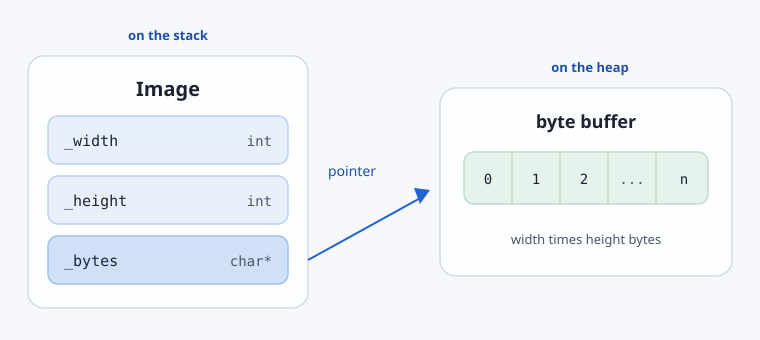

This chapter shows what goes wrong when a class owns memory through a pointer, and you let the compiler copy it field by field.

- **Copying:** passing or returning an object by value copies it, and the default copy shares the pointers, so two objects think they own the same memory.
- **Assignment:** assigning one existing object to another leaks the old memory and shares the new.
- **The rule of three:** the destructor, the copy constructor, and the assignment operator are the three functions you must write together to fix it.

## Copying an object

In C++ an object can be passed to a function by value, or returned from one by value. Either way, the object is copied from one activation frame to another. (This never happens in Java, where an object variable always holds an address.)

What does "copy an object" mean? For an `int` it is obvious. For an object that points at other objects, it is a choice: copy the pointers, or copy what they point at? In C++ the class decides, with a special constructor called the **copy constructor**. Whenever an object must be copied, the compiler calls it.

If you do not write one, the compiler writes one that copies field by field. Look at what that means for one field of `Student`, the pointer `_bag`.

```cpp
Student(const Student& other)
    : _bag(other._bag)      // copies the address, not the Bag
    , ...
{ }
```

The copy gets the **same address**, so both students now point at one `Bag`. Here is where that goes wrong.

```cpp
void F(Student s) { ... }

{
    University univ(...);
    Student ringo(7, "ringo", new Bag(7), univ);
    F(ringo);                     // s is a copy of ringo
    cout << ringo.getBag();       // ?
}
```

1. **`F(ringo)`** copies `ringo` into `s`. Now `s._bag` and `ringo._bag` hold the same address.
2. **When `F` returns,** `s` is destroyed, and its destructor deletes the `Bag`.
3. **Back in the block,** `ringo.getBag()` reads a `Bag` that was already deleted.
4. **At the end of the block,** `ringo`'s destructor deletes the same `Bag` a second time.

The same happens to every pointer in `_books`.

**The fix: a deep copy.** A class with pointer fields writes its own copy constructor, which copies the objects the pointers point at, not just the addresses.

```cpp
Student(const Student& other)
    : _id(other._id), _name(other._name), _univ(other._univ)
{
    _bag = new Bag(*other._bag);         // a new Bag, a copy of the other's
    for (Book* b : other._books)
        _books.push_back(new Book(*b));  // a new copy of every book
}
```

- **`new Bag(*other._bag)`** calls `Bag`'s own copy constructor on the other student's bag, and puts the copy on the heap.
- **Each class copies its own fields.** `Student` does not need to know what is inside a `Bag` or a `Book`.

Now `s` inside `F` gets its own bag and its own books, and destroying it leaves `ringo` intact.

### The same bug with a byte buffer

The lecture slides show the same problem with an `Image` class.

- **The example:** an `Image` holds a `char* _bytes`, a buffer that its constructor (בנאי) allocated on the heap.
- **The copy:** copying the `Image` copies only that pointer, so both images point at one buffer.
- **The crash:** when the first image's destructor (הורס) releases the buffer, the other image is still using it, and later releases it a second time.

A destructor is named `~` followed by the class name. It takes no parameters and has no return type.

- **For `Image`:** `~Image()` calls `delete[] _bytes`.
- **In Java:** once no reference to an `Image` remains, the garbage collector eventually frees its byte array too.
- **In C++:** when an `Image` is destroyed, only the pointer itself disappears. The bytes it points at stay allocated unless the destructor releases them.



`void processImage(Image img)` takes the image by value, so calling it makes a copy.

- **At the call:** the copy constructor builds `img`. When the function returns, `img`'s destructor runs.
- **With the generated copy constructor:** `_width`, `_height`, and `_bytes` are copied as they are, so `img` and the caller's image point at the same array.
- **When the function returns:** `img`'s destructor runs `delete[]` on that shared array. The caller's `_bytes` is now a dangling pointer: it still holds the address, but the memory there has been released.

The fix is a copy constructor that allocates a new buffer and copies the other image's bytes into it.

```cpp
Image::Image(const Image& other)
    : _width(other._width), _height(other._height),
      _bytes(new char[_width * _height]) {
    std::memcpy(_bytes, other._bytes, _width * _height);
}
```

This constructor could also delegate to `Image(int, int, char*)`, so that the allocation code lives in only one place.

- **The result:** inside `processImage`, `img` now has a buffer of its own.
- **When it is destroyed:** its destructor releases only that buffer, and the caller's image is left intact.


## Assigning an object

In C++ you can also assign one object to another that already exists. (Again, Java cannot, because its object variables are addresses.)

```cpp
Student ringo(7, "ringo", new Bag(7), univ);
Student jango(8, "jango", new Bag(5), univ);
ringo = jango;      // means ringo.operator=(jango)
```

The meaning of assignment is set by a special method, the **assignment operator**, `operator=`. If you do not write one, the compiler writes one that assigns field by field. For `_bag`, that is:

```cpp
_bag = other._bag;      // copies the address
```

After `ringo = jango`, that causes two problems.

- **A leak:** `ringo`'s old `Bag` is never deleted. Nothing points at it anymore.
- **Sharing:** both students now point at `jango`'s `Bag`. When one of them is destroyed, the other is left with a dangling pointer.

**The fix** has to do two things for every pointer field: release what the object held before, and take a copy of the other object's. For `_bag`:

```cpp
delete _bag;                    // 1. release the old Bag
_bag = new Bag(*other._bag);    // 2. take a copy of the other's
```

For `_books`, the same two steps, in a loop:

```cpp
for (Book* b : _books)
    delete b;                   // 1. release the old books
_books.clear();
for (Book* b : other._books)
    _books.push_back(new Book(*b)); // 2. copy the other's books
```

Two more details complete the operator.

```cpp
Student& operator=(const Student& other) {
    if (this != &other) {       // guard against ringo = ringo
        ...                     // the steps above, plus the simple fields
    }
    return *this;               // allows a = b = c
}
```

- **The self-assignment guard:** without it, `ringo = ringo` would delete its own bag, and then try to copy the bag it just deleted.
- **Returning `*this`:** `a = b = c` is read as `a.operator=(b.operator=(c))`, so the inner assignment must give back an object for the outer one. Returning it by reference avoids a copy.

### Another way: copy and swap

The operator above deletes the old bag first, and copies second. If the copy fails halfway, for example because `new` throws, the object is left holding a deleted bag. The lecture slides show a safer standard way, called **copy and swap**, on the `Image` class: copy first into a temporary, then swap.

```cpp
void Image::swap(Image& other) {
    std::swap(_width, other._width);
    std::swap(_height, other._height);
    std::swap(_bytes, other._bytes);
}

Image& Image::operator=(const Image& other) {
    Image temp(other);   // deep copy, through the copy constructor
    swap(temp);
    return *this;        // temp's destructor frees what used to be ours
}
```

The slides follow it on two images, `avi` and `benni`, each built on a pixel buffer of its own.

```cpp
char* bytesAvi = ...;
char* bytesBenni = ...;
Image avi(1080, 1920, bytesAvi);
Image benni(1080, 1920, bytesBenni);
avi = benni;             // calls avi.operator=(benni)
```

Before the call, `avi` and `benni` each hold their own buffer. Inside `operator=`, `this` is `avi` and `other` is `benni`.

- **Step 1:** `temp` is created as a third image, a deep copy of `benni`, with a new buffer.
- **Step 2:** `swap` exchanges the contents of `avi` and `temp`, so `avi` now holds the new buffer and `temp` holds `avi`'s old one.
- **Step 3:** when the function returns, `temp` is destroyed, and its destructor releases `avi`'s old buffer.
- **Why self-assignment is safe:** `temp` is always a separate copy, so swapping an object with a copy of itself leaves its values unchanged.


Copy-and-swap is also safe when allocation fails. An assignment that releases the old buffer first and then throws while allocating would leave the object broken.

- **Copy-and-swap allocates first**, inside `temp`, before it touches `avi`.
- **If that allocation throws**, `avi` has not been changed at all.

| | Copy constructor | Copy assignment operator |
| --- | --- | --- |
| The object on the left | does not exist yet | already holds a resource |
| Self-assignment | cannot occur | must be harmless |
| Releases the old buffer | no | yes |

:::problem id=worked-copy-and-swap title="Assignment by copy and swap" source="materials/lectures/Chapter 4 - Rule of Thee.pptx" kind=worked solution_origin=source
`avi` holds buffer A. `benni` holds buffer B. Follow `avi = benni` and say which buffer is released.

```cpp
Image& Image::operator=(const Image& other) {
    Image temp(other);   // deep copy of B into a new buffer B2
    swap(temp);          // avi gets B2, temp gets A
    return *this;        // ~Image on temp runs delete[] on A
}
```

:::solution
- **`Image temp(other)`** makes a deep copy of B in a new buffer, B2. At this point `avi` still owns A.
- **`swap(temp)`** makes `avi._bytes` point at B2, and `temp._bytes` point at A.
- **When the function returns,** `~Image` runs on `temp` and releases A with `delete[]`.
- **The result:** buffer A is the one released. `benni` still owns B, `avi` owns B2, and each object has its own buffer.
:::
:::

:::check id=chk-init-vs-assign
Which line calls the copy constructor?

```cpp
Image a(...);
Image b = a;
b = a;
```

- [ ] Both lines
- [x] Only `Image b = a`
- [ ] Only `b = a`

- **`Image b = a`** creates a new object, so it calls the copy constructor.
- **`b = a`** assigns to an object that already exists, so it calls the copy assignment operator.
- **Don't be fooled by `=`:** both lines contain it, but in a declaration it means initialization, not assignment.
:::

## The rule of three

:::definition id=def-rule-of-three title="The rule of three (חוק השלושה)" source="materials/lectures/Chapter 4 - Rule of Thee.pptx"
Write the destructor, the copy constructor (בנאי העתקה), and the assignment operator (אופרטור השמה) together: if a class needs one of them, it needs all three.

- **The destructor** releases the resources the object is responsible for.
- **The copy constructor** allocates new resources and copies the contents into them.
- **The assignment operator** does both jobs: it releases the resources this object already holds, and it makes a deep copy (העתקה עמוקה) of the other object.
- **`Image b = a`** creates a new object, so the copy constructor runs, even though the line contains `=`.
- **`b = a`** assigns to an object that already exists, so the assignment operator runs.

```cpp
Image a(...);
Image b = a;   // copy constructor, not assignment
b = a;         // assignment, both objects already exist
```
:::

These three methods define the meaning of a class in the basic scenarios of a programming language: removal from memory, passing by value, and assignment.

**Operator overloading.** Just as you can define the assignment operator, every class can define what the standard operators mean for its objects, such as `+`, `-`, `*`, `/`, `<`, `>`, `==`, `+=`, `[]`, and `<<`. This is an elegant and recommended way to design classes. Of all these operators, only assignment belongs to the rule of three, because only assignment replaces the whole contents of an object with a copy of another one.

The slides show one more operator on `Image`: `operator()`, the call operator. Once a class defines it, you can write an object followed by parentheses, as if the object were a function.

```cpp
class Image {
    ...
    // the color of the pixel at column x, row y
    char operator()(int x, int y) const {
        return _bytes[y * _width + x];
    }
};

Image avi(1080, 1920, bytesAvi);
char c = avi(0, 0);      // calls avi.operator()(0, 0): the color of the first pixel
```

- **`avi(0, 0)` is not a function call.** `avi` is an object, and the compiler turns the line into `avi.operator()(0, 0)`.
- **Why `y * _width + x`:** `_bytes` stores the pixels row after row, and each row holds `_width` pixels. So row `y` starts at index `y * _width`, and the pixel in column `x` is `x` places further along.
- **The `const` at the end** promises that reading a pixel does not change the image.

:::trap
- **The mistake:** thinking that once a class overloads an operator, such as `operator()` above, it must also write the destructor, the copy constructor, and the assignment operator.
- **Why that is wrong:** the rule of three is about who releases the memory an object owns. `operator()` only reads one pixel. It allocates nothing, copies nothing, and releases nothing, so it adds no work for the other three.
- **What really decides it:** `Image` needs the rule of three because it owns a buffer through a raw pointer, `char* _bytes`, not because it has operators. A class that owns no memory through a raw pointer needs none of the three, however many operators it overloads.
:::

:::trap
- **The wrong test:** `if (this == other)` compares a pointer (`this`) with an object (`other`), so it does not compile.
- **The right test:** `if (this == &other)` compares two addresses.
- **With copy-and-swap you need no test at all:** it releases the old buffer only after the copy exists, and the copy is always a separate object.
:::

## Practice

:::problem id=ps3-rule-of-three title="The three functions of List" source="materials/sessions/SPL_PS3.pptx" kind=exercise solution_origin=source
`List` holds a `Node* head` that points at a chain of nodes allocated with `new`. The class still uses the special members that the compiler generates.

```cpp
class List {
    Node* head;
};
```

:::check id=ps3-rule-of-three-q1
`List b = a` uses the generated copy. What breaks?

- [ ] The program fails to compile, because a `Node*` cannot be copied
- [ ] `b` allocates its own chain
- [x] `b` and `a` share one chain. One destructor deletes the nodes, and the other deletes those same nodes again

The generated copy constructor copies only `head`, so both lists point at the same chain. After one destructor deletes the nodes, the other list holds a dangling pointer, and its destructor deletes the same nodes a second time.
:::

:::check id=ps3-rule-of-three-q2
Which bodies are required?

- [x] The destructor walks the chain and `delete`s every node
- [ ] The copy constructor copies `head` and shares the chain
- [x] The copy constructor allocates a new node for each element and points `head` at that new chain
- [x] Copy assignment releases the chain `this` already holds, then makes a deep copy, and returns `*this`

- **Why `List` needs all three:** its raw `Node*` does not manage the nodes on its own, so `List` must free them, copy them, and replace them itself.
- **When the generated members are fine:** when every member already manages its own memory, as `std::string` or `std::vector` do.
- **Why the second option is wrong:** sharing the chain is exactly the bug the rule of three prevents.
:::

:::check id=ps3-rule-of-three-q3
Copy-and-swap builds a {{=temporary|second list|reference}}, swaps the two `head` pointers, and lets that object's destructor release the old chain.

This way, assignment needs no new code of its own: it reuses the copy constructor to build the temporary and the destructor to release the old chain.
:::
:::

:::problem id=prac-r3-which-member title="Which special member runs?" source="materials/lectures/Chapter 4 - Rule of Thee.pptx" kind=exercise solution_origin=derived
`Image` has the three special members from this chapter: a destructor, a copy constructor, and an assignment operator. Its constructor `Image(int width, int height)` allocates a buffer of `width * height` bytes.

```cpp
void show(Image img) { ... }          // by value
void peek(const Image& img) { ... }   // by reference

int main() {
    Image a(2, 2);
    Image b = a;     // line 1
    Image c(a);      // line 2
    c = b;           // line 3
    show(a);         // line 4
    peek(a);         // line 5
}
```

:::check id=prac-r3-which-member-q1
Line 1 calls {{=the copy constructor|the assignment operator|no special member}}.

Line 2 calls {{=the copy constructor|the assignment operator|no special member}}.

Line 3 calls {{=the assignment operator|the copy constructor|no special member}}.

- **Lines 1 and 2** both create a new object from an existing one, so both call the copy constructor. The `=` in line 1 is part of a declaration, so it means initialization, not assignment.
- **Line 3** gives a new value to `c`, which already exists, so it calls the assignment operator.
:::

:::check id=prac-r3-which-member-q2
Which of the two calls, `show(a)` and `peek(a)`, makes a copy of `a`?

- [x] Only `show(a)`
- [ ] Only `peek(a)`
- [ ] Both
- [ ] Neither

- **`show` takes its parameter by value,** so the copy constructor builds `img` as a copy of `a`.
- **`peek` takes a reference,** so `img` is just another name for `a`, and nothing is copied.
:::

:::check id=prac-r3-which-member-q3
`img`, the parameter of `show`, is destroyed {{=when show returns|at the end of main|never}}. At the end of `main`, the three images are destroyed in the order {{=c, b, a|a, b, c|b, a, c}}.

- **`img` is a local of `show`,** so its destructor runs as soon as `show` returns, and releases only `img`'s own buffer.
- **Local objects are destroyed in the reverse order of their creation:** `c` was created last, so it goes first, and `a` goes last.
- **`peek` destroys nothing,** because its reference is not a new object.
:::
:::

:::problem id=prac-r3-shallow-trace title="Following a shallow copy" source="materials/lectures/Chapter 4 - Rule of Thee.pptx" kind=exercise solution_origin=derived
`Playlist` owns an array of song numbers on the heap. It has a constructor and a destructor, but no copy constructor of its own, so the compiler generates one.

```cpp
class Playlist {
    int* _songs;
    int _size;
public:
    Playlist(int size) : _songs(new int[size]), _size(size) {
        for (int i = 0; i < size; i++)
            _songs[i] = 0;
    }
    ~Playlist() { delete[] _songs; }
    void set(int i, int song) { _songs[i] = song; }
    int get(int i) const { return _songs[i]; }
};

int main() {
    Playlist mine(3);
    Playlist yours = mine;      // the generated copy constructor
    yours.set(0, 42);
    cout << mine.get(0);        // ?
}
```

:::check id=prac-r3-shallow-trace-q1
What does `cout << mine.get(0)` print?

- [ ] 0
- [x] 42
- [ ] It does not compile

- **The generated copy constructor** copies the fields one by one, so `yours._songs` gets the same address as `mine._songs`.
- **So there is only one array.** `yours.set(0, 42)` writes into it, and `mine.get(0)` reads the same cell.
:::

:::check id=prac-r3-shallow-trace-q2
What happens when `main` ends?

- [x] `yours` is destroyed first, and its destructor releases the shared array
- [x] Then `mine`'s destructor runs `delete[]` on the same address a second time
- [ ] Each destructor releases an array of its own
- [ ] The array is never released

- **Objects are destroyed in reverse order,** so `yours` goes first and releases the one array.
- **`mine._songs` is now a dangling pointer.** Its destructor releases the same array again, which is a double free, and the behavior is undefined.
:::

:::check id=prac-r3-shallow-trace-q3
Which copy constructor fixes the bug?

```cpp
// Version A
Playlist(const Playlist& other)
    : _songs(other._songs), _size(other._size) { }

// Version B
Playlist(const Playlist& other)
    : _songs(new int[other._size]), _size(other._size) {
    for (int i = 0; i < _size; i++)
        _songs[i] = other._songs[i];
}

// Version C
Playlist(const Playlist& other) : _size(other._size) {
    delete[] _songs;
    _songs = new int[_size];
    for (int i = 0; i < _size; i++)
        _songs[i] = other._songs[i];
}
```

- [ ] Version A
- [x] Version B
- [ ] Version C

- **Version A** is exactly what the compiler already generates: it copies the address, so the bug stays.
- **Version B** is a deep copy: a new array of its own, then every song copied into it.
- **Version C** releases `_songs` before it ever held anything. A copy constructor builds a new object, so there is no old array to release, and `delete[]` on an uninitialized pointer is undefined behavior. Releasing the old array is the job of the assignment operator.
:::
:::

:::problem id=prac-r3-assignment title="Assigning one playlist to another" source="materials/lectures/Chapter 4 - Rule of Thee.pptx" kind=exercise solution_origin=derived
`Playlist` from the previous question now has the deep copy constructor (Version B). Here is its assignment operator, written the way the chapter wrote it for `Student`.

```cpp
Playlist& operator=(const Playlist& other) {
    if (this != &other) {
        delete[] _songs;                    // 1. release the old array
        _size = other._size;
        _songs = new int[_size];            // 2. take a copy of the other's
        for (int i = 0; i < _size; i++)
            _songs[i] = other._songs[i];
    }
    return *this;
}
```

:::check id=prac-r3-assignment-q1
Which of these are true about the lines of the assignment operator?

- [x] Without `if (this != &other)`, the line `p = p` would delete the array and then copy from the array it just deleted
- [x] Without `delete[] _songs;`, every assignment would leak the array the object held before
- [ ] Without `return *this;`, `a = b` would no longer change `a`

- **The self-assignment guard:** in `p = p`, `this` and `&other` are the same address, so `other._songs` is the array that `delete[]` just released.
- **The `delete[]`:** `_songs` is about to point at a new array. If the old one is not released first, nothing points at it anymore.
- **`return *this`** does not change `a`: the body already did. It returns `a` so that `a = b = c` works.
:::

:::check id=prac-r3-assignment-q2
The same operator, written with copy and swap:

```cpp
Playlist& operator=(const Playlist& other) {
    Playlist temp(other);              // a deep copy of other
    std::swap(_songs, temp._songs);
    std::swap(_size, temp._size);
    return *this;
}
```

In `a = b`, which array does `temp`'s destructor release when the function returns?

- [x] The array that `a` held before the assignment
- [ ] The new copy of `b`'s songs
- [ ] `b`'s own array

- **`temp`** starts with a new copy of `b`'s songs.
- **The swap** gives that copy to `a`, and gives `a`'s old array to `temp`.
- **When `temp` is destroyed,** its destructor releases `a`'s old array, exactly once. `b` is never touched.
:::

:::check id=prac-r3-assignment-q3
Copy and swap needs {{=no self-assignment check|a self-assignment check|a second delete[]}}, because `temp` is {{=always a separate copy|the same object as other|a reference to this}}. If `new` throws while building `temp`, `a` is {{=left unchanged|left with a released array|left empty}}.

- **No check needed:** in `p = p`, `temp` is a copy of `p`, so swapping with it leaves `p`'s songs unchanged.
- **Safe when allocation fails:** the only allocation happens inside `temp`, before `a` is touched. If it throws, `a` still holds its old array.
:::
:::

:::problem id=prac-r3-needs-three title="Which classes need the rule of three?" source="materials/lectures/Chapter 4 - Rule of Thee.pptx" kind=exercise solution_origin=derived
Each of these classes uses only the special members that the compiler generates. The comments say who owns what.

```cpp
class Point {
    int _x, _y;
};

class FullName {
    std::string _first, _last;
};

class Buffer {
    char* _data;      // allocated with new[] in Buffer's constructor
    int _len;
};

class Student {
    int _id;
    Bag* _bag;        // Student created this Bag, and must delete it
};

class Reader {
    University* _univ;   // the University lives elsewhere; Reader never deletes it
};
```

:::check id=prac-r3-needs-three-q1
Which classes must write their own destructor, copy constructor, and assignment operator?

- [ ] `Point`
- [ ] `FullName`
- [x] `Buffer`
- [x] `Student`
- [ ] `Reader`

- **`Buffer` and `Student`** own memory through a raw pointer. The generated copy would share it, and nothing would release it.
- **`Point`** holds only `int`s, so copying them field by field is a correct copy.
- **`FullName`** holds `std::string`s, and each string already copies and releases its own characters.
- **`Reader`** has a pointer, but owns nothing through it. Two readers sharing one `University` is exactly right, and neither may delete it.
:::

:::check id=prac-r3-needs-three-q2
The question that decides it is {{=whether the class owns a resource|whether the class has a pointer field|whether the class has more than two fields}}. If a class needs one of the three special members, it needs {{=all three|only the destructor|only the copy constructor}}.

- **Ownership decides,** not pointers: `Reader` has a pointer and needs nothing, and `Buffer` needs all three.
- **The three come together:** the destructor that releases the resource is what makes a shared copy dangerous, so the copy constructor and the assignment operator must both make deep copies.
:::
:::

:::examnote
- **What the question looks like:** a small class with a raw pointer or raw array, and a request for its destructor and a deep copy constructor. Sometimes it is a two-dimensional board that needs both constructors.
- **The usual traps:** relying on the default memberwise copy, or writing an assignment that releases the old buffer before the new one exists.
:::

:::problem id=exam-17b-q2 title="A deep copy of a board" source="materials/exams/17-b.pdf" kind=exam solution_origin=derived
A game keeps its board in a class `Terrain<T>`. The `<T>` means the class works for any cell type `T`, the way `std::vector<int>` holds `int`s: a `Terrain<int>` is a board of `int`s.

- **The fields:** `_w` and `_h` hold the board's width and height. `_cells` points at one array of `T` on the heap, with `_w * _h` cells, one for each square of the board.
- **The task:** write the constructor, the copy constructor, and the destructor. The copy constructor must make a deep copy, so that the copy gets a board of its own.

```cpp
template <typename T>
class Terrain {
public:
    Terrain(int w, int h);           // w wide, h high
    Terrain(const Terrain& other);   // deep copy
    ~Terrain();
private:
    int _w;       // width
    int _h;       // height
    T* _cells;    // _w * _h cells, new[]
};
```

:::check id=exam-17b-q2-q1
Which initializer list is right for `Terrain(int w, int h)`?

- [x] `: _w(w), _h(h), _cells(new T[w * h]) {}`
- [ ] `: _w(w), _h(h), _cells(nullptr) {}`
- [ ] `: _w(w), _h(h), _cells(new T[w + h]) {}`

- **The board needs one cell for every square,** so `w` columns of `h` squares each make `w * h` cells.
- **`nullptr`** allocates no board at all, so the first access to a cell would crash.
- **`w + h`** is far too few: a 10 by 10 board has 100 squares, not 20.
:::

:::check id=exam-17b-q2-q2
Which version of the copy constructor makes a deep copy?

```cpp
// Version A
Terrain(const Terrain& other)
    : _w(other._w), _h(other._h), _cells(other._cells) {}

// Version B
Terrain(const Terrain& other)
    : _w(other._w), _h(other._h), _cells(new T[other._w * other._h]) {}

// Version C
Terrain(const Terrain& other)
    : _w(other._w), _h(other._h), _cells(new T[other._w * other._h]) {
    for (int i = 0; i < _w * _h; i++)
        _cells[i] = other._cells[i];
}
```

- [ ] Version A
- [ ] Version B
- [x] Version C

A deep copy needs two steps: allocate an array of its own, then copy every cell into it.

- **Version A** copies only the address, so both boards share one array. That is the shallow copy the compiler would write anyway.
- **Version B** allocates an array of its own, but never copies the cells into it, so the copy is a blank board, not a copy of `other`.
- **Version C** does both steps.
:::

:::check id=exam-17b-q2-q3
Which of these are true about the destructor and the copy constructor of `Terrain`?

- [x] The destructor is `delete[] _cells;`
- [ ] The destructor is `delete _cells;`
- [x] Without our copy constructor, a copy would share `_cells` with the original, and the first destructor to run would release a board that the other object still uses
- [ ] The destructor must also release `_w` and `_h`

- **`delete[]`, not `delete`:** the cells were allocated with `new[]`, so they must be released with `delete[]`.
- **The shared board:** the compiler's copy constructor copies only the pointer `_cells`. When one of the two objects is destroyed, the other is left pointing at released memory.
- **The rule of three at work:** once the class needs that destructor, it also needs its own copy constructor.
- **`_w` and `_h`** are plain `int`s inside the object. They were never allocated with `new`, so there is nothing to release.
:::

:::check id=exam-17b-q2-q4
`Terrain` still uses the assignment operator that the compiler generates. After `a = b`, where both boards already exist, `a._cells` holds {{=the same address as b._cells|a new copy of b's cells|nullptr}}, and the array that `a` held before is {{=never released|released by the assignment|moved into b}}. To fix both, the rule of three asks for one more method: {{=a copy assignment operator|a second destructor|a default constructor}}.

- **The generated assignment** copies the fields one by one, so `a._cells` gets the same address as `b._cells`, and the two boards are now shared.
- **`a`'s old array is leaked:** nothing points at it anymore, and nothing releases it.
- **The fix** is a copy assignment operator, for example with copy and swap, as on `Image` earlier in this chapter.
:::
:::

Copy-and-swap leads straight into the [rule of five](topic:rule-of-five) (חוק החמישה).

- **What this chapter does:** every copy still allocates a new buffer, even when the source is a temporary that is about to be destroyed.
- **What the next chapter adds:** the same swap can simply take the buffer from that temporary instead of copying it, and that transfer is called a move (העברה).
